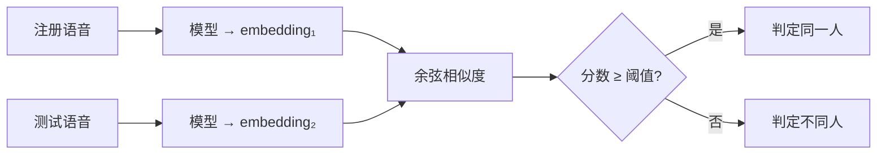

# 01 · 背景与动机

上一篇：[中文导读首页](README.md) · 下一篇：[网络结构](02-architecture.md)

---

## 1. 说话人验证在做什么

**说话人验证（Speaker Verification, SV）** 回答一个二分类问题：

> 这两段语音，是不是同一个人说的？

典型流程：



模型输出的固定长度向量叫 **说话人嵌入（speaker embedding）**。本仓库默认约 **192 维**。训练时通常用「闭集分类」当代理任务：把训练集里的每个说话人当成一类，学完后丢掉分类头，只留 embedding 做开集验证。

和 **说话人识别（identification）** 的差别：识别是「这是库里的哪一位」；验证是「这两段像不像同一个人」。工业里验证更常见（门禁、电话银行、会议系统等）。

---

## 2. 为什么难

真实语音里，同一个人会因内容、情绪、信道、噪声、口音而变化很大；不同人又可能碰巧相似。好的 embedding 空间应满足：

- **类内紧**：同一人、不同条件 → 向量靠近  
- **类间散**：不同人 → 向量拉开  

现代系统常用 **加性角度间隔损失**（ArcFace / SphereFace2 等）：不只做普通 Softmax，还在角度空间强制间隔，让决策边界更「严」。

---

## 3. 评估：EER 等指标

验证时扫阈值，会得到：

| 指标 | 含义 |
|------|------|
| **FAR**（False Accept Rate） | 不同人被判成同一人的比例 |
| **FRR**（False Reject Rate） | 同一人被判成不同人的比例 |
| **EER**（Equal Error Rate） | FAR = FRR 时的错误率；**越低越好** |

常见测试协议：

| 协议 | 大致含义 |
|------|----------|
| **Vox1-O** | VoxCeleb1 原始试验对（本仓库训练时本地验证常用） |
| **Vox1-E / Vox1-H** | 更大规模 / 更难的扩展与困难协议 |
| **SITW / VOICES / CN-Celeb** | 跨数据集、跨信道、跨语言等域外测试 |

根目录 README 的表格就是这些 EER。入门时先盯住 **Vox1-O** 即可。

---

## 4. 声学前端：波形 → Mel 频谱

人耳对频率的感知近似 Mel 刻度。常见处理步骤是：

```text
波形 (16 kHz)
  → 预加重 / 可选归一化
  → 短时傅里叶变换 (STFT)
  → Mel 滤波器组（本仓库常见 n_mels = 72）
  → log → 均值归一化
  → 形状约 (B, F, T) 或 (B, 1, F, T)
```

- **F**：频率维（Mel bins）  
- **T**：时间帧数（ hop 常用 10 ms 量级）  

ReDimNet2 的「维度重塑」就建立在这张 `(F, T)` 图上。

---

## 5. 从 x-vector 到 ReDimNet 系

简史（不必背，用来定位本工作）：

| 阶段 | 代表思路 |
|------|----------|
| i-vector | 统计模型 + 因子分析 |
| **x-vector / ECAPA-TDNN** | 1D 时序卷积 + 统计池化 |
| ResNet / ConvNeXt 系 | 把 Mel 当 2D 图做视觉式 CNN |
| **ReDimNet** | 在 2D 与「通道×频率」的 1D 之间反复 reshape |
| **ReDimNet2（本仓库）** | 在 1D 通路上 **时间池化**，腾出算力把通道做得更宽 |

ReDimNet2 论文标题里的 *Time-Pooled Dimension Reshaping* 就是在说：  
**先压时间维再做昂贵的 1D 上下文建模，再用上采样把时间维调到同一长度，从而更激进地扩大通道宽度。**

效果上，官方报告在多个规模点上，精度–效率 Pareto 优于前代（见 `assets/pareto.png`）。

---

## 6. 本仓库解决的工程问题

对研究生而言，这个仓库不只是「一个网络定义」，而是三条线：

1. **可发布的推理模型**：用 `torch.hub` 直接加载，权重自带 `model_config`。  
2. **可复现的训练栈**：`wespeaker_lite` + YAML recipe。  
3. **多规模型号 B0–B6**：同一设计，从手机级算力到服务器级精度。

若你的课题是「换 backbone」「换损失」「换数据」，这里分别对应：

- backbone → `redimnet2/`  
- 损失 / 调度 → `wespeaker_lite/models/projections.py`、`utils/schedulers.py`  
- 数据 → `examples/*/scripts` + `dataset/`

---

## 7. 读论文时建议先抓住的三点

1. **维度重塑**让 2D 局部建模与 1D 长时建模共享同一套特征。  
2. **时间池化**降低 1D 注意力/卷积的序列长度，从而允许更大通道。  
3. **多尺度软加权融合**（类似 U-Net 的跨层连接 + 可学习门控）把各 stage 的 1D 特征合到一起，再经 ASTP 得到段级 embedding。

下一篇把这三点对应到具体模块与张量形状上：[02 网络结构](02-architecture.md)。
