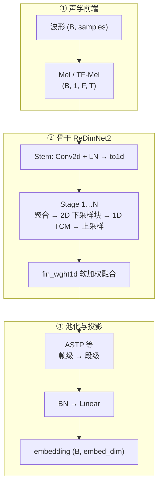
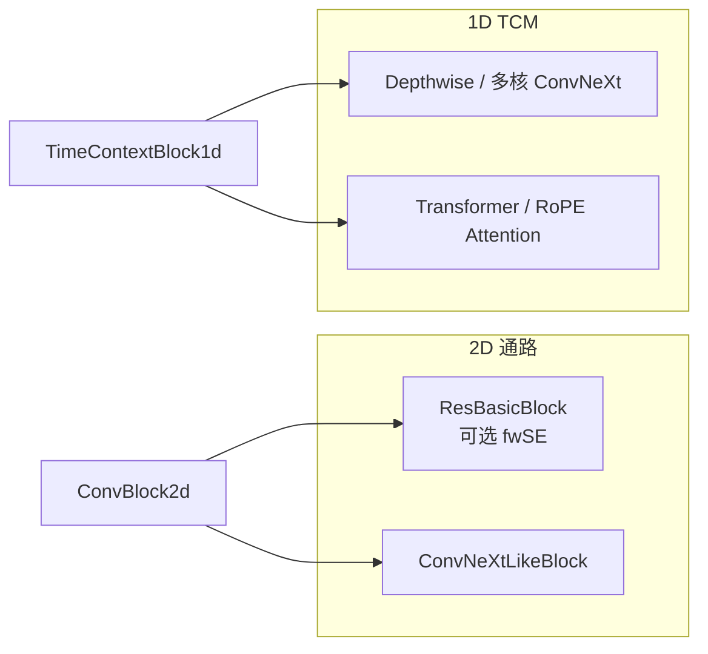

# 02 · 网络结构（深入浅出）

上一篇：[背景与动机](01-background.md) · 下一篇：[代码地图](03-code-walkthrough.md)

---

## 1. 总览：从波形到 embedding

对外接口是 **`ReDimNet2Wrap`**（`redimnet2/redimnet2.py`）。可以把它想成三段：



默认：`F=72`（Mel bins），`embed_dim=192`，池化 **`ASTP`**（Attentive Statistics Pooling）。

---

## 2. 核心隐喻：一张图，两种看法

设特征为 `(B, C, F, T)`：

| 看法 | 形状 | 适合做什么 |
|------|------|------------|
| **2D 视图** | `(B, C, F, T)` | 卷积扫「频率×时间」局部模式 |
| **1D 视图** | `(B, C·F, T)` | 把「通道×频率」当成更宽的通道，对时间做长上下文（ConvNeXt + Attention） |

代码里的物理实现（`layers/redim_structural.py`）：

| 模块 | 作用 |
|------|------|
| `to1d` | `(B,C,F,T) → (B, C·F, T)` |
| `to2d` | 反过来，需要知道当前的 `F` 与 `C` |
| `weigth1d` | 对多路 1D 特征图做 **softmax 可学习加权和** |

「ReDim」= **Re**-shape **Dim**ensions（维度重塑），不是另一个无关缩写。

---

## 3. Stage：U-Net 式多尺度

骨干注释里写的是 *UNet-like ReDimNet*。每个 stage 大致做：

```text
已有多路 1D 特征 ──weigth1d──► 融合
        │
        ▼ to2d
   [可选频率位置编码]
        │
        ▼ stride Conv2d          # 频率/时间下采样，通道按规则扩展
        ▼ ×N 个 ConvBlock2d      # 2D 残差块（ResNet 或 ConvNeXt-like）
        ▼ to1d
   [可选 TimeContextBlock1d]     # 1D：瓶颈 → 多尺度卷积 + 注意力 → 残差
        ▼ Upsample(time)         # 把时间维调到融合所需长度
        │
        ▼ 追加进 outputs_1d 列表
```

要点：

1. **时间池化**：stage 内用累积时间 stride `stt` 把序列变短，1D 模块更便宜。  
2. **最近邻上采样**把时间维调到同一长度，方便和历史特征在同一 `T` 上融合。  
3. **历史特征不丢**：每个 stage 输出 append 到列表，下一 stage 先融合「到目前为止全部 1D map」——类似 dense/skip，但权重可学习。  
4. **`dual_agg`（可选）**：2D→1D 与 1D-attention 两路并行上采样，一次 stage 贡献两路特征，再配合 `agg_gnorm` 统一归一化。

`stages_setup` 每一项语义（recipe YAML 里会写）：

```text
(stride=(sf, st), num_blocks, conv_exp, kernel_sizes, att_block_red)
```

- `sf` / `st`：频率 / 时间 stride  
- `num_blocks`：该 stage 2D 块个数  
- `conv_exp`：通道扩展倍率相关  
- `att_block_red`：1D 瓶颈压缩比；`None` 表示该 stage 不做 1D TCM  

---

## 4. 积木块对照表



| 文件 | 你要记住的类 |
|------|----------------|
| `layers/blocks.py` | `ConvBlock2d`, `TimeContextBlock1d`, `TimeContextBlock1dV2`, `SymmetricalDWMixer` |
| `layers/resblocks.py` | `ResBasicBlock`, `fwSEBlock`（按频率维的 SE） |
| `layers/convnext.py` | `ConvNeXtLikeBlock`, 可选 Weight Standardization |
| `layers/attention.py` | `MultiHeadAttention`, 多种 EncoderLayer（含 RoPE / Stable） |
| `layers/poolings.py` | `ASTP`（默认）、`TSTP`、`TAP` 等 |
| `layers/features.py` / `features_tf.py` | MelBanks、TFMelBanks… |

训练配方里常见组合：

- `block_2d_type: basic_resnet`  
- `block_1d_type: conv+att`  
- `pooling_func: ASTP`  
- `agg_gnorm: true`

---

## 5. ASTP：帧级特征如何变成一句 embedding

Stage 融合后仍有时间维 `T`。**ASTP**（Attentive Statistics Pooling）：

1. 用注意力给每一帧一个权重（可拼全局均值/方差作 context，`global_context_att=True`）。  
2. 算加权均值与加权标准差。  
3. 拼起来得到 `2 × 特征维`，再经 `BatchNorm1d → Linear` 投到 `embed_dim`。

直觉：不是简单平均所有帧，而是 **自动多看「说话人信息强」的帧**，并保留波动统计。

---

## 6. B0–B6：同一骨架，不同「胖瘦」

Python 包内 **没有** 写死 B0–B6 字典；规模由 checkpoint 的 `model_config` 或训练 YAML 的 `C`、`stages_setup`、`out_channels` 等决定。

| 型号 | 大致参数量 | 通道起点 `C`（vox2 配方） | 入门建议 |
|:----:|:----------:|:------------------------:|----------|
| B0 | 1.1M | 12 | 冒烟、调试首选 |
| B1 | 2.1M | 16 | 小规模消融 |
| B2 | 3.6M | 20 | |
| B3 | 4.1M | 24 | README 常点名的甜点 |
| B4 | 6.6M | 32 | |
| B5 | 8.9M | 48 | 显存吃紧时减小 batch |
| B6 | 12.3M | 64 | 精度优先 / 官方强权重 |

精度数字见根 README；这里只需记住：**先 B0 跑通，再 B3，最后 B6**。

---

## 7. 与「普通 ResNet-34 + ASP」差在哪

| 维度 | 常见 ResNet-SV | ReDimNet2 |
|------|----------------|-----------|
| 特征布局 | 基本一直在 2D | 2D ↔ 1D 反复切换 |
| 长时依赖 | 靠深层卷积堆感受野 | 显式 1D Attention / 多核卷积 |
| 算力扩展 | 加通道则 2D 代价猛涨 | 时间池化后 1D 便宜，通道可加宽 |
| 多尺度融合 | 常见最后一层再池化 | 各 stage 1D map 软加权聚合 |

若你要写 related work：ReDimNet2 = **维度重塑框架 + 时间池化缩放策略 + 工程化训练配方**。

---

## 8. 读代码时建议的「三步验证」

用一张短音频、`model.eval()`，在调试器或 `print` 里确认：

1. Mel 后形状是否接近 `(1, 1, 72, T)`。  
2. 某个 stage 前后，`C·F` 是否按设计变化、时间是否先缩后扩。  
3. 最终 `embedding.shape[-1] == embed_dim`。

下一篇按文件带你走：[03 代码地图](03-code-walkthrough.md)。
