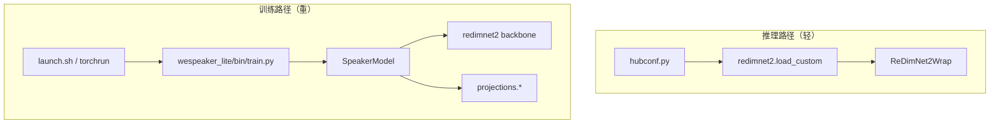

# 03 · 代码地图与关键模块

上一篇：[网络结构](02-architecture.md) · 下一篇：[训练流程](04-训练流程.md)

---

## 1. 两套入口：推理 vs 训练



| 你想… | 从哪进 |
|--------|--------|
| 加载官方权重抽向量 | `torch.hub` → `hubconf.redimnet2` |
| 改网络结构做实验 | `redimnet2/redimnet2.py` + `layers/` |
| 改增强 / 损失 / 优化器 | `applications/speaker_rec/wespeaker_lite/` |
| 改数据与超参复现论文 | `applications/speaker_rec/examples/**/recipes/**/*.yaml` |
| **核对发布的权重和官方表差多少** | `scripts/eval_vox1_checkpoints.py`、`scripts/eval_ood_checkpoints.py` |

注意最后一行：这两个脚本在仓库根目录 `scripts/` 下，不在 `applications/` 里。
它们不训练，只加载 `checkpoints/pretrained/` 里的权重算等错误率，结果与官方数字对比后写成表格。

---

## 2. `redimnet2/` 包：文件职责

```text
redimnet2/
├── __init__.py          # load_custom / from_pretrained
├── redimnet2.py         # ReDimNet2, ReDimNet2Wrap
└── layers/
    ├── redim_structural.py   # to1d / to2d / weigth1d  ★先读
    ├── blocks.py             # 2D/1D 积木工厂
    ├── attention.py          # MHA / Transformer 层
    ├── convnext.py           # ConvNeXt-like + WSConv
    ├── resblocks.py          # ResBasicBlock + fwSE
    ├── features.py           # MelBanks 等（torchaudio）
    ├── features_tf.py        # 可学习/固定 DFT 的 TF 前端
    ├── poolings.py           # ASTP 等
    └── layernorm.py          # channels_first / last
```

### 建议阅读顺序（约半天）

1. **`redim_structural.py`** — 弄懂 reshape，后面全是这套语言。  
2. **`ReDimNet2.forward` / `run_stage`** — 看 stage 如何堆。  
3. **`TimeContextBlock1d` + `build_internal_1d_tcm_block`** — 1D 里有什么。  
4. **`ReDimNet2Wrap`** — 前端 + 池化 + Linear。  
5. **`__init__.py` 的 `load_custom`** — 权重如何自描述实例化。

---

## 3. 关键类速查

### `ReDimNet2Wrap`

- **输入**：`(B, samples)`，16 kHz；可选第二个参数 `lengths`，见下。  
- **输出**：`(B, embed_dim)`。  
- **重要参数**：`feat_type`、`embed_dim`、`pooling_func`、`hop_length`、`spec_params`、以及透传给骨干的 `C`、`F`、`stages_setup`…  

#### 支持一个 batch 里长度不同的音频

签名是 `forward(self, x, lengths=None)`。`x` 是**补齐到同一长度**的波形，
`lengths` 是每条的真实采样点数（张量、列表或数组都行，形状 `(B,)`）。

```python
# 两条长度不同的音频，补到同长后一次前向
x = torch.zeros(2, T); x[0, :n0] = wav0; x[1, :n1] = wav1
emb = model(x, lengths=torch.tensor([n0, n1]))   # (2, 192)
```

- **不传 `lengths` 时行为与从前逐位一致**（20 个发布权重实测差值为 0），
  所以老用法一行都不用改。
- 传了 `lengths` 之后，补零的那些帧在池化与前端归一化里会被排除掉。
  **这一点很关键**：如果只是把短的补零凑成一批、却不传 `lengths`，
  同一说话人的余弦会掉到 0.14 左右（实测），结果等于错的。
- 补齐只影响同批内较短的那些条；不补齐的那条不受影响。

##### 要清楚：变长批量并不等于逐条推理

把长度不同的音频补零凑成一批、再传 `lengths`，**结果与逐条推理不完全相同**。
这不是没修好的问题，而是这种做法本身的限制，实测数字如下：

| 情况 | 余弦（b0，与逐条推理比） |
|------|--------------------------|
| 补齐比 1.00（只是传了 `lengths`，没有补零） | **1.000000** |
| 补齐比 2 倍 | 0.938 |
| 补齐比 4 倍 | 0.982 |
| 掩码全有效 vs 不传掩码 | 0.9999998 |
| 补零却**不传** `lengths`（错误用法） | 0.326 |

原因是三件事叠在一起：

1. 补齐会改变**总帧数**（例如 96 帧对 196 帧），下采样后的时间上下文随之不同；
2. 最后一个真实帧的卷积感受野会读到补零区；
3. 骨干里有跨时间位置的全局运算（多路特征加权、时间注意力、`ASTP` 池化的整条 softmax），
   边界那一帧的差异会被扩散到全部帧。

所以：**掩码的作用是把补零帧排除在统计量之外**（这一步把 0.326 救到 0.938），
而不是让两条路径逐位相同。要缩小差距，办法是让同一批里的音频长度尽量接近
（见 [04 训练流程](04-训练流程.md) 里的分桶说明）。
回归检查脚本在 `tests/test_varlen_masking.py`，它记录的是**下限**，不是等号。

> 长度不是某个倍数的整数倍时，从前会被静默丢掉最多 3 帧（约 30 毫秒）。
> 无掩码的那条路径现在仍然如此（这是已发布权重依赖的行为，不能改）；
> 传了 `lengths` 的路径也是同样截断，所以两条路径的帧数一致。

`feat_type` 常见取值：

| 值 | 含义 |
|----|------|
| `pt` / `pt_mel` | torchaudio Mel |
| `tf` / `tf_mel` | TF 实现的 Mel（**20 个发布权重全用这个**） |
| `tf_spec` | 更偏谱图的 TF 前端（**当前是坏的**，频点数与骨干配置对不上） |
| `pt_stft` | 引用了不存在的类（**当前构造就会失败**） |

### `ReDimNet2`

- 纯骨干，签名是 `forward(self, inp, mask=None)`：吃 `(B,1,F,T)`（或等价），
  吐出融合后的特征图；`mask` 是帧级的 `(B, T')` 张量，`None` 表示全有效。  
- 旋钮：`stages_setup`、`block_1d_type`、`block_2d_type`、`dual_agg`、`agg_gnorm`、`fm_weigthing_type`、`causal` 等。详见 [02](02-architecture.md)。

`mask` 会跟着时间维一起降采样与上采样，具体在 `layers/masking.py` 里
（那里也放了感知掩码的卷积、上采样、分组归一化几个包装类，名字与参数名保持不变，
所以已发布权重的键名不受影响）。

### 训练侧别名

`wespeaker_lite` 通过 `get_speaker_model("ReDimNet2Custom")` 从 `redimnet2` 包取类（名称以 YAML 的 `model:` 字段为准）。骨干只负责 embedding；**投影头不在 `SpeakerModel.forward` 里**，由 `executor` 单独调用。

---

## 4. `hubconf.py` 与权重契约

```python
# 伪代码逻辑
weight_name = f"{model_name}-{dataset}-{train_type}.pt"
# 例：b6-vox2-lm.pt
#     b6-vb2+vox2+cnc2_v0-lm.pt
url = f"https://github.com/PalabraAI/redimnet2/releases/download/v1.0.0/{weight_name}"
ckpt = torch.hub.load_state_dict_from_url(url)
model = ReDimNet2Wrap(**ckpt["model_config"])
model.load_state_dict(ckpt["state_dict"])
```

含义：

- **配置跟着权重走**，换 B0/B6 不必手写结构。  
- `pretrained=False` 在 hub 入口会直接报错；自定义结构请直接构造 `ReDimNet2Wrap(...)`。

---

## 5. `applications/speaker_rec/` 地图

```text
applications/speaker_rec/
├── launch.sh / launch.md     # torchrun 封装；在仓库根调用
├── pyproject.toml            # Poetry 依赖（package-mode=false）
├── wespeaker_lite/
│   ├── bin/train.py          # 主入口
│   ├── dataset/              # IterableDataset 数据处理
│   ├── models/               # SpeakerModel + projections + mix_augs
│   └── utils/                # executor / schedulers / checkpoint
└── examples/
    ├── vox2/                 # 仅 VoxCeleb2
    └── vb2_vox2_cnc2/        # Vox2 + VoxBlink2 + CN-Celeb2
```

### 模块速览

| 路径 | 作用 |
|------|------|
| `dataset/dataset.py` | 拼数据处理步骤；当前训练 assert `raw_fast` |
| `dataset/processor.py` | 读 wav、变速、切 chunk、旧版加噪混响 |
| `dataset/augs.py` | 可组合增强树（Sequential / OneOf / …） |
| `dataset/lmdb_data.py` | 读 MUSAN/RIR 的旧版 LMDB；**当前配方不用**，增强直接读 wav 目录 |
| `models/projections.py` | SphereFace2、ArcMargin… |
| `models/mix_augs.py` | GPU 上 Mixup / Cutmix / OverlapMix |
| `utils/executor.py` | `run_epoch`、EER 评估 |
| `utils/schedulers.py` | LR 与 **margin** 调度 |
| `utils/checkpoint.py` | 存盘时剥掉 DDP / compile 前缀 |

---

## 6. 张量形状「随身小抄」

假设 `B=2, C=24, F=72, T=200`（数字仅示意）：

| 位置 | 形状 |
|------|------|
| 波形 | `(2, 32000)`（约 2 s @16 kHz） |
| Mel | `(2, 1, 72, T')` |
| stem → to1d | `(2, 24*72, T')` = `(2, 1728, T')` |
| 某 stage 频 stride=2 后 | `C`↑、`F`↓，常维持 `C·F` 量级便于融合 |
| ASTP 后 | `(2, 2·in_dim)` |
| Linear 后 | `(2, 192)` |

调试时优先打印这几处，比通读所有层更快定位 bug。

---

## 7. 常见「在哪改」

| 目标 | 改哪里 |
|------|--------|
| 换 Mel bins / hop | `model_args` 里 `F`、`hop_length`、`spec_params` |
| 加深某个 stage | YAML `stages_setup` 的 `num_blocks` |
| 关掉注意力省算力 | 对应 stage `att_block_red: null`，或改 `block_1d_type` |
| 换损失 | `projection_args.project_type` |
| 换增强强度 | `dataset_args.aug_setup` |
| 只训骨干、冻投影 | 需自己在 `train.py` / optimizer 参数组动手（仓库默认未封装开关） |

---

## 8. 依赖分层

| 场景 | 依赖 |
|------|------|
| 仅推理 | 根目录 `requirements.txt`：`torch torchaudio scipy numpy` |
| 训练 | `applications/speaker_rec/pyproject.toml` + 系统 `ffmpeg`、`libsndfile`；当前配方增强直接读原始 wav 目录。只有仍用旧配置的 LMDB 并打开 `lmdb_to_ram` 时，才需留意 `/dev/shm` 空间 |

下一篇把训练一步步展开：[04 训练流程](04-训练流程.md)。
