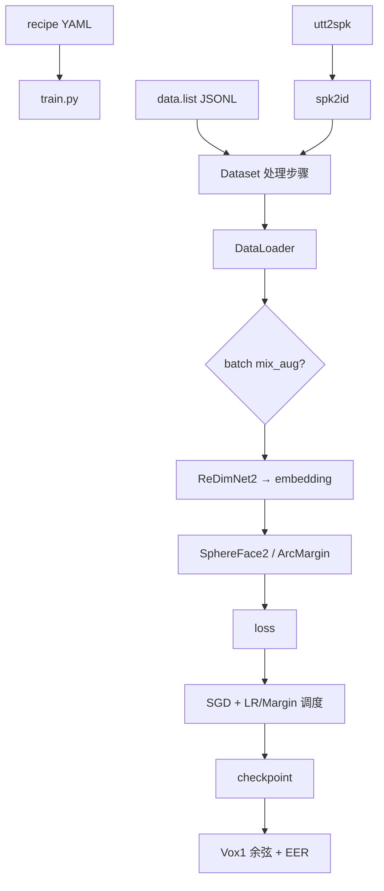
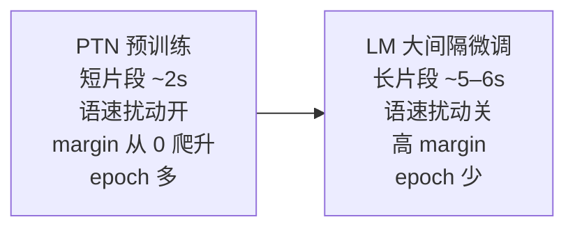

# 04 · 训练流程

上一篇：[代码地图](03-code-walkthrough.md) · 下一篇：[实验配方与复现](05-recipes-and-repro.md)

---

## 1. 一张图看懂整条链



入口文件：`applications/speaker_rec/wespeaker_lite/bin/train.py`。  
启动封装：仓库根执行 `./applications/speaker_rec/launch.sh <yaml> <n_gpus> ...`（内部 `torchrun` + 设置 `PYTHONPATH`）。

---

## 2. 数据长什么样

### `data.list`（每行一条 JSON）

```json
{"key":"id00012/21Uxsk56VDQ/00001.wav","spk":"id00012","wav":"/abs/path/to.wav"}
```

三个字段分别是：`key` 样本编号（`说话人/视频目录/文件名`）、`spk` 所属说话人、`wav` 音频的绝对路径。
`prepare_data.py` 写出的字段顺序是 `key`、`spk`、`wav`（`examples/vox2/scripts/prepare_data.py:801`）；
读的时候按字段名取值，所以顺序本身不影响运行。

### `utt2spk`

两列文本：`样本编号 说话人`（例如 `id00012/21Uxsk56VDQ/00001.wav id00012`）。训练开始时读入，生成 `spk2id.json`（说话人 → 整数类别），投影头的类别行数按说话人个数设定。

同一目录下还会一起生成 `spk2utt`（一行一个说话人，后接它的全部样本编号）和 `wav.scp`（`样本编号 绝对路径`），便于人工检查。

当前训练路径 **只支持** `data_type: raw_fast`：训练时直接解码波形，而不是预先提好 fbank 再打包。

### 一条样本读进来之后实际做了什么

以下顺序照着 `wespeaker_lite/dataset/processor.py` 读，单位都是采样点（16 kHz）：

1. 按 JSON 里的路径读音频。**`sample_rate` 直接当成 16000**，不读文件本身的采样率，所以清单里指向的文件必须是 16 kHz。
2. 丢掉太短的句子：默认最短 100 帧（约 1.0 秒）。
3. 按 `num_frms` 换算目标长度，取 `(帧数 - 1) × 帧移 + 帧长`：
   `num_frms` 200 → 约 2.02 秒，500 → 约 5.02 秒，600 → 约 6.02 秒。
   读音频时多留 10% 再截回这个长度，起点在可用范围内随机；不够长就循环复制补齐。
4. 语速扰动、随机裁剪、增强，按下一节的顺序走。

**`fbank_args` 在这里只用得到 `frame_shift` 和 `frame_length`**（用来换算长度）。
里面的 `num_mel_bins`、`dither` 在数据侧不起作用 —— 真正的梅尔前端在模型内部，由 `model_args` 里的
`F`（频率维，配方里是 72）、`hop_length`（160，即 10 毫秒一帧）和 `spec_params` 决定。
想改梅尔相关参数，去改 `model_args`，改 `fbank_args` 是无效的。

---

## 3. Dataset 处理顺序

`wespeaker_lite/dataset/dataset.py` 大致按固定顺序挂 Processor：

```text
parse_raw_fast_and_filter   # 读 wav、按时长过滤
  → shuffle                 # 缓冲打乱
  → spk_to_id
  → resample                # 默认 16 kHz
  → speed_perturb           # 0.9 / 1.0 / 1.1；类别数 ×3（微调阶段会关）
  → random_chunk            # 由 num_frms 等换算秒数
  → 增强（旧写法或 Sequential 树）
```

### 语速扰动会把类别数变成三倍

这一条不看代码很难想到，但它直接决定投影头要开多少个类别。

`processor.speed_perturb` 在三档速度 `[1.0, 0.9, 1.1]` 里随机选一档，
非 1.0 时用 `torchaudio.functional.speed` 变速，**同时把标签平移**：

```text
新标签 = 原标签 + 说话人总数 × 速度档位编号
```

也就是说，同一个人的正常语速、慢速、快速样本，被当成**三个不同的说话人**。
所以开启语速扰动的主训练，类别数是真实说话人数的 3 倍
（5,994 × 3 = 17,982）；大间隔微调阶段强制关掉语速扰动，类别数回到 5,994。

配套的是：一类样本编号会按 epoch 重新播种（按卡号、按数据加载进程号错开），
保证每轮看到的打乱顺序和增强都不同，但整体可复现。

### 增强分三层

| 层级 | 位置 | 例子 |
|------|------|------|
| 样本级（旧写法） | `processor.add_reverb_noise_gain` | `aug_setup.type: wespeaker_augs`，并从 MUSAN/RIR 的键值库读波形 |
| 样本级树（当前） | `augs.py` | `Sequential` / `OneOf` / `CustomNoise` / `Reverb` / `LowPassAug` / `CodecAug`，噪声与混响目录用 `dataset_dir` |
| Batch 级 GPU | `mix_augs.py` | Mixup、Cutmix、OverlapMix；产出软标签 |

当前 vox2 与混合数据配方都用 **Sequential 增强树 + 原始 wav 目录**
（配置键 `dataset_dir`，如 `raw/musan/{music,noise,speech}`、`raw/rirs/simulated_rirs`）。
`wespeaker_augs`、MUSAN/RIR 的键值库、以及 `lmdb_to_ram`，只给旧配置选用，新实验不必再走这条路。

各增强组件的实际行为（都是白话）：

- **加噪**（`CustomNoise`）：在配置给的信噪比区间里随机取一个目标值，按功率比把噪声缩放到那个水平再相加；
  `babble: true` 时一次叠 3~7 条噪声，模拟人声嘈杂。
- **混响**（`Reverb`）：脉冲响应默认截到 1 秒，做单位能量归一化后与语音卷积。
- **低通**（`LowPassAug`）：在频域做平滑低通，混合线配方里截止比 0.6。
- **编解码**（`CodecAug`）：模拟 mp3 / opus 等压缩损伤，依赖 `ffmpeg`；当前配方里被注释掉了。

**Mixup 那一层是关着的**：当前配方的 `mixup_alpha` 都是 `null`，也没有 `mix_aug_setup`。

### 两处与说明文字不符的细节

- `processor.py` 里 `max_num_frames`（默认 800，约 8 秒）算出了一个 `max_len`，
  但**这个上限从来没有被使用**，超长句子不会被丢掉。真正生效的只有最短时长过滤（默认 1.0 秒）。
- 数据集的文档字符串说支持 `shard` / `raw` / `raw_fast` 三种模式，
  但函数体里是硬断言只支持 `raw_fast`。入口虽然放行了另外两种，进去也会立刻报错。

---

## 4. 模型与损失：谁算 logits

```python
# 概念代码，非逐字拷贝
embeds = model(wav)  # SpeakerModel → 仅 backbone
# SphereFace2：投影头内部直接返回 (logits, loss)
# ArcMargin 等：返回 logits，再交给 CrossEntropyLoss
```

### 投影头（`project_type`）

| 类型 | 说明 |
|------|------|
| **`sphereface2`** | 当前 recipe **默认**；前向可自带 loss |
| `arc_margin` | ArcFace / AAM-Softmax：`cos(θ+m)` |
| `arc_margin_intertopk_subcenter` | 子中心 + inter-topk；LM 时常关掉 hard penalty |
| `add_margin` | CosFace |
| `linear` | 普通分类头 |

**MarginScheduler** 在训练过程中逐步增大 margin，避免一开始任务过难。大间隔微调阶段（`do_lm: true`）通常用更大、更固定的 margin，并关闭语速扰动。

---

## 5. 优化与分布式

| 组件 | 常见设置 |
|------|----------|
| 优化器 | SGD + momentum + weight_decay |
| LR 调度 | `ExponentialDecrease` 或 `ExponentialDecayPlateauWithWarmup` |
| 精度 | `enable_amp` + GradScaler |
| 并行 | 单机多卡 DDP（`nccl`），由 `torchrun` 注入 `RANK` 等 |
| LR 缩放 | 与 `world_size * batch_size` 相关（相对 batch 64） |

每个 epoch：`run_epoch` 按 iteration 推 scheduler；IterableDataset 流式读，靠 `epoch_iter` 截断。  
验证：在 Vox1 试验对上抽 embedding，**余弦相似度**打分，算 **EER**，写入 `exp_dir/val_log.csv`。

---

## 6. Checkpoint 约定

| 文件 | 含义 |
|------|------|
| `exp_dir/models/model_{轮号}.pt` | 每个轮次由 0 号进程存一次，**只存权重**，不含优化器状态、不含轮号 |
| `exp_dir/spk2id.json` | 说话人映射（大间隔微调阶段必须能读到同一份） |
| `exp_dir/config.yaml` | 实际生效配置快照 |
| `final_model.pt` | 指向最后一轮的软链接 |

存盘时每轮会删掉上一轮的权重，除非上一轮编号正好落在 `save_epoch_interval` 上，
或已进入最后 `num_avg` 轮（默认 10），这是为了给后续平均留料。
训练结束建的 `final_model.pt` 直接软链到 `num_epochs` 那一轮的权重。

> **`num_avg` 不做参数平均。** 代码里没有对最后若干轮的权重做任何平均操作，
> 它只决定"保留最后几轮别删"。名字容易让人以为会取平均，实际不会。

### 续训的真实行为（有一处容易踩）

启动时若在 `exp_dir/models/` 发现最新的 `model_*.pt`，会取它的**轮号 + 1** 作为起始轮。

但要注意 `train.py:331` 这一句：`ckpt_to_load = configs.get('model_ckpt', None) or checkpoint`，
其中 `checkpoint` 就是刚扫到的那份最新权重。也就是说：

- **主训练配置**（不写 `model_ckpt`）：中断后重启会从最新权重接着训，符合预期。
- **大间隔微调配置**（写了 `model_ckpt` 指向主训练的权重）：`model_ckpt` 恒非空，
  所以**就算微调已经跑到第 3 轮再重启，也会重新从主训练权重初始化骨干和分类头**，
  只有起始轮号来自最新的那份文件。微调本身只训 5 轮（vox2 线）或 1 轮（混合线），
  建议一次跑完；一旦中断，宁可清空 `exp_dir` 重跑，不要指望它原地续上。

LM 阶段用 `model_ckpt` 显式指向主训练权重；若投影头类别数变化，可用 `spk2id_map_path`
或旁边的 `spk2id.json` 做分类头重组（按说话人名字把旧的中心搬到新头里，
旧头没有的新说话人会随机挑一个已有类的中心来初始化）。

---

## 7. PTN vs LM（务必建立直觉）



| | PTN（`ptn.yaml`） | LM（`lm.yaml`） |
|--|------------------|-----------------|
| 目的 | 学好表征与分类边界 | 把边界再「撑开」一点 |
| `num_frms` | 常见 200（≈2 s） | 500–600（≈5–6 s） |
| `speed_perturb` | true | false |
| `do_lm` | false | true |
| `model_ckpt` | 无 | 指向 PTN |
| `num_epochs` | 量大（如 120） | 很少（vox2 常 5；混合可 1） |

业务上优先用 **`train_type="lm"`** 的发布权重做推理。

---

## 8. YAML 里最常摸的键

| 键 | 作用 |
|----|------|
| `train_data` / `train_label` | 样本清单与标签路径 |
| `validation.vox1` | Vox1-O 根目录（验证用试验列表所在目录） |
| `exp_dir` | 输出目录 |
| `model` / `model_args` | 骨干类名与结构（改梅尔参数也在这里） |
| `dataset_args.num_frms` | 切片长度 |
| `dataset_args.aug_setup` | 增强 |
| `dataloader_args.batch_size` | **每张卡**的批大小；全局批还要乘卡数 |
| `projection_args` | 损失头；`num_class` 运行时会被覆盖，勿手改死 |
| `optimizer_args` / `scheduler_args` / `margin_update` | 优化日程 |
| `num_epochs` / `save_epoch_interval` / `num_avg` | 训练长度、存盘间隔、保留末尾几轮（不做平均） |
| `model_ckpt` | 只在大间隔微调配置里用，指向主训练权重 |
| `enable_amp` | 混合精度开关，当前配方都是开 |
| `compile_backbone` | 是否用 `torch.compile` 编译骨干 |

### 写了但不起作用的键

下面这些键在某些配方里出现，但训练代码里**没有任何地方读它们**。照着它们调参不会有任何效果，
新人很容易被误导，看到时可以当注释忽略：

| 键 | 实际情况 |
|----|----------|
| `gpus` | 不生效。用哪几张卡完全由命令行第二个参数（`launch.sh` 的 `num_gpus`）和 `CUDA_VISIBLE_DEVICES` 决定 |
| `grad_accum_steps` | 不生效。**训练栈没有实现梯度累积**，每个 iteration 都直接反向与更新 |
| `eval_step_interval` | 不生效。验证是按轮触发的，不是按步 |
| `scheduler_args.scale_ratio` | 会被覆盖。启动时用 `卡数 × 每卡批大小 / 64` 重算（`train.py:453`） |
| `full_val` | 不加就等于关掉完整验证（切 5 段 × 3 秒、含 TTA 与多段平均）。**所有配方都没设**，所以训练中报的只有快速版的 `-eer-fl` |

> `vox2/recipes/redimnet2/b3/lm.yaml` 里写着 `gpus: [0]`（只列一张卡），它**不会**把训练限制在单卡。
> 这是个不生效的残留。

`num_class` 同理：配置里写多少都会被实际读到的说话人表覆盖，
开了语速扰动还会再乘 3（见第 3 节）。改它不影响训练，只是记录用。

**路径建议写在 `--config_overrides` 本地覆盖文件**，不要直接改仓库内配方，方便拉取上游更新。
注意两个 examples 的 README 里给的覆盖模板，示例路径写的也是 `/data/wespeaker_data/...`，
在本机照样不可用，要按自己的数据位置改。

---

## 9. 最小启动示例

```bash
# 在仓库根；先准备好数据与 local.yaml（改路径）
./applications/speaker_rec/launch.sh \
  applications/speaker_rec/examples/vox2/recipes/redimnet2/b0/ptn.yaml \
  1 \
  --config_overrides /path/to/local.yaml
```

`local.yaml` 至少覆盖：`train_data`、`train_label`、`validation`、`exp_dir`，以及增强用的 MUSAN/RIR 路径。

具体数据准备步骤见下一篇：[05 实验配方与复现](05-recipes-and-repro.md)。
