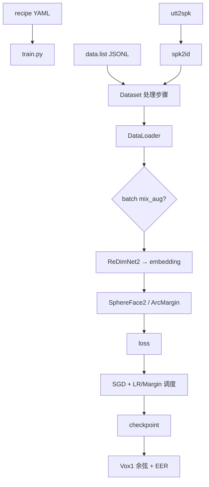
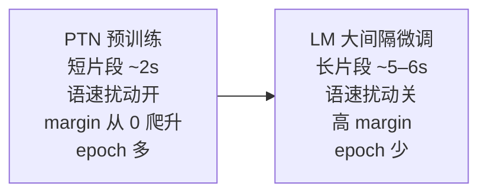

# 04 · 训练流程

上一篇：[代码地图](03-code-walkthrough.md) · 下一篇：[实验配方与复现](05-recipes-and-repro.md)

---

## 1. 一张图看懂整条链



入口文件：`applications/speaker_rec/wespeaker_lite/bin/train.py`。  
启动封装：仓库根执行 `./applications/speaker_rec/launch.sh <yaml> <n_gpus> ...`（内部 `torchrun` + 设置 `PYTHONPATH`）。

---

## 2. 数据长什么样

### `data.list`（每行一条 JSON）

```json
{"key": "某utterance_id", "wav": "/abs/path/to.wav", "spk": "说话人ID"}
```

### `utt2spk`

两列文本：`utterance_id speaker_id`。训练开始时读入，生成 `spk2id.json`（说话人 → 整数类别），投影头的类别行数按说话人个数设定。

当前训练路径 **只支持** `data_type: raw_fast`：训练时直接解码波形，而不是预先提好 fbank 再打包。

---

## 3. Dataset 处理顺序

`wespeaker_lite/dataset/dataset.py` 大致按固定顺序挂 Processor：

```text
parse_raw_fast_and_filter   # 读 wav、按时长过滤
  → shuffle                 # 缓冲打乱
  → spk_to_id
  → resample                # 默认 16 kHz
  → speed_perturb           # 0.9 / 1.0 / 1.1；类别数 ×3（LM 阶段会关）
  → random_chunk            # 由 num_frms 等换算秒数
  → 增强（旧写法或 Sequential 树）
```

### 增强分三层

| 层级 | 位置 | 例子 |
|------|------|------|
| 样本级（旧写法） | `processor.add_reverb_noise_gain` | `aug_setup.type: wespeaker_augs`，并从 MUSAN/RIR 的 LMDB 读波形 |
| 样本级树（当前） | `augs.py` | `Sequential` / `OneOf` / `CustomNoise` / `Reverb` / `LowPassAug` / `CodecAug`，噪声与混响目录用 `dataset_dir` |
| Batch 级 GPU | `mix_augs.py` | Mixup、Cutmix、OverlapMix；产出软标签 |

当前 vox2 与混合数据配方都用 **Sequential 增强树 + 原始 wav 目录**（配置键 `dataset_dir`，如 `raw/musan/{music,noise,speech}`、`raw/rirs/simulated_rirs`）。`wespeaker_augs`、MUSAN/RIR 的 LMDB、以及 `lmdb_to_ram`，只给旧配置选用，新实验不必再走这条路。

---

## 4. 模型与损失：谁算 logits

```python
# 概念代码，非逐字拷贝
embeds = model(wav)  # SpeakerModel → 仅 backbone
# SphereFace2：投影头内部直接返回 (logits, loss)
# ArcMargin 等：返回 logits，再交给 CrossEntropyLoss
```

### 投影头（`project_type`）

| 类型 | 说明 |
|------|------|
| **`sphereface2`** | 当前 recipe **默认**；前向可自带 loss |
| `arc_margin` | ArcFace / AAM-Softmax：`cos(θ+m)` |
| `arc_margin_intertopk_subcenter` | 子中心 + inter-topk；LM 时常关掉 hard penalty |
| `add_margin` | CosFace |
| `linear` | 普通分类头 |

**MarginScheduler** 在训练过程中逐步增大 margin，避免一开始任务过难。大间隔微调阶段（`do_lm: true`）通常用更大、更固定的 margin，并关闭语速扰动。

---

## 5. 优化与分布式

| 组件 | 常见设置 |
|------|----------|
| 优化器 | SGD + momentum + weight_decay |
| LR 调度 | `ExponentialDecrease` 或 `ExponentialDecayPlateauWithWarmup` |
| 精度 | `enable_amp` + GradScaler |
| 并行 | 单机多卡 DDP（`nccl`），由 `torchrun` 注入 `RANK` 等 |
| LR 缩放 | 与 `world_size * batch_size` 相关（相对 batch 64） |

每个 epoch：`run_epoch` 按 iteration 推 scheduler；IterableDataset 流式读，靠 `epoch_iter` 截断。  
验证：在 Vox1 试验对上抽 embedding，**余弦相似度**打分，算 **EER**，写入 `exp_dir/val_log.csv`。

---

## 6. Checkpoint 约定

| 文件 | 含义 |
|------|------|
| `exp_dir/models/model_{epoch}.pt` | 周期存盘 |
| `exp_dir/spk2id.json` | 说话人映射（大间隔微调阶段必须能读到同一份） |
| `exp_dir/config.yaml` | 实际生效配置快照 |
| `final_model.pt` | 指向最后一轮的 symlink |

启动时若发现最新 `model_*.pt`，会自动 **resume**。  
LM 阶段用 `model_ckpt` 显式指向 PTN 权重；若投影头类别数变化，可用 `spk2id_map_path` / 旁路 `spk2id.json` 做头重组。

---

## 7. PTN vs LM（务必建立直觉）



| | PTN（`ptn.yaml`） | LM（`lm.yaml`） |
|--|------------------|-----------------|
| 目的 | 学好表征与分类边界 | 把边界再「撑开」一点 |
| `num_frms` | 常见 200（≈2 s） | 500–600（≈5–6 s） |
| `speed_perturb` | true | false |
| `do_lm` | false | true |
| `model_ckpt` | 无 | 指向 PTN |
| `num_epochs` | 量大（如 120） | 很少（vox2 常 5；混合可 1） |

业务上优先用 **`train_type="lm"`** 的发布权重做推理。

---

## 8. YAML 里最常摸的键

| 键 | 作用 |
|----|------|
| `train_data` / `train_label` | 列表与标签路径 |
| `validation.vox1` | Vox1-O 根目录 |
| `exp_dir` | 输出目录 |
| `model` / `model_args` | 骨干类名与结构 |
| `dataset_args.num_frms` | 切片长度 |
| `dataset_args.aug_setup` | 增强 |
| `dataloader_args.batch_size` | batch（结合 GPU 数理解全局吞吐） |
| `projection_args` | 损失头；`num_class` 运行时覆盖，勿手改死 |
| `optimizer_args` / `scheduler_args` / `margin_update` | 优化日程 |
| `num_epochs` / `save_epoch_interval` / `num_avg` | 长度与平均模型 |

**路径建议写在 `--config_overrides` 本地 YAML**，不要直接改仓库内配方，方便拉取上游更新。

---

## 9. 最小启动示例

```bash
# 在仓库根；先准备好数据与 local.yaml（改路径）
./applications/speaker_rec/launch.sh \
  applications/speaker_rec/examples/vox2/recipes/redimnet2/b0/ptn.yaml \
  1 \
  --config_overrides /path/to/local.yaml
```

`local.yaml` 至少覆盖：`train_data`、`train_label`、`validation`、`exp_dir`，以及增强用的 MUSAN/RIR 路径。

具体数据准备步骤见下一篇：[05 实验配方与复现](05-recipes-and-repro.md)。
