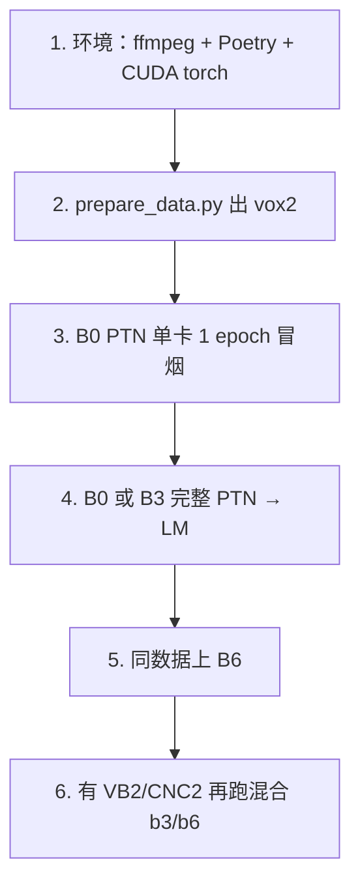

# 05 · 实验配方与复现指南

上一篇：[训练流程](04-训练流程.md) · 下一篇：[本机数据与开训检查](07-本机数据与开训检查.md) · [术语表与 FAQ](06-glossary-faq.md)

---

## 1. 两条实验线

| 目录 | 训练数据 | 配方型号 | 适合谁 |
|------|----------|----------|--------|
| `examples/vox2/` | 仅 VoxCeleb2-dev | **B0–B6** 齐全 | 入门；方便和论文 Vox2 表对照数字 |
| `examples/vb2_vox2_cnc2/` | Vox2 + VoxBlink2 + CN-Celeb2 | **B3 / B6** | 大规模混合、冲跨数据集指标 |

验证集两边通常都是 **VoxCeleb1-O**（`veri_test2.txt`）。

除了这些按固定长度切片的配方，每个型号还多了一份**变长训练**的兄弟配方
（文件名里带 `varlen_`，例如 `b0/varlen_ptn.yaml`），它让一批里的语音保持各自
真实长度，并可按长度分桶以减少补零。默认关闭，旧配方行为不变，
见 [08 变长训练与长度分桶](08-变长训练与长度分桶.md)。

混合数据说话人加命名空间前缀，避免 ID 撞车：

- `A_` = VoxCeleb2  
- `B_` = VoxBlink2  
- `C_` = CN-Celeb2  

---

## 2. 路径 A：VoxCeleb2 端到端

脚本：`applications/speaker_rec/examples/vox2/scripts/prepare_data.py`

### 关于路径：配方里现在写的是本机的真实路径

仓库里 18 份配方原先统一写 `/data/wespeaker_data/...`，但本机**没有 `/data` 目录**，
照原样跑会在读样本清单那一步失败。现在配方已经改成真实位置：

```text
/root/group-shared/voiceprint/data/wespeaker_data/
```

（`/root/group-shared` 是指向 `/shared/group-shared` 的软链接，两者是同一块盘。）

所以本机可以直接启动，**不需要再建 `/data` 软链接**。配方里涉及的路径逐条核过：
样本清单、语句到说话人表、验证集目录、以及四种增强目录都真实存在。

### 换机器时怎么改路径

不建议直接改配方，而是写一份本地覆盖文件交给 `--config_overrides`
（模板见第 4 节）。这样拉取上游更新时不会冲突。要覆盖的有五处：
`train_data`、`train_label`、`validation.vox1`，以及增强用的 MUSAN 与 RIRS 目录
（后两者在 `dataset_args.aug_setup` 里，**要整段替换**，只改一半容易指到旧数据）。

### 阶段默认值

`download → extract → convert → lists`（最后一步 `lists` 是写 `data.list`、`utt2spk` 等训练用样本清单；
**不含** `lmdb`；可重跑，带缓存标记）。

注意 `--stages all` 和默认**完全一样**，也不含 `lmdb`。只有还想用旧版键值库增强时，
才需要显式写 `--stages lmdb`（那一步还要求额外装 Python 的 `lmdb` 包）。
当前配方增强直接读 `raw/` 下 wav 目录（配置键 `dataset_dir`），新实验不必走这条路。

### 全量准备（需网络与磁盘）

```bash
export HF_TOKEN=...   # 若走 HuggingFace 镜像下载
python applications/speaker_rec/examples/vox2/scripts/prepare_data.py \
  --data-root /data/wespeaker_data
```

### 已有压缩包 / 已解压目录

用 `--vox2-archive`、`--vox1-test-archive`、`--musan-archive`、`--rirs-archive`，或对应的 `--*-source`，并指定 `--stages`。

### 期望目录结构

```text
/data/wespeaker_data/          # 本机实际在 /root/group-shared/voiceprint/data/wespeaker_data/
├── vox1-test/{wav/, veri_test2.txt}
├── vox2_dev/{wav/, data.list, utt2spk, spk2utt, wav.scp}
├── raw/musan/{music,noise,speech}/          # 通常是软链接，指向共享盘上的 musan
├── raw/rirs/simulated_rirs/                 # 软链接，extract 阶段会自动建好
└── {musan,rirs}/wav.scp
```

关于 RIRS 目录名：官方压缩包解出来是 `raw/RIRS_NOISES/simulated_rirs`，
而配置里读的是 `raw/rirs/simulated_rirs`。`extract` 阶段会自动建一个软链接把两者接上，
不用手工处理；如果那里已存在但指向别处，脚本会报错而不是覆盖。

规模量级（脚本会校验，数量不符直接中止；子集调试可加 `--allow-incomplete` 降级为告警）：

| 集合 | 约计量 |
|------|--------|
| Vox2-dev | 1,092,009 句 / 5,994 说话人 |
| Vox1-test WAV / trials | 4,874 / 37,611 |
| MUSAN / RIRS(sim) | 2,016 / 60,000 |

> **Vox1-test 的 WAV 数量要按 4,708 理解。** 官方小包全量是 4,874 个文件，
> 但本机是按 `veri_test2.txt` 用到的句子挑着链的，正好 4,708 个，逐条核对无缺失。
> 按这份试验列表做验证够用，两个数字不冲突。

AAC/M4A → 16 kHz mono WAV 依赖系统 **`ffmpeg`**（转换参数固定为 16 kHz、单声道、16 位 PCM）。

---

## 3. 路径 B：混合数据（只生成样本清单、不下载音频）

前置：vox2 侧的样本清单与 wav 已就绪；CN-Celeb2、VoxBlink2 的音频需自行准备好：

- **CN-Celeb2**：OpenSLR-82，布局如 `.../CN-Celeb2_flac/data/<spk>/<utt>.flac`  
- **VoxBlink2**：需申请；布局如 `.../audio/<spk>/.../*.wav`（本例无下载脚本）

脚本对目录名有**硬性约定**，不匹配就直接退出（`exit 1`）：
VoxBlink2 必须是 `<vb2-root>/audio/`，CN-Celeb2 必须是 `<cnc2-root>/CN-Celeb2_flac/data/`。

### 本机现状：这两份清单还没生成

在本机核对时，`vox2_vb2_cnc2_v0/` 下的 `mix_join/`、`mix_join_lm/`，
连中间产物 `vb2_full/`、`cnc2_full/` 都**完全不存在**，一份清单都没有（全盘查找无命中）。
原始语料本身是齐的：VoxBlink2 的 `audio/` 有 111,284 个说话人目录（带校验通过的解压完成标记），
CN-Celeb2 的 flac 与 wav 各 524,787 句。

也就是说**混合线现在还开不了训**，下面两条命令要自己先跑。
注意它们默认往 `/data/wespeaker_data/...` 写，会先撞上第 2 节说的路径问题，
`--output-root` 和 `--vb2-root` / `--cnc2-root` 都要换成自己的真实位置。

### 主训练（PTN）用的样本清单

```bash
applications/speaker_rec/examples/vb2_vox2_cnc2/scripts/prepare_vox2_vb2_cnc2_data.sh \
  --vox2-list /data/wespeaker_data/vox2_dev \
  --vb2-root /data/voxblink2 \
  --cnc2-root /data/cnceleb2 \
  --output-root /data/wespeaker_data/vox2_vb2_cnc2_v0
```

内部：`gen_datalists.py` → `join_datalists.py` → `mix_join/`。
三份来源**全量**拼接后按固定种子（默认 42）整体打乱，不做任何过滤。

### 大间隔微调（LM）用的样本清单（按时长过滤）

```bash
applications/speaker_rec/examples/vb2_vox2_cnc2/scripts/prepare_vox2_vb2_cnc2_lm_data.sh \
  --vox2-list /data/wespeaker_data/vox2_dev \
  --vb2-list /data/wespeaker_data/vox2_vb2_cnc2_v0/vb2_full \
  --cnc2-list /data/wespeaker_data/vox2_vb2_cnc2_v0/cnc2_full \
  --output-root /data/wespeaker_data/vox2_vb2_cnc2_v0 \
  --min-duration 5.0
```

内部：`infer_durations_sf.py` → `filter_datalist_by_duration.py` → `mix_join_lm/`。  
依赖：`pyarrow`、`soundfile`。注释中说话人量级约 PTN 11.9 万 / LM 过滤后约 11.5 万（以你生成结果为准）。

### `mix_join` 和 `mix_join_lm` 差在哪

这是两阶段训练能接上的关键，值得单独说清：

| | `mix_join`（主训练用） | `mix_join_lm`（微调用） |
|--|------------------------|--------------------------|
| 筛选 | 不过滤，三份来源全量 | 先按最短时长（默认 5 秒）筛掉过短的句子 |
| 打乱 | 按种子 42 整体打乱 | 同样打乱，但**前缀和来源顺序与主训练完全一致** |
| 结果 | 说话人集合较全 | 说话人集合是主训练的子集 |

因为两边用的是**同样的 `A_` / `B_` / `C_` 前缀和同样的来源顺序**，
微调阶段重装分类头时，说话人编号能和主训练阶段存下的 `spk2id.json` 对应上。
如果两边拼接方式不一致，微调会从一堆错位的类别中心开始训，数字会莫名其妙地差。

`speed_perturb` 与类别数的联动也要连着理解：主训练开了语速扰动后，
0.9 / 1.1 两种速度会被当成"新说话人"，所以类别数变成真实说话人数 × 3
（VoxCeleb2 开发集 5,994 × 3 = 17,982，正是配方里写的数字）；
微调阶段强制关掉语速扰动，类别数回到真实说话人数 5,994。

---

## 4. 启动训练

### 环境

```bash
cd applications/speaker_rec
poetry install --no-root
# 按机器安装匹配的 torch / torchaudio
```

### 推荐：本地覆盖文件

```yaml
# /tmp/vox2-b0-local.yaml 示例字段（★ 路径按你机器改，下面这些是仓库默认值，本机不可用）
train_data: /data/wespeaker_data/vox2_dev/data.list
train_label: /data/wespeaker_data/vox2_dev/utt2spk
validation:
  vox1: /data/wespeaker_data/vox1-test
exp_dir: exp/vox2/b0_ptn
# 当前配方用 Sequential 增强树 + raw 下 dataset_dir 读 wav，不必再打 LMDB / 开 lmdb_to_ram。
# 若路径与默认不同，整段覆盖 dataset_args.aug_setup（见 vox2 README）。
```

本机实际可用的写法（对应第 2 节的"做法二"）：

```yaml
train_data: /root/group-shared/voiceprint/data/wespeaker_data/vox2_dev/data.list
train_label: /root/group-shared/voiceprint/data/wespeaker_data/vox2_dev/utt2spk
validation:
  vox1: /root/group-shared/voiceprint/data/wespeaker_data/vox1-test
exp_dir: /root/group-shared/voiceprint/data/wespeaker_data/exp/vox2/b0_ptn
```

> **`exp_dir` 别落在容器根上。** 本机 `/` 只剩约 2 GB，训练日志和权重会直接把它写满。
> 写到共享盘，或写到 `/dev/shm`（本机约 325 GB 可用）。

改增强路径时，**整段带上 `aug_setup`**（列表是整段替换，只改一半容易指到旧 MUSAN）。

### 命令

```bash
# 仓库根
./applications/speaker_rec/launch.sh \
  applications/speaker_rec/examples/vox2/recipes/redimnet2/b0/ptn.yaml \
  8 \
  --config_overrides /tmp/vox2-b0-local.yaml
```

冒烟（单卡 1 epoch）：

```bash
./applications/speaker_rec/launch.sh \
  applications/speaker_rec/examples/vox2/recipes/redimnet2/b0/ptn.yaml \
  1 \
  --config_overrides /tmp/vox2-b0-local.yaml \
  --num_epochs 1 \
  --exp_dir exp/vox2/smoke
```

PTN 跑完后，把 `lm.yaml` 的 `model_ckpt` 指到对应 `model_*.pt`，并保证能读到 PTN 旁的 `spk2id.json`，再启 LM。

---

## 5. B0–B6 配方差异（vox2）

共同习惯：`ReDimNet2Custom`、`block_1d_type: conv+att`、`embed_dim: 192`、`F: 72`、
池化一律 `ASTP`、`feat_type: tf`、`hop_length: 160`（10 毫秒一帧）、SphereFace2；
主训练 120 epoch、大间隔微调 5 epoch。

**配方里的 `batch_size` 是每张卡的批大小**，不是全局批大小。
例如 b0 写 512，8 卡跑时一次迭代实际处理 8 × 512 = 4096 条。

| 变体 | 起始通道 `C` | 输出通道 | 每卡批大小 | 权重衰减 | 备注 |
|------|:---:|:---:|:---:|:---:|------|
| b0 | 12 | 64 | 512 | 2e-5 | 冒烟首选 |
| b1 | 16 | 默认 | 224 | 5e-6 | |
| b2 | 20 | 默认 | 192 | 1.5e-5 | 卷积核用 `(3,5)`、`(3,7)` |
| b3 | 24 | 默认 | 224 | 2e-5 | 常用甜点；**没写 `stages_setup`，用代码默认值** |
| b4 | 32 | 默认 | 160 | 2e-5 | 加深前几个阶段 |
| b5 | 48 | 256 | 128 | 2e-5 | |
| b6 | 64 | 224 | 140 | 2e-5 | 最深最宽 |

> **b1–b4 没有 `out_channels` 这个键**，走代码默认的 `None`。这不是漏写，是设计如此，
> 但看对照表时容易以为少了一列。

**模型越大，单卡 batch 往往越小** —— 改 GPU 数或显存时先调 `batch_size`，再看是否 OOM。

学习率与间隔调度（vox2 线 7 个型号一致）：学习率 0.1，指数衰减到 6e-5，预热 6 轮；
`loss_weight_decay_mult` 各型号不同（b1 是 2.0、b2 是 4.0、其余多为 5.0），
它决定分类头的权重衰减是骨干的多少倍。间隔从 0 升到 0.20，第 20 轮起增、第 40 轮后固定。

**vox2 线的大间隔微调**：`do_lm: true`、只训 5 轮、`num_frms` 加到 600（约 6 秒）、
关掉语速扰动、学习率 1e-4、权重衰减 1e-4、间隔固定 0.3。

### 混合实验的差异

混合线只有 b3、b6 两个型号，配置习惯和 vox2 线**差别不小**，不要混着比：

| | vox2 线主训练 | 混合线主训练 |
|--|--------------|--------------|
| 轮数 | 120 | b3 是 110，b6 是 120 |
| 学习率 | 0.1 | b3 是 0.025，b6 是 0.06 |
| 调度器 | `ExponentialDecrease` | `ExponentialDecayPlateauWithWarmup`（带平台检测） |
| 增强总概率 | 0.6 | 0.9 |
| 间隔爬升 | 第 20 轮起增、第 40 轮固定 | 第 15 轮起增、第 30 轮固定 |

> **两条线的微调学习率差三个数量级。** vox2 线的 `lm` 是 1e-4，
> 混合线的 `lm` 是 0.1（权重衰减也差一档：4e-5 对 1e-4）。
> 这来自两套不同的原始配方，不是笔误，但把两条线的微调放一起比较时要注意。

混合线微调：只训 1 轮、`num_frms: 500`（约 5 秒）、间隔固定 0.3。

### 混合线配置里三处对不上的地方

开训前建议先确认，都是"注释说的"和"代码实际做的"不一致：

1. **b6 微调加载的权重与注释对不上。** `b6/ptn.yaml` 写 `num_epochs: 120`、
   注释也说"练到第 120 轮"，但 `b6/lm.yaml:28` 加载的是 `model_115.pt`；
   `exp_dir` 又写成 `b6_gnorm_100ep`。三处数字互不相符。
   （b3 那条线是 110 对 `model_110.pt`，自洽。）
   两个 examples 的 README 也提醒过这类注释要按实际结果改。
2. **主训练文件头写的增强比实际多做一步。** b3/b6 的 `ptn.yaml` 开头说
   "低通增强用 0.5 和 0.6 两个截止比""编解码增强以中等概率启用"，
   但这两段在文件里**都被注释掉了**，实际只有 `cutoff_ratio: 0.6` 那个生效。
3. **`gpus`、`grad_accum_steps`、`eval_step_interval` 都不生效**，
   详见 [04 第 8 节](04-训练流程.md#写了但不起作用的键)。

---

## 6. 官方预训练权重（免训练）

不复现训练时，直接 hub 加载即可。权重托管在 GitHub Release `v1.0.0`，命名：

```text
{b0–b6}-{dataset}-{ptn|lm|dis}.pt
```

数据集字符串：`vox2`、`vb2+vox2_v0`、`vb2+vox2+cnc2_v0`。完整链接表见根目录 [README.md](../README.md#model-zoo)。

---

## 7. 推荐复现阶梯



**最短冒烟步骤**：先跑完数据准备；用本地覆盖文件改好本机路径；再开 `b0/ptn.yaml` 单卡训 1 个 epoch；
最后打开 `val_log.csv`，确认已经写出等错误率（EER）。

> **训练日志里的 EER 不能直接和官方数字比。** 这一列现在叫 `vox1-eer-8s`（**旧名 `vox1-eer-fl`**，
> 改名前的老日志里就是同一列），是按**每段音频开头 8 秒**算的，
> 不足 8 秒的还会循环补齐；而官方表的数字是按整段音频评测的口径。同一个权重 `b0-vox2-lm`，
> 整段评测是 1.042%，8 秒窗口是 1.074%，差 0.032 个百分点。
> 要对官方表请走第 9 节的整段评测脚本；这一列只适合盯收敛趋势。细节见 [04 第 5 节](04-训练流程.md#训练中验证读的是开头-8-秒的窗口)。

---

## 8. 常见坑（按出现频率）

**vox2**

- **配方里的路径已经是本机真实位置**，本机可直接启动；换机器时用覆盖文件改路径（见第 2 节）。  
- **`exp_dir` 落在容器根上，几个轮次就把盘写满** → 改到共享盘或 `/dev/shm`。  
- HF 下载失败 → 准备本地 archive/source，跳过 download。  
- Vox2 缺卷导致计数断言失败。  
- 若你显式跑了可选的 `--stages lmdb` 且中途中断 → 用 `--stages lmdb --rebuild-lmdb` 重建。  
- Vox1 缺 `veri_test2.txt` 或 trial 引用文件缺失。  
- LM 找不到 PTN 的 `spk2id.json`。  
- **大间隔微调中断后重启，会从微调自己的最新存档续上**（不是重头再来）。但想**从头重跑**必须先清空 `exp_dir` —— 存档优先级高于 `model_ckpt`，旧存档还在时改 `model_ckpt` 会被静默忽略。见 [04 第 6 节](04-训练流程.md#续训的真实行为有一处容易踩)。  
- 想干净重跑却仍自动 resume → 换新的空 `exp_dir`。  
- 改了 `fbank_args` 里的梅尔参数发现没反应 → 那是无效的，改 `model_args`（见 [04 第 2 节](04-训练流程.md#一条样本读进来之后实际做了什么)）。  
- 改了 `num_class`、`gpus`、`grad_accum_steps` 发现没反应 → 这些键都不生效（见 [04 第 8 节](04-训练流程.md#写了但不起作用的键)）。

**混合数据**

- **`mix_join` / `mix_join_lm` 还没生成**（本机就是这种状态）→ 先跑这一节的两个脚本。  
- 未先生成 vox2 的 `data.list` / `utt2spk`。  
- VB2/CNC2 目录层级不对（脚本要求 `<vb2-root>/audio/` 与 `<cnc2-root>/CN-Celeb2_flac/data/`）。  
- 缺 `pyarrow` / `soundfile`。  
- 过期的 `durations.parquet` → 删掉后重跑大间隔微调那条脚本。  
- 已存在的 `mix_join*/data.list` 会跳过重建（要删掉才会重新生成）。  
- 覆盖文件只改了一半路径，增强仍指向旧数据。  
- **b6 微调加载哪一轮的权重**要先确认（配置、注释、`exp_dir` 三处对不上），见第 5 节。  
- VoxBlink2 的全量句数至今没人统计过；要写进报告得单独补，会很慢。

---

## 9. 指标预期

- 根 README 的表格是 **论文/官方发布结果**（清洗协议等设置以论文为准）。  
- 本地训练脚本每个 epoch 报的是 **Vox1-O 等错误率（EER）**，方便盯收敛。**但它和官方表不是同一口径，不能直接相减**：
  它读的是每段音频开头 8 秒（不足 8 秒循环补齐），官方表按整段音频算。
  同一权重 `b0-vox2-lm` 上两者差 0.032 个百分点（整段 1.042% 对 8 秒窗口 1.074%），细节见 [04 第 5 节](04-训练流程.md#训练中验证读的是开头-8-秒的窗口)。  
- 想和官方表逐项比较，用 `scripts/eval_vox1_checkpoints.py`（读整段音频）自己再测一遍，它也是 `checkpoints/` 下那些 CSV 的来源；见第 10 节。  
- 两个 examples 的 README **本身不重复贴目标数字**；以根 README 与论文为准。

## 10. 本仓库已做的官方权重复现

若你只想核对「下载的 `.pt` 与 README 数字差多少」，直接读：

- 入口与结论：[checkpoints/reports/README.md](../checkpoints/reports/README.md)
- 背景与「我们的数减去官方的数」怎么读：[01-背景与评测说明](../checkpoints/reports/01-背景与评测说明.md)
- Vox1 全表：[02-VoxCeleb1结果](../checkpoints/reports/02-VoxCeleb1结果.md)
- 训练集之外的试验：[03-域外试验结果](../checkpoints/reports/03-域外试验结果.md)
- 数据路径与命令：[04-数据与复现步骤](../checkpoints/reports/04-数据与复现步骤.md)

已测范围内（不含 SITW）与官方表接近；具体差多少见上述报告与 `checkpoints/eval_*.csv`。
这些数来自 `scripts/eval_vox1_checkpoints.py` 等脚本，读的是**整段音频**；
和训练日志里的 `vox1-eer-8s`（8 秒窗口，旧名 `vox1-eer-fl`）不是一回事，别把两者混着比。

更多名词与答疑：[06 术语表与 FAQ](06-glossary-faq.md)。
