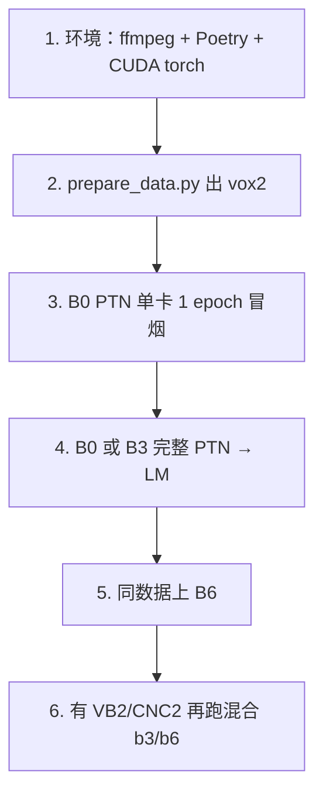

# 05 · 实验配方与复现指南

上一篇：[训练流程](04-训练流程.md) · 下一篇：[术语表与 FAQ](06-glossary-faq.md)

---

## 1. 两条实验线

| 目录 | 训练数据 | 配方型号 | 适合谁 |
|------|----------|----------|--------|
| `examples/vox2/` | 仅 VoxCeleb2-dev | **B0–B6** 齐全 | 入门；方便和论文 Vox2 表对照数字 |
| `examples/vb2_vox2_cnc2/` | Vox2 + VoxBlink2 + CN-Celeb2 | **B3 / B6** | 大规模混合、冲跨数据集指标 |

验证集两边通常都是 **VoxCeleb1-O**（`veri_test2.txt`）。

混合数据说话人加命名空间前缀，避免 ID 撞车：

- `A_` = VoxCeleb2  
- `B_` = VoxBlink2  
- `C_` = CN-Celeb2  

---

## 2. 路径 A：VoxCeleb2 端到端

脚本：`applications/speaker_rec/examples/vox2/scripts/prepare_data.py`

阶段默认：`download → extract → convert → lists`（最后一步 `lists` 是写 `data.list`、`utt2spk` 等训练用样本清单；**不含** `lmdb`；可重跑，带缓存标记）。  
当前配方增强直接读 `raw/` 下 wav 目录（配置键 `dataset_dir`）。只有还想用旧版 LMDB 增强时，再显式加 `--stages lmdb`。

### 全量准备（需网络与磁盘）

```bash
export HF_TOKEN=...   # 若走 HuggingFace 镜像下载
python applications/speaker_rec/examples/vox2/scripts/prepare_data.py \
  --data-root /data/wespeaker_data
```

### 已有压缩包 / 已解压目录

用 `--vox2-archive`、`--vox1-test-archive`、`--musan-archive`、`--rirs-archive`，或对应的 `--*-source`，并指定 `--stages`。

### 期望目录结构

```text
/data/wespeaker_data/
├── vox1-test/{wav/, veri_test2.txt}
├── vox2_dev/{wav/, data.list, utt2spk, spk2utt, wav.scp}
├── raw/musan/{music,noise,speech}/
├── raw/rirs/simulated_rirs/   # 或 extract 产出的 raw/RIRS_NOISES/simulated_rirs
└── {musan,rirs}/wav.scp
```

规模量级（脚本会校验；子集调试可 `--allow-incomplete`）：

| 集合 | 约计量 |
|------|--------|
| Vox2-dev | 1,092,009 句 / 5,994 说话人 |
| Vox1-test WAV / trials | 4,874 / 37,611 |
| MUSAN / RIRS(sim) | 2,016 / 60,000 |

AAC/M4A → 16 kHz mono WAV 依赖系统 **`ffmpeg`**。

---

## 3. 路径 B：混合数据（只生成样本清单、不下载音频）

前置：vox2 侧的样本清单与 wav 已就绪；CN-Celeb2、VoxBlink2 的音频需自行准备好：

- **CN-Celeb2**：OpenSLR-82，布局如 `.../CN-Celeb2_flac/data/<spk>/<utt>.flac`  
- **VoxBlink2**：需申请；布局如 `.../audio/<spk>/.../*.wav`（本例无下载脚本）

### 主训练（PTN）用的样本清单

```bash
applications/speaker_rec/examples/vb2_vox2_cnc2/scripts/prepare_vox2_vb2_cnc2_data.sh \
  --vox2-list /data/wespeaker_data/vox2_dev \
  --vb2-root /data/voxblink2 \
  --cnc2-root /data/cnceleb2 \
  --output-root /data/wespeaker_data/vox2_vb2_cnc2_v0
```

内部：`gen_datalists.py` → `join_datalists.py` → `mix_join/`。

### 大间隔微调（LM）用的样本清单（按时长过滤）

```bash
applications/speaker_rec/examples/vb2_vox2_cnc2/scripts/prepare_vox2_vb2_cnc2_lm_data.sh \
  --vox2-list /data/wespeaker_data/vox2_dev \
  --vb2-list /data/wespeaker_data/vox2_vb2_cnc2_v0/vb2_full \
  --cnc2-list /data/wespeaker_data/vox2_vb2_cnc2_v0/cnc2_full \
  --output-root /data/wespeaker_data/vox2_vb2_cnc2_v0 \
  --min-duration 5.0
```

内部：`infer_durations_sf.py` → `filter_datalist_by_duration.py` → `mix_join_lm/`。  
依赖：`pyarrow`、`soundfile`。注释中说话人量级约 PTN 11.9 万 / LM 过滤后约 11.5 万（以你生成结果为准）。

---

## 4. 启动训练

### 环境

```bash
cd applications/speaker_rec
poetry install --no-root
# 按机器安装匹配的 torch / torchaudio
```

### 推荐：本地 overlay

```yaml
# /tmp/vox2-b0-local.yaml 示例字段（按你机器改路径）
train_data: /data/wespeaker_data/vox2_dev/data.list
train_label: /data/wespeaker_data/vox2_dev/utt2spk
validation:
  vox1: /data/wespeaker_data/vox1-test
exp_dir: exp/vox2/b0_ptn
# 当前配方用 Sequential 增强树 + raw 下 dataset_dir 读 wav，不必再打 LMDB / 开 lmdb_to_ram。
# 若路径与默认不同，整段覆盖 dataset_args.aug_setup（见 vox2 README）。
```

改增强路径时，**整段带上 `aug_setup`**（列表是整段替换，只改一半容易指到旧 MUSAN）。

### 命令

```bash
# 仓库根
./applications/speaker_rec/launch.sh \
  applications/speaker_rec/examples/vox2/recipes/redimnet2/b0/ptn.yaml \
  8 \
  --config_overrides /tmp/vox2-b0-local.yaml
```

冒烟（单卡 1 epoch）：

```bash
./applications/speaker_rec/launch.sh \
  applications/speaker_rec/examples/vox2/recipes/redimnet2/b0/ptn.yaml \
  1 \
  --config_overrides /tmp/vox2-b0-local.yaml \
  --num_epochs 1 \
  --exp_dir exp/vox2/smoke
```

PTN 跑完后，把 `lm.yaml` 的 `model_ckpt` 指到对应 `model_*.pt`，并保证能读到 PTN 旁的 `spk2id.json`，再启 LM。

---

## 5. B0–B6 配方差异（vox2）

共同习惯：`ReDimNet2Custom`、`block_1d_type: conv+att`、`embed_dim: 192`、`F: 72`、SphereFace2；PTN 约 120 epoch，LM 约 5 epoch。

| 变体 | `C` | PTN batch（配方内） | 备注 |
|------|-----|---------------------|------|
| b0 | 12 | 较大（如 512） | 冒烟首选 |
| b1 | 16 | 中 | |
| b2 | 20 | 中 | |
| b3 | 24 | 中 | 常用甜点；可用默认 `stages_setup` |
| b4 | 32 | 偏小 | |
| b5 | 48 | 更小 | `out_channels: 256` |
| b6 | 64 | 更小 | 最深最宽 |

**模型越大，单卡 batch 往往越小**——改 GPU 数或显存时先调 `batch_size`，再看是否 OOM。

混合实验额外差异：增强树、Plateau+Warmup 调度、MUSAN/RIRS 均从 raw 目录经 `dataset_dir` 读 wav（不必再用 LMDB）、LM 常仅 1 epoch、`num_frms: 500`。b6 LM 注释里的 checkpoint 轮次（如 `model_115.pt`）请按你实际 PTN 结果改。

---

## 6. 官方预训练权重（免训练）

不复现训练时，直接 hub 加载即可。权重托管在 GitHub Release `v1.0.0`，命名：

```text
{b0–b6}-{dataset}-{ptn|lm|dis}.pt
```

数据集字符串：`vox2`、`vb2+vox2_v0`、`vb2+vox2+cnc2_v0`。完整链接表见根目录 [README.md](../README.md#model-zoo)。

---

## 7. 推荐复现阶梯



**最短冒烟步骤**：先跑完数据准备；用 overlay YAML 改好本机路径；再开 `b0/ptn.yaml` 单卡训 1 个 epoch；最后打开 `val_log.csv`，确认已经写出等错误率（EER）。

---

## 8. 常见坑（按出现频率）

**vox2**

- HF 下载失败 → 准备本地 archive/source，跳过 download。  
- Vox2 缺卷导致计数断言失败。  
- 若你显式跑了可选的 `--stages lmdb` 且中途中断 → 用 `--stages lmdb --rebuild-lmdb` 重建。  
- Vox1 缺 `veri_test2.txt` 或 trial 引用文件缺失。  
- LM 找不到 PTN 的 `spk2id.json`。  
- 想干净重跑却仍自动 resume → 换新的空 `exp_dir`。

**混合数据**

- 未先生成 vox2 的 `data.list` / `utt2spk`。  
- VB2/CNC2 目录层级不对。  
- 缺 `pyarrow` / `soundfile`。  
- 过期的 `durations.parquet` → 删掉后重跑大间隔微调那条脚本。  
- 已存在的 `mix_join*/data.list` 会跳过重建（要删掉才会重新生成）。  
- overlay 只改了一半路径，增强仍指向旧数据。

---

## 9. 指标预期

- 根 README 的表格是 **论文/官方发布结果**（清洗协议等设置以论文为准）。  
- 本地训练脚本每个 epoch 报的是 **Vox1-O 等错误率（EER）**，方便盯收敛；若要和论文全表逐项比较，需按官方评估设定再测一遍。  
- 两个 examples 的 README **本身不重复贴目标数字**；以根 README 与论文为准。

## 10. 本仓库已做的官方权重复现

若你只想核对「下载的 `.pt` 与 README 数字差多少」，直接读：

- 入口与结论：[checkpoints/reports/README.md](../checkpoints/reports/README.md)
- 背景与「我们的数减去官方的数」怎么读：[01-背景与评测说明](../checkpoints/reports/01-背景与评测说明.md)
- Vox1 全表：[02-VoxCeleb1结果](../checkpoints/reports/02-VoxCeleb1结果.md)
- 训练集之外的试验：[03-域外试验结果](../checkpoints/reports/03-域外试验结果.md)
- 数据路径与命令：[04-数据与复现步骤](../checkpoints/reports/04-数据与复现步骤.md)

已测范围内（不含 SITW）与官方表接近；具体差多少见上述报告与 `checkpoints/eval_*.csv`。

更多名词与答疑：[06 术语表与 FAQ](06-glossary-faq.md)。
