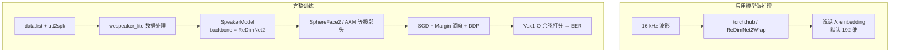
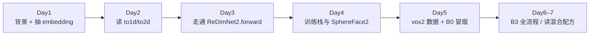

# ReDimNet2 中文导读

> 面向入门研究生的中文文档体系。根目录 [README.md](../README.md) 保持英文官方说明；这里用平实中文把「做什么 → 怎么想 → 代码在哪 → 怎么训 → 怎么复现」串起来。

**论文**：[ReDimNet2: Scaling Speaker Verification via Time-Pooled Dimension Reshaping](https://arxiv.org/abs/2603.11841)（Interspeech 2026）  
先看这里：把语音变成固定长度的「说话人指纹」（embedding），并在精度与算力之间走出更好的 Pareto 曲线。

---

## 你将学到什么

| 问题 | 答案在哪 |
|------|----------|
| 说话人验证是什么？为何需要专门网络？ | [01 背景与动机](01-background.md) |
| ReDimNet2 比普通 CNN 多了什么？ | [02 网络结构](02-architecture.md) |
| 仓库里每个文件对应什么概念？ | [03 代码地图](03-code-walkthrough.md) |
| 数据怎么进模型、loss 怎么算？ | [04 训练流程](04-训练流程.md) |
| 如何准备数据、跑 B0→B6？ | [05 实验配方与复现](05-recipes-and-repro.md) |
| **本机数据在哪、开训前要处理什么？** | [05 第 2 节](05-recipes-and-repro.md) 与 [07 本机数据与开训前检查](07-本机数据与开训检查.md) |
| EER、PTN、LM、ASTP 是什么？ | [06 术语表与 FAQ](06-glossary-faq.md) |
| 想让一批里各句长度不同、少补点零？ | [08 变长训练与长度分桶](08-变长训练与长度分桶.md) |
| 想让训练片段切在完整字词上、不切到静音？ | [09 用语音活动检测给音频加时间标注](09-VAD标注与RTTM.md) |
| 官方权重复现得怎样？EER 差多少？ | [评测报告入口](../checkpoints/reports/README.md) |

---

## 仓库鸟瞰

```text
redimnet2-fork/
├── redimnet2/                 # 模型本体（推理也可只用这一包）
│   ├── redimnet2.py           # ReDimNet2 + ReDimNet2Wrap
│   └── layers/                # 特征前端、2D/1D 块、注意力、池化
├── hubconf.py                 # torch.hub 入口
├── applications/speaker_rec/  # 训练栈（wespeaker_lite + examples 下的配方）
│   ├── wespeaker_lite/        # 数据 / 损失头 / 训练循环
│   └── examples/              # vox2、vb2_vox2_cnc2 配方
├── scripts/                   # 对官方预训练权重做复现评测的两个脚本
├── checkpoints/               # 官方权重、评测结果表、中文评测报告
├── assets/                    # 结构示意、Pareto 图
└── docs/                      # ← 你正在读的中文体系
```



---

## 5 分钟上手：抽 embedding

依赖（推理最小集）：`torch`、`torchaudio`、`scipy`、`numpy`。

```python
import torch
import torchaudio

# 默认：VoxCeleb2 上训好的 B6，large-margin 权重（推荐）
model = torch.hub.load(
    "PalabraAI/redimnet2", "redimnet2",
    model_name="b6", train_type="lm", pretrained=True,
)
model.eval()

waveform, sr = torchaudio.load("audio.wav")  # (channels, samples)
if sr != 16000:
    waveform = torchaudio.functional.resample(waveform, sr, 16000)
if waveform.size(0) > 1:
    waveform = waveform.mean(0, keepdim=True)

with torch.no_grad():
    emb = model(waveform)  # (1, embed_dim)，常见 embed_dim=192
```

常用旋钮：

| 参数 | 取值 | 含义 |
|------|------|------|
| `model_name` | `b0` … `b6` | 从小到大，参数量约 1.1M → 12.3M |
| `train_type` | `ptn` / `lm` / `dis` | 预训练 / 大间隔微调（推荐）/ 蒸馏（部分型号） |
| `dataset` | `vox2`（默认）、`vb2+vox2_v0`、`vb2+vox2+cnc2_v0` | 训练数据组合 |

完整模型表与指标见根目录英文 [README.md](../README.md#results)。

---

## 结果直觉（VoxCeleb2-dev 训练）

EER 越低越好。同一协议下，模型越大通常越准，但算力也上去：

| 型号 | 参数量 | GMACs | Vox1-O EER (%) |
|:----:|:------:|:-----:|:--------------:|
| B0 | 1.1M | 0.33 | 1.04 |
| B3 | 4.1M | 2.70 | 0.42 |
| B6 | 12.3M | 13.05 | 0.29 |

混合更大数据（VoxBlink2、CN-Celeb2）后，跨数据集表现通常更好。Pareto 曲线见图：[`assets/pareto.png`](../assets/pareto.png)。

---

## 建议学习路径（约一周）



| 天数 | 做什么 | 文档 |
|:----:|--------|------|
| 1 | 弄清任务与指标；用 hub 抽向量、算余弦相似度 | [01](01-background.md) |
| 2 | 理解「维度重塑」：`(B,C,F,T) ↔ (B,C·F,T)` | [02](02-architecture.md) |
| 3 | 对照代码：stem → stages → ASTP → Linear | [03](03-code-walkthrough.md) |
| 4 | 看 `train.py`、增强、投影头、PTN→LM | [04](04-训练流程.md) |
| 5 | 核对本机数据在哪、把 `/data` 路径问题解决掉 | [07](07-本机数据与开训检查.md) |
| 5 | 跑 `prepare_data.py` + B0 单卡 1 epoch | [05](05-recipes-and-repro.md) |
| 6–7 | 完整 B3；有条件再看混合数据配方 | [05](05-recipes-and-repro.md)、[06](06-glossary-faq.md) |

> 第 5 天分两步：**先处理路径再做冒烟**。本机没有 `/data` 目录，不先解决这一步，
> 训练会在读样本清单时直接失败。详见 [07 本机数据与开训检查](07-本机数据与开训检查.md)。

---

## 设计哲学（先建立直觉）

传统说话人网络常在 **2D Mel 频谱图**上做卷积。ReDimNet 系列的核心想法是：

1. **同一特征两种看法**：看成 `(通道, 频率, 时间)` 的 2D 图，或看成 `(通道×频率, 时间)` 的 1D 序列。
2. **2D 擅长局部频时模式**；**1D + 注意力擅长长时上下文**。
3. ReDimNet2 进一步在 **1D 通路上对时间做池化**，算力降下来后，可以把通道开得更宽——于是「同样算力更准」或「同样精度更省」。

结构示意见：[`assets/scheme.png`](../assets/scheme.png)。细讲见 [02 网络结构](02-architecture.md)。

---

## 文档与代码的对应关系

| 文档 | 主要代码 |
|------|----------|
| 02 架构 | `redimnet2/redimnet2.py`, `layers/redim_structural.py`, `layers/blocks.py` |
| 03 代码地图 | `redimnet2/layers/*`, `hubconf.py`, `scripts/eval_*.py` |
| 04 训练 | `applications/speaker_rec/wespeaker_lite/**` |
| 05 复现 | `applications/speaker_rec/examples/**` |
| 07 本机数据 | `AGENTS.md` 第 3、6 节、`checkpoints/reports/05-训练数据检查.md` |
| 08 变长训练与长度分桶 | `wespeaker_lite/dataset/{dataset,processor}.py`、`utils/executor.py` |
| 评测报告 | `checkpoints/eval_*.csv`、`checkpoints/reports/**` |

---

## 引用

```bibtex
@inproceedings{redimnet2_2026,
  title={ReDimNet2: Scaling Speaker Verification via Time-Pooled Dimension Reshaping},
  author={Yakovlev, Ivan and Okhotnikov, Anton},
  booktitle={Proceedings of Interspeech 2026},
  year={2026},
  note={Accepted to Interspeech 2026},
  eprint={2603.11841},
  archivePrefix={arXiv},
  primaryClass={eess.AS},
  url={https://arxiv.org/abs/2603.11841}
}
```

许可证：MIT。英文官方说明以仓库根目录为准；若中英文表述冲突，以英文 README 与代码为准。
