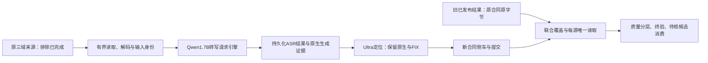

# 转写提速方案的反思、路线选择与执行优先级

本次在提交`7e3d535`之后重新做架构、交付和质量三方面审阅。用户最新要求仍是“GPU先不测了”，因此这里给出研究和规划结论，不运行GPU、不改现有任务，也不把任何路线称为已经实测最优。已有最新机器证据仍是10月27日11:22—11:34快照，本次没有刷新它。

## 推荐选择

对于剩余千万条来源，优先研究并准备的生产候选是：**保留Qwen3-ASR-1.7B，单卡一个高吞吐转写引擎，以BF16和有界请求批处理提高吞吐；八卡独立分配来源；Ultra先保留现有方法；ASR、定位与发布有独立持久化结果；旧已完成来源继续引用原producer，只处理真正缺失来源。**

官方vLLM路径是长期优先候选，不是本机已证明的最优参数。最近能以最少新增代码安排的实验，是已有legacy与BF16/SDPA对照；同参数两副本/卡是减少模型数值变化的另一条过渡候选，但它需要新资源组支持，工程改动比现有精度开关大。不要同时建设数套完整生产调度系统：先把统一接续、质量协议和一个候选的最小验证路径打通，兼容或收益不成立时再使用退路。

## 对此前工作的反思

此前交付22个文件、约2300行增补和713项CPU通过，解决了配置观察、计时、审计和剩余输入准备；它没有交付已验证的生产提速。测试通过数证明对应软件行为，不能说明GPU速度、文字或字界质量。后续汇报必须把准备完成、实际运行和性能收益分别说明。

转写占历史3000条两个进程累计时间的87.81%，Ultra占4.20%，主优化对象确实是转写。但只关注FP32/BF16、SDPA或“显存可放几份”，范围仍偏小；逐条自回归生成无法充分摊薄开销，批量请求调度应成为主候选。单窗约束源于批次敏感性证据，它保护了当时实验的可解释性，不应被永久当成所有后续架构只能单窗的理由。新批量架构需要独立质量和恢复协议，原有严格单窗协议保留原义。

显存静态可放4—5份，与最合适并发数不同；多份权重、CUDA上下文、调度和带宽竞争都有成本。约38%的GPU利用率也不是SM占用率，不提供100/38的加速上限。现程序每UUID一份，不能把32进程写成已支持。

目前更大的交付缺口是：剩余输入准备成功以后，联合全库准入、每源唯一读取和新旧结果终验还没有打通。只有新工具而没有这条实际接续路径，候选不能安全接全量。现有`audit_speed_comparison.py`同时要求工程和第三方源码不变、runtime只允许asr_compute变化，不能直接用来评价vLLM；跨引擎对照须另立协议，不放宽旧微配置检查。后续应先补它，再扩大候选参数数量。

同时，约七成来源标为unknown不能解释成七成字界错误。它混合来源级、窗口级、时间几何、库修补、读法等不同原因。只提高来源条数，未必提高真正可用于完整字实验的数据产量。

## 四种路线怎样排序

| 路线 | 适用目的 | 当前状态与主要代价 | 建议 |
|---|---|---|---|
| 现有Transformers单窗BF16/SDPA | 最少新增代码，识别数值计算是否有收益 | 代码和CPU反例已完成；实际速度及质量未测，SDPA旧默认可能已在内部使用 | 未来GPU验证恢复时先用小样本做有界对照 |
| 同参数两副本/卡 | 尽量少改变模型数值方式，提高请求并行 | 尚无多副本启动器；须做完整资源组、线程和显存预算，不保证加速 | 保留为过渡/退路，不直接开4份 |
| 官方vLLM+1.7B+BF16+请求批处理 | 剩余千万条的长期吞吐主候选 | 需新adapter、版本/权重兼容、原生输出及GPU子进程归属协议；尚未实测 | 优先准备最小可验证路径，不把现有backend简单替换一个函数 |
| 换0.6B、激进量化、同时更换定位器 | 新模型或数值方案的质量/速度再权衡 | 会同时增加多项质量变量，当前没有支持选型的本机证据 | 本轮不优先展开 |

Qwen官方提供`Qwen3ASRModel.LLM(...)`并推荐其vLLM路径，示例包含1.7B。因此它是有依据的研究优先级，仍需按固定本机版本验证。官方示例中的128批和较大生成上限不直接照抄到本任务；当前窗口、语种、生成长度分布与Ultra并存预算不同。[官方说明](https://github.com/QwenLM/Qwen3-ASR)

vLLM内存还包括KV缓存、工作区与图捕获等，不能把旧Transformers约14.23GiB整进程占用套给新引擎。`gpu_memory_utilization`是该实例对整卡的预算参数，应显式设置并给Ultra留预算，不能随便使用默认值后在同卡再加进程。[引擎参数](https://docs.vllm.ai/en/stable/configuration/engine_args/)

## 建议架构及边界

八卡优先按独立来源副本组织，每个转写引擎先按单卡TP=1规划。这里说的是8个独立请求引擎，不是8卡训练DDP，也不预设vLLM内置数据并行功能对当前ASR实现可用。1.7B的权重已能放进一张卡，不因机器有八卡就做TP=8。

ASR和FA先逻辑解耦并有独立结果，不能据旧4.2%占比直接固定“7张转写+1张定位”。旧阶段墙钟不是独立服务的饱和能力；ASR提速后FA占比会变化。第一版尽量少改物理配卡，是否同卡串行、同卡受控并行或专卡分工，待服务速率、显存与积压证据决定。

现有资源挑战针对单已知上下文，新引擎可能生成子进程。须保存并核实整组实际进程、nonce、UUID、共享锁FD、显存预算、异常清理和归还证据。不能靠删除“未知PID拒绝”支持多副本，也不能只证明控制父进程存在。没有真实CUDA上下文证据，本轮只做设计。

## 恢复、缓存与旧结果怎样保留

完整旧侧车不重算、不覆盖、不改producer。最终剩余输入须在真实旧writer终态与锁保护下得到，不从仍变化的运行中快照直接启动新任务。新旧覆盖互斥且并集等于固定原总分母；消费者按明确覆盖路由选择每源唯一结果，不按mtime、最新文件名或目录优先级猜。按producer、语域、长度分别审阅，防止处理顺序使引擎版本与数据域混杂。

现阶段缓存包含整份合同SHA，ASR配置变化会连带让同文字的FA缓存失效。下一版可定义独立阶段语义身份：ASR绑定PCM/窗口、模型/特征处理、引擎/数值方式、解码参数及声明的批次语义；FA绑定PCM、实际目标文字/语言、定位权重/代码/数值方式及原生处理规则。只有这些身份完全匹配且有兼容证据时才引用旧阶段结果。此为新设计，不能直接删旧cache键里的合同SHA或给旧结果贴新标签。

新vLLM adapter须保留原生输出token IDs、finish_reason、stop_reason、截断及解码参数，不能只拿最终文字替代现有EOS/截断证据。现有capture_generate期望Transformers tensor/input_ids，不能不加适配地套到vLLM的RequestOutput上。

对恢复分别验收：已经发布和持久化的结果字节不变、已发布来源不重复消费、缺失来源不漏、原始失败证据保留。崩溃前尚未持久化的在途计算可能有界重做，应准确记账。固定批次组合也有半组发布问题：移除已完成行会改批次，重跑整组会重复计算。因此先持久化完整阶段结果，再逐来源发布，不能声称仅固定batch就自动解决恢复。

跨引擎或动态批次的新计算不宜一律要求与旧引擎logits逐位相同。原单窗恢复审计继续保留严格要求；新协议将已发布结果的不变性、未发布重算的数值变化和真正质量非劣分开记录，不能把某一项替代另两项。

vLLM的batch-invariance仍为beta，其最新文档列NVIDIA计算能力8.0及以上，但已验证清单没有明确Qwen3-ASR。A800硬件条件不代表ASR已经被验证。默认可复现也有限制，不能只设seed或开一个环境变量就承诺本任务跨批次不变。[批次不变说明](https://docs.vllm.ai/en/stable/features/batch_invariance/)、[可复现边界](https://docs.vllm.ai/en/stable/usage/reproducibility/)

## 质量应怎样衡量

运行指标同时报来源/小时、音频小时/卡时、窗口/秒、实际新生成token/秒、冷启动与稳定段、峰值显存、CPU与存储耗时。候选单位数量和时长也要报，但明确它是机器候选，不是人工认证产量。质量另报人工抽检完整字合格率、文字错误、削首、削尾和邻字污染，并按域/长度/producer分层。不能拿candidate比例或GPU利用率作为总目标。

需要两种互补对照：一组固定同一份已核文字，检查定位计算与时钟差异；另一组允许各ASR输出自己的文字再定位，比较完整端到端效果。仅在“文字恰好相同”的子集中算边界差异会漏掉转写引起的污染，不能代替总体。以原件为基本统计单元，不能把同一来源生成的多个前缀当多个独立成功例；原件也未必统计独立，置信区间应考虑说话人和会话聚类。

建议先60条盲审排明显错误，再补三域分层随机约300来源；困难例另列，不拿困难例均值估整库。吞吐主批保留约3000条，但按真实待处理分布分层，并另补少数域/长音频诊断；均衡三域的诊断均值和按生产比例加权的均值分开。512恢复批继续检查真实中断和已有结果保留，不用长时间挂机替代问题覆盖。这些是拟议样本量，不是本轮已经执行或有统计精度保证的结果。

实际旧摘要的`timestamp_segment_ms=80`，原生类别转毫秒有80ms格点；库内FIX后的更细小数不自动增加真实边界精度。不要无依据要求或承诺所有字20ms/采样点级准确。用人工允许的边界区间及可听完整性判断，分别保存原生、FIX和最终单位。后续若定位精度成为主要问题，再据实研究声学细化，不能简单扩边以掩盖削首削尾，也不能均分粗词。

质量阈值、允许边界区间及统计口径应在查看候选结果前确定；人工分歧也要计账，不能在看到结果后放宽。没有真人修订的旧机器对照不能给完整字准确率。API只限已明确授权的少量诊断辅助，不用于全量训练/测试数据标注，也不能把API给的时间直接当人工真值。本轮没有发送音频或调用API。

## 有执行产物的优先级

| 优先级 | 完成什么 | 完成依据 |
|---|---|---|
| P0 | 冻结质量/吞吐评价协议、unknown原因表、原生输出适配需求 | 每个指标有分母和对照对象；不把0%软件failed当0%内容错误 |
| P0 | 联合覆盖准入、每源唯一消费者及全库终验方案 | 旧保留+新剩余互斥、精确全覆盖；旧SHA/字节不变；不修改原全量分母放行 |
| P1 | vLLM固定版本兼容性与最小adapter设计 | 原生token/终止原因、批次语义、资源子进程和预算都能说明；不先造完整服务集群 |
| P1 | 保存已有单窗BF16对照为低成本实验，双副本为退路 | 明确哪个方案减少新增代码、哪个减少模型数值变化，避免同时大改 |
| P2 | 用户允许GPU后，先小样本再选中候选的3000/512 | 速度、文字、字界和恢复证据完整；未完成不能提前写通过 |
| P3 | 最终旧writer交接、固定剩余输入、唯一八卡新任务 | 实际8卡/进程、挂载、日志、覆盖和首批发布回读；PTN排除在修改范围 |

下一轮实现应交付具体程序接口，以下名称和schema均为拟议，尚不存在这些运行能力：

- `union_coverage.py`与`annotation-union-coverage/v1`：绑定原全量index/SHA/总数、原producer与新producer、旧完成片及部分已发布来源、新剩余index和明确的每源选择规则。提供`validate_union()`及`resolve_source(source_id)`，消费者不依赖mtime。CPU反例覆盖重叠、漏项、同ID不同原记录、篡改producer、旧字节变化和未完成发布；终验须按各producer真实格式核提交与总覆盖。
- `audit_engine_comparison.py`与`annotation-engine-comparison/v1`：固定权重、PCM/窗口、提示文字/语言政策、解码上限及质量规则，显式声明可变backend/engine源码/precision/batch调度。跨引擎native格式分别保存，文字和同target边界可比项明确，不能默认所有native字段都跨引擎等价。反例覆盖改窗口、偷改生成上限、丢失败源、只挑相同文字和复用假装新推理。
- `vllm_backend.py`的最小适配接口：输入有唯一request/source/window身份，输出保留原生token、实际终止原因、语言/文字及完整配置引用。CPU假引擎覆盖缺结束信息、截断、错序、重复request、缺输出、未知语言和恢复缓存；假引擎成功不算真实vLLM兼容。
- 只有选择多副本或子进程架构时才扩展资源组：真实全卡锁持有关系、每个模型进程和nonce、总显存/线程预算、失败清理及归还。CPU反例覆盖未登记子进程、部分启动失败、旧writer仍活跃和孤儿上下文，真实CUDA证明另取。

有限验证会让选定的小批音频由基线和候选分别计算，用于公平比较并单独计账；正式全量的已有发布结果继续保留，不随新引擎重跑。不能把少量对照开销隐入全量已完成进度。

当前GPU暂停阶段只做P0和P1的研究、接口及CPU可验证准备；本次文档不自动开始实施未请求的新系统。不设置无证据的上线日期或加速承诺。进一步开发以这份优先级为准，停止继续堆无目标开关。

建议把“值得切换”的初始工程目标定为端到端至少1.5倍且在预先约定的分层质量检验中满足非劣要求，属于可调整的决策门槛，不是预计必达。最终选择还要比较节省的剩余工期、部署时间及恢复风险；质量更好的较小提速也应明确权衡，不机械按阈值淘汰。

以旧3000条阶段比例作数学情景：若只有ASR阶段变快2/4/8倍、其他时间不变，整体约快1.78/2.93/4.32倍；从10月27日11:22的17.33天条件基线换算约9.72/5.92/4.01天。这个串行比例模型不是新引擎预测，新增批处理或阶段解耦后比例需重新测量。Ultra耗时即降为0，按旧比例整体也只约快4.4%，所以本轮不优先重选定位器。

最终仍需用后续完整字长度交叉声纹评测衡量标注价值：转写更快、文字错误更低或候选更多，都不自动代表短语音声纹更准。官方模型完整字微调与PTN复现接续继续分开，来源、说话人、会话、用途隔离和人工边界资格保留。这里不启动这些训练或评测。

## 本次review结论和边界

三方面审阅一致认为：现有工具有必要，但尚没有实测提速结论；多副本不是凭显存即可选择的最优解；长期应优先评估共享请求引擎；接续联合覆盖和质量定义比继续加参数更紧迫。本次没有新代码变更，没有重新运行713项行为测试，没有机器实测或新任务提交；原测试仍只说明`7e3d535`中对应软件行为。只对新增文档、链接、来源和数字做复核。

研究笔记与复算留在本机`.audit-local/strategy-review-20261027/`。这份规划与项目skill同步、按nanless提交推送；不会重封旧GPU或旧报告证据。
