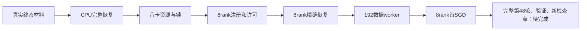

# PTN启动时效修复与八卡接续巡检

2026年10月26日07:38开始重新检查。前次任务没有进入训练：它排队后取得资源时，旧任务的终态观察已超过一小时有效期，启动入口等待30分钟后退出。本轮保留平台全部36条原始日志、旧control字节及元数据，重新核实两个旧训练任务终态，完成更新工具独立审查和实际CPU恢复复验，再提交唯一后继。后继`t-20261026074833-ctjsk`于07:48:57启动；正式训练验收与最新进度在下文按实际原件分别记录，不能只由平台“运行中”推断。

## 前次失败究竟发生在哪里

| 事件 | 北京时间 | 依据 |
|---|---|---|
| 原任务提交 | 02:58:49 | `t-20261026025849-jvhrd`详情 |
| 容器实例开始 | 05:17:01 | 平台worker_0 |
| 等待新鲜终态材料 | 05:17:02.646 | 原日志`WAITING_FRESH_TERMINAL`，原因为`terminal evidence stale/future` |
| 等待1800秒耗尽 | 05:47:02.650 | 原Traceback：`fresh terminal evidence wait exhausted; no CUDA launched` |
| 实例结束 | 05:47:17 | 平台worker_0终态为失败 |

控制文件中的真实观察分别为02:53:12.599和02:54:01.082。到第一条等待日志时，已分别旧8630.047秒和8581.564秒，超过3600秒上限。日志中原包清单与合同SHA检查均通过，异常出在`predecessor_gate.wait_for_terminal`；程序顺序在挂载验收、训练锁、CPU模型构造、CUDA和torchrun之前。共享存储的新run从未创建，八个训练进程、192个数据读取进程、首优化步、新检查点均不存在。这不是旧48轮NaN再次发生，也不是训练后检查点丢失。

平台日志导出覆盖该任务起止范围、stdout和stderr的全部36条，JSON压缩原件SHA256为`edd53db9b4fd3d5f76ae1b25a1dbd6c403e0025295eaabff005c6387058ad909`。原始带平台字段文件及可读内容保存在仓库私有证据目录，不把截图推测替代完整异常。失效证明和失败任务记录均保留。

## 本轮怎样修复

原1—35任务`t-20261019232824-8zqrl`仍为已停止、节点待下线；36—47任务`t-20261024154424-vggvm`仍为失败。重新从真实控制台核单worker终态、零活动实例和结束时间，新的观察为07:41:43.326及07:42:13.167。前次启动尝试jvhrd也重新核实为失败，且新run仍未认领；不是只看输出目录不存在就宣称没有并发启动者。

新增仓库维护入口[`refresh_terminal_refs.py`](../../tools/ptn_resume/refresh_terminal_refs.py)，说明见[终态观察刷新](../../tools/ptn_resume/终态观察刷新.md)。默认只封存、校验，不改规范文件。显式执行前先在新外部审计目录保存两份旧原字节、SHA及元数据并同步到盘，再校验带固定任务、run、状态和SHA的新材料。每个文件临时写完并同步后，在实际替换之前再次核新run未创建、两文件代次未漂移，才原子替换该文件。不是双文件事务，部分写入如实保留；不自动重写`observed_utc`，不拿训练锁，不授予运行许可。

六项测试和三个独立文件系统故障注入通过；另有四项真实运行层的纯CPU反例，证明过期材料有限等待后拒绝，真实新引用替换后可通过，错误任务、未来时间、伪布尔worker数、坏SHA及变更引用都拒绝。原合同在排队后旧两小时而新引用可通过的测试及实际接线测试也重新运行，确认没有另一处隐藏地继续要求旧静态时间。

真实dry-run确认两control原字节及已记录的inode、大小、mtime、ctime均未变。正式刷新在封存原件后执行，结果只更换两个规范引用，输入观察时间保持原样。冻结candidate3、190份模型源码、model47、有效期、等待上限、学习率、AMP、数据与批量均未修改。

随后实际调用原candidate3的`launch.sh --preflight-only`：6.813秒完成CPU完整恢复，823项模型状态、584项SGD动量、585参数顺序与scaler精确一致，绝对迭代705047、学习率0.72、margin0.2；实际证明绑定的是这次新鲜引用。没有模型前向、更新、CUDA初始化或新run创建。

## 唯一后继任务

[任务详情](https://console.volcengine.com/ml-platform/region:ml-platform+cn-beijing/customTask/detail?Id=t-20261026074833-ctjsk&tabState=TaskInfo)：`redimnet2-b6-ptn-r47-capture-8a800-p6-20261026-v2`，ID`t-20261026074833-ctjsk`。精确名称查询无结果后只点击一次提交，回读新ID；没有自动重复提交，没有停止或迁移任何现有任务。

实际表单及详情确认：优先级6，PyTorchDDP，worker一台、8×A800-SXM4-80GB，原4.0镜像，720小时、自动重试关闭；`/root`读写，`/shared/group-shared`只读。同candidate3整包SHA为`bc55c1f8fc8e55a951fc4a4ac95f941a2cc6c0c4447a500c85f9ba9f9b0a8ac2`，合同为`80fc717ed941161706dea4c3c91fc5217f0097033d87da9b13d4f1a7df867293`，与失败启动尝试相同。复用的是尚未认领的独立新run，旧两段训练目录和锁没有删除或改名。

## 八个训练进程与192个数据读取进程

两份独立读取均确认：8份`worker_ready`、8份CUDA许可引用、8份精确恢复证明、8份首前向时钟和8份首实际优化证明都齐全。恢复证明绑定同一model47、同一合同/新包及47→48轮；823模型状态、584动量、585参数顺序与scaler逐项一致，恢复scale为131072、增长计数1840，学习率0.72、margin0.2。不是把同一份rank0结果复制为8份。

8个rank首次实际SGD更新均为第48轮、绝对迭代705047，北京时间07:51:27.814315—07:51:27.814567。`first_iteration`另行证明首前向也从705047开始；没有把GradScaler尝试调用或可能跳过的更新当作真实SGD。这次首步没有因AMP跳步而推迟到后一个迭代。

八份数据读取门中的全局收集内容完全一致，每rank24份子进程原件，共192个全局唯一PID。逐文件核SHA与对应门的引用，核rank、worker_id、父PID、实际分布式rank/world8、fork上下文、sampler继承rank/world及partition/epoch48、原始seed函数调用和legacy增强均正确。子进程没有自行做GPU操作或跨rank通信。文件证明说明当时实际初始化成功；该证明与下节真实容器的`/proc`存活检查分别记录，不能拿文件存在代替持续存活。

## 真实云容器的存活进程与八卡

在平台WebShell中先实际执行`hostname`，确认处于`t-20261026074833-ctjsk-worker-0`真实训练容器，而不是开发机。随后运行同SHA冻结的[实时只读核验器](../../tools/ptn_resume/live_process_probe.py)，08:01:14完成。实际读取父入口、8个已注册rank及192个已注册数据进程的`/proc`，核PID/PPID/进程组/会话/启动时钟、8rank必要环境、设备锁FD及inode；200个训练/数据PID全局唯一。每个PID前后两读均存活且身份稳定，正常R/S/D调度状态变化没有误判为PID变更。

同时核实际合同、包索引与核心状态检查器的小文件SHA，逐项绑定8份恢复证明和192份worker原件及门引用。只读201个已知PID，不枚举全机进程或无关环境，只读取8rank的必要环境键；不导入Torch、不建立CUDA上下文、不拿锁、不向训练进程发信号，不写现run文件。进程代次、退出或切换轮次导致证据不全时，结果是待确定并重新取样，不能据此自动停止训练。

| GPU编号 | 实际显存MiB | 08:01利用率 |
|---|---:|---:|
| 0 | 55260 | 89% |
| 1 | 55356 | 87% |
| 2 | 55356 | 84% |
| 3 | 55356 | 91% |
| 4 | 55356 | 89% |
| 5 | 55356 | 92% |
| 6 | 55356 | 92% |
| 7 | 55260 | 90% |

8卡均为81920MiB，当前使用约54GiB/卡，UUID顺序与实际启动准入一致。NVML的compute PID原样保存，没有猜成容器PID；容器内的进程身份由`/proc`独立验证。采集结果已在本机由另一份审阅逐字段核对，原JSON、文件摘要及来源保留于私有审计目录。此核验只证明采样时段的身份和活动，不是永久健康或声学质量证明。

## 最新检查点与异常范围

本轮开始不久时，新任务的`models`目录尚无完整model48，验证CSV也尚未产生，这是第48轮训练尚未完成的正常状态。最新可安全恢复的完整保存仍是前驱的`model_47.pt`，650777251字节，SHA256为`91c1b76ac9d867286a860011a4912b4316d4d987dc30316329d84dc699235e95`；真实CPU准入及八rank都严格恢复了它。

新包190份模型源码、206个被声明成员及额外索引本体的实际集合、约3.18MB逐文件SHA均核对通过，没有新增或缺失成员；整包身份仍是bc55开头的原candidate3，没有在正在训练的目录内修补代码。已读取的日志尾部未出现新的Traceback、读音频失败或非有限值故障。尾部检查不能证明未来不会再出现旧48轮数值问题；原NaN首坏算子仍未确定，完整取证门仍保留。

刚启动的首批耗时含构造和数据预取，不能把tqdm初始130小时等估计当全程剩余时间。主训练正执行第48—120轮，每轮15001个批次；应在实际稳定窗口统计单位批次时间，再加每轮验证和保存开销估计。这里没有等待整个第48轮结束，也不把首优化步成功写成完整轮次或新检查点已经验收。

08:05:17的轻快照已到第48轮1316/15001批。最近1300批的rank0训练表为学习率0.72、margin0.2、Loss5.6051、Acc27.829%。源码每16批将一次loss/分类结果加入本轮累计统计，所以这些值是累计抽样训练指标，不是第1300批单独损失、验证等错误率或短完整字质量。该表沿用WARNING日志级别打印，不能把正常训练表算成异常。

两次后热身窗口由516推进至1316批，日志时间差512.048秒，实际约1.56235批/秒。按同速度纯训练外推，48—120轮还剩1093757批，约194.46小时（8.10天）；当前48轮余下纯训练约2.43小时。窗口只有8分32秒，验证、保存和资源/数值异常都未计入，不能当固定完成时间。末次状态与是否越过旧1773批位置另按交付时新读记录，越过该数字也不能宣称旧故障的同一输入/RNG已经重放通过。

## 标注任务独立状态

正式标注`t-20261025054739-4kzhp`继续原54cd冻结包。07:44:23完成下界366810/11521178（3.184%）、1463个完成片和8个在途租约；109086候选、257724待复核、0发布失败。03:17:04.788951至本次快照增加112707条，16038.275秒窗口约7.0274条/秒、25299条/小时。若这一长期窗口速度保持，剩余11154368条约需18.37天；这是自动发布阶段的条件估计，不含最终全量回读、人工质量审阅、任务调度或性能变化。

两个新快照之间208.134秒又增加1759条、7片。7个worker已提交新片，另一个虽仍处理原片，但日志和GPU活动都新鲜，不能据此判停滞。8个租约均为第一代，PID、随机标识、UUID与资源证明及最新云端监控对应；末点八卡利用率约34%—44%，显存13851—14383MiB。这里只从开发机读取共享盘上的云任务监控，没有把开发机GPU当成标注八卡。

各worker末2MiB日志没有匹配到明确的fatal、FLAC/解码、CUDA或NCCL故障模式；不是全历史日志或全侧车质量证明。待复核占约70.26%，机器候选、未知和0发布失败都不能自动授予训练/评测资格。本轮未修改标注队列、租约或正在运行的程序。

## 测试、版本和后续未验事项

本轮全仓651项CPU测试全部通过、0跳过、0预期失败；静态检查覆盖411个维护文件，Python、Shell、JSON和本地文档链接均通过。新工具分别完成独立复审：终态刷新6项、运行层等待4项、实时进程核验8项，并另有文件发布顺序、代次漂移、已知PID范围及小文件SHA反例。CPU结果、实际模型恢复、真实云容器进程读取分别保留证据，不相互冒充。

代码、测试和中文操作说明维护在本仓库；部署副本独立版本化，原candidate3及原模型、原训练配置不变。实际平台日志、前后control、CPU恢复输出、8rank/192worker、实时进程及NVML原JSON、日志窗口和逐文件SHA均保留在仓库私有审计目录，不提交原业务音频或完整现场日志。

仍需等待完整第48轮的15001批、验证记录及新完整检查点，并按保存后实际SHA、epoch/model/optimizer/scaler与有限性复核。主训练到120轮后，进入LM仍需三段训练记录及新鲜终态，不自动调用旧两段入口。旧NaN根因尚未确定，后续若再出现非有限值，按原完整取证门保存并停止，不跳批、不擅改精度或学习率。

暂停的变长微调后台跟进未恢复，本轮没有新建后台调度；此次已持续核到实际准入、192worker及首SGD，而不是停在排队状态。启动准入完成后，依靠该run的稳定锁和已核身份继续训练；不要向已经创建的run再运行终态刷新工具。临时屏幕保活按此前要求保留。

## 交付前末次状态（08:10—08:12）

08:10:52的只读快照显示第48轮已到1859/15001批，越过原失败段同轮1773批的位置；最近1850批表中学习率0.72、margin0.2、累计抽样Loss5.6534、Acc27.264%，1775批也有实际训练表。末64KiB日志未出现新的Traceback、非有限、读取失败或NCCL错误。越过批次数字只证明这条新轨迹继续推进，不能说旧故障的同一音频/增强/RNG重现成功，更不能宣布NaN根因解决。

较长窗口从516到1859批，846.708秒实际增加1343批，约1.58614批/秒。余1093214批按恒速纯训练外推约191.45小时，即7.98天；当前48轮余纯训练约2.30小时，验证、存盘和中断另外计算。此时新models目录仍无完整model48、验证CSV仍未创建，最新完整模型仍是前驱model47，符合本轮尚未完成的状态。

08:12:21标注完成下界已到377861/11521178（3.280%）、1507片完成、8片在途；112368候选、265493待复核、0发布失败。相比07:44增加11051条，约23700条/小时；对03:17精确基线的较长窗口约25147条/小时。剩11143317条按两窗口恒速条件外推约18.46—19.59天，仍不是保证完成日期或质量验收时间。八worker日志mtime均为08:12:15—21，最新八卡利用率34%—50%、显存13851—14383MiB，任务仍在推进。本次末快照没有重复整段错误扫描，前述错误扫描的时间和范围不扩写为08:12全历史无错。

本轮只修复启动材料的衔接和可复用核验工具，保持已运行PTN与标注的冻结源码、配置、锁和队列不变。全部改动以nanless身份在本仓库提交并推送，项目技能源随后从已提交字节同步；实际提交与安装摘要另保留于私有交付收据。没有把后台调度自动恢复，也没有再创建第二个运行中的后继。
