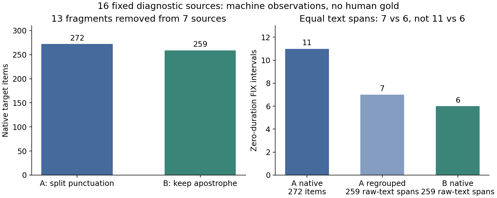

# 标注源时钟与词内撇号的有限检查

维护代码的源时钟错误已经修正，原有待复核规则没有放宽。新文字条件已完成固定16源两卡真实对照，但不能据此把自动边界改成训练或正式评测的可用标签。正在运行的旧冻结标注任务和主训练任务均未修改。

## 观察了什么

本次只读第一完成片的前16条已封存侧车，以及对应的分片提交记录、生产合同和源码。它们是偏向固定前缀的样本，包含13条VoxBlink2和3条VoxCeleb2，没有CN-Celeb2。不能据此估计全库准确率或三域总体的待复核原因比例；没有人工听审或完整字金标。

16条源有272个原生词时间对。原始分类结果有7个零长、2个负长词对和11组相邻重叠；库的FIX处理后有11个零长、0个负长和0组相邻重叠。7个窗口的时间被FIX修改。因此，最终零长不能一概写成原始分类直接预测的零长。11条`invalid_native_geometry`记录来自5条源，也不表示11条源发生程序崩溃。

按互斥主因计数：4条是机器候选；5条有FIX最终零长；1条同时有浮点换算假重叠和独立的库修补；3条只有修补待核；3条只有文字读法待核。源时钟修复后仍为4条候选、12条待复核，因为假重叠的那条源仍有独立修补理由。

本次重新核了原侧车字节摘要、长度、来源编号、来源绑定的任务键和分片记录，重新检查了记录内部的目标词序、重复序号、时间槽位置、类别范围、类别与毫秒的关系、FIX前后及最终返回的绑定。正常推理只保存时间槽张量的摘要，没有完整张量原字节，因此没有独立重算其argmax或张量摘要；最初这16份旧侧车的旧单源提交文件没有取得，不能声称旧提交字节已逐项回读；后续新A/B的32份单源提交文件已经取得并重新打开核对，见下一节。这些限制与模型边界是否声学准确是不同问题。

## 已修正的错误

原先直接计算`floor(float秒 × 原采样率)`和`ceil(float秒 × 原采样率)`。即使两个词共享同一十进制端点，二进制浮点乘法也可能略小于整数。例如16.24秒在16kHz中恰是259840采样点，旧运算却可能把后一词的起点向下取成259839，制造一个采样点的重叠。

`tools/open_annotation/source_clock.py`使用`Fraction(str(seconds))`表达作者已经保存的十进制秒，再向下取起点、向上取终点。新窗口声明`source_offset_decimal_floor_start_ceil_end_v2`，并与生产合同中的`runtime.boundary_mapping`强绑定。没有增加epsilon、裁剪、平移或拉伸，raw/FIX及作者最终时间仍原样保留。

真正的交叠仍拒绝。例如44.1kHz下1毫秒为44.1个采样点，保守整数覆盖确实会让相接时间的两个区间共享一个采样点；这仍保留待核，不能用“一采样点容差”全部抹去。旧VAD的v1映射完全不变；旧侧车继续按自己声明的v1公式验证，不改坐标或重写冻结合同冒充同版本。

## 为什么另设文字条件

固定的官方Qwen分词源码明确保留ASCII撇号。纯CPU调用其实际分词函数可见，合成例子`I'm`是一个目标词，而旧规范化先变成`I m`后会成为两个目标词。合法输入形式不证明转写正确，但这一差异可以独立测试，不能仅靠删待核标记处理。

默认旧条件仍为`nfkc_punctuation_to_space_whitespace_collapse/v1`。新增显式条件`nfkc_preserve_ascii_word_apostrophe_punctuation_space/v2`只保留两边都是字母的ASCII词内撇号。弯撇号不猜成ASCII，数字读法不扩展；兼容字符经NFKC变成ASCII撇号后，新条件仍保留待核标记。原ASR文字、中间变换和字符映射均保留，`word_internal_apostrophe_requires_review`也保留。schema依据生产合同的显式条件重建审计，侧车不能自行选更宽的规则。

官方分词器接受数字，不等于已知它在原声中如何发音或应计几个完整词。数字、小数分隔符和其他既有读法未决项仍待复核。新条件未授予训练或正式评测资格。

## 两轨真实执行与逐源结果

两轨已经由维护者在独立两卡资源检查通过后顺序执行，均正常退出、完成16源全侧车回读及资源归还。本轮分析器只读取已下载证据，没有再次使用GPU、媒体或API。A的资源记录时段为北京时间2026年10月26日02:36:41—02:37:48，B为02:38:51—02:39:50。源码包和两份合同是此前冻结的v3；之后维护仓库的导入方式修正不改这些历史文件。

两轨各8源分给两个工作进程，合计16源、16窗、81.616秒连续原声。32份新侧车与单源提交标记、分片提交、队列完成槽、worker摘要及父进程摘要互相绑定；来源字段和编码/完整PCM/模型输入摘要与原件一致。每轨16个ASR缓存实际命中，原raw、语言、生成token与EOS等native字段逐项不变；ASR新调用为0，强制对齐缓存命中为0，各有16次真实单窗强制对齐，API为0。七阶段资源证明、summary/ACK摘要链及最后间隔至少5秒的空闲双快照均核实；这是历史实际记录，不是此刻GPU仍空闲的证明。

A重跑的16窗raw、FIX和作者最终items与原冻结结果全部相同。B未改变目标文字的9窗，与A的这三层也全部相同。两轨均采用新有理数时钟，原先的浮点假重叠没有复发。人审仍为空、训练和正式评测资格仍为false。

| 指标 | A：旧标点规则 | B：保留词内ASCII撇号 |
|---|---:|---:|
| 原生目标项 | 272 | 259 |
| raw零长 / 负长 | 7 / 2 | 6 / 2 |
| raw相邻重叠 | 11 | 7 |
| FIX零长 / 负长 | 11 / 0 | 6 / 0 |
| FIX后相邻重叠 | 0 | 0 |
| 时间发生FIX修改的窗口 | 7 | 5 |
| 候选 / 待复核 / 失败 | 4 / 12 / 0 | 4 / 12 / 0 |

**11到6不是同一分母上的边界准确率提升。** 7条源中共有13个撇号碎片被合为整词。按原ASR的确切字符位置，把A也合成与B一致的259个完整文字范围后，A与B的raw均为6个零长、2个负长；组级FIX零长才是7对6。因此，表面少的5个FIX零长中，4个来自不再把整词拆成碎片，1个来自一项完整文字范围的最终区间由零长变正长。

259个相同原文范围中，256个最终起止完全相同，只有3个范围端点改变，均在同一条源中，最大160毫秒。13个合并组中有11组的整体最终起止不变。分析器只按可重建的原文字符位置及出现位置配组，没有按重复文字值猜配、没有平均拆粗词、没有插值生成内部字界。独立复审另发现单个NFKC兼容码点可展开为多个空白词，原始区间会重叠；现遇此类就保留无法测量，不重复配组或分配内部时间。补充合成反例后重新读取实际16源，259个范围及3处端点变化均不变。这个结果支持修正不必要的目标碎片，不能据此判定那160毫秒移动更准确；本轮仍没有原声听审或人工参考。



图左为两个条件的原生目标项数；图右先把A放到与B相同的259个原文范围再比较FIX零长，避免把换了分母的11对6当作声学改善。

下表只给匿名序号及计数，不公开实际名单、转写或路径。“raw非正长”是零长加负长，FIX修改为0或1；完整原始文字、向量、单位、原文范围和拒绝原因保存在私有逐源表中。

| 匿名序号 | 目标改变 | 词项 A/B | raw非正长 A/B | FIX零长 A/B | FIX修改 A/B | 两轨状态 |
|---|---|---:|---:|---:|---:|---|
| 01 | 否 | 7/7 | 0/0 | 0/0 | 1/1 | 待核/待核 |
| 02 | 否 | 7/7 | 0/0 | 0/0 | 0/0 | 候选/候选 |
| 03 | 是 | 11/9 | 0/0 | 1/0 | 1/0 | 待核/待核 |
| 04 | 否 | 49/49 | 1/1 | 0/0 | 1/1 | 待核/待核 |
| 05 | 是 | 58/53 | 3/2 | 5/2 | 1/1 | 待核/待核 |
| 06 | 是 | 9/8 | 0/0 | 0/0 | 0/0 | 待核/待核 |
| 07 | 否 | 6/6 | 0/0 | 0/0 | 0/0 | 候选/候选 |
| 08 | 是 | 13/12 | 0/0 | 0/0 | 0/0 | 待核/待核 |
| 09 | 否 | 13/13 | 0/0 | 0/0 | 1/1 | 待核/待核 |
| 10 | 是 | 25/24 | 0/0 | 0/0 | 0/0 | 待核/待核 |
| 11 | 否 | 7/7 | 0/0 | 0/0 | 0/0 | 候选/候选 |
| 12 | 是 | 14/13 | 2/2 | 2/2 | 0/0 | 待核/待核 |
| 13 | 是 | 17/15 | 1/1 | 2/1 | 1/0 | 待核/待核 |
| 14 | 否 | 20/20 | 1/1 | 0/0 | 1/1 | 待核/待核 |
| 15 | 否 | 11/11 | 1/1 | 1/1 | 0/0 | 待核/待核 |
| 16 | 否 | 5/5 | 0/0 | 0/0 | 0/0 | 候选/候选 |

逐条看，匿名03的FIX零长1→0、匿名05为5→2、匿名13为2→1，其余源的FIX零长不变。没有某条源的该项计数增加，但计数仍不能替代声学准确性判断。两条只因撇号而待核的源、以及其他带数字或原生几何问题的源都保留原待核语义，没有为了扩大候选数量删除规则。

### 实际时间与资源开销

| 实际记录 | A | B |
|---|---:|---:|
| 父程序记录的总耗时 | 74.426秒 | 66.089秒 |
| 两卡占用时段 | 66.734秒 | 58.812秒 |
| 模型文件检查耗时 | 7.458秒 | 7.049秒 |
| 两个进程强制对齐调用耗时之和 | 4.227秒 | 2.375秒 |
| 单进程模型加载 | 约15.08—15.10秒 | 约15.31—15.36秒 |
| 每卡峰值已分配显存 | 约11.16—11.24GiB | 约11.16—11.24GiB |

GPU利用率按秒采样，A两卡均值约2.91%/3.24%、峰值48%/61%，B约1.86%/1.68%、峰值5%/6%。这是一小批带加载、资源挑战和等待的诊断，短计算很容易落在采样间隔之间。不能把这些数字解释成饱和吞吐或断言B更快；也不能用复用ASR后的这16条推算全量ASR加对齐任务的剩余时间。

实际结果支持保留词内ASCII撇号作为后续候选输入条件。仍需对声学边界独立审阅、在目标训练/评测语言和长度上取得足够证据，才决定是否另立全量后继版本。当前八卡旧冻结任务没有热更新、停止或迁移，机器标签没有升格。

## 维护入口与CPU验证

代码、测试和可复用说明都在本仓库。外部实验目录中的`code-A-v3`、`code-B-v3`只是冻结部署快照，不是唯一实现。

```bash
PYTHONDONTWRITEBYTECODE=1 python3 -m unittest discover \
  -s tools/open_annotation/tests -v
```

实施与准备阶段实际运行139项，全部通过，0跳过。后续真实结果分析器另有6项定向测试通过；模块双入口修正另由8项时钟测试验证。其中最初7项时钟测试覆盖共享整数端点、真实交叠、分数采样网格、修补保持待核、旧记录验证、无效输入和合同绑定；4项文字条件测试覆盖撇号、NFKC兼容字符、其他标点/数字及条件绑定；4项对照准备测试覆盖原始ASR保真、外来任务/截断/分母/摘要拒绝、合同差异和输出保护。另有独立复审及32个真实ASR种子文件的摘要与配对字段复核。CPU测试本身不替代GPU实际消费或声学字界评审；本次真实消费证据另列在上节，声学真值仍未取得。

部署材料的原始快照已复制到本仓库私有目录`.audit-local/ptn-repair-20261026/annotation-ab-v3/`，122个文件逐字节SHA一致，外部原件不删。复制收据保留相对路径、原路径和摘要。原始收据中的历史绝对路径没有改写；本机审阅通过相对复制表定位文件。该私有目录含受控转写和样本证据，不提交公开Git。公开材料只保留本篇研究结论、代码、合成测试和下列通用命令。

## 可复用的准备步骤

以下路径和摘要变量必须由维护者以这次实际输入设置。不能把示例路径、合成测试名单或历史资源快照当作真实启动许可。`PY`应指向已有、身份已核实的Qwen推理解释器；本工具不安装环境或下载模型。

先从同一份固定生产合同分别冻结两个新条件，输出必须是仓库外的全新目录：

```bash
"$PY" -B tools/open_annotation/freeze_contract.py \
  --base-contract "$BASE_CONTRACT" --base-contract-sha "$BASE_CONTRACT_SHA" \
  --output "$TASK/code-A" --version-prefix diagnostic-a \
  --normalization-profile nfkc_punctuation_to_space_whitespace_collapse/v1

"$PY" -B tools/open_annotation/freeze_contract.py \
  --base-contract "$BASE_CONTRACT" --base-contract-sha "$BASE_CONTRACT_SHA" \
  --output "$TASK/code-B" --version-prefix diagnostic-b \
  --normalization-profile nfkc_preserve_ascii_word_apostrophe_punctuation_space/v2
```

从两个`freeze_receipt.json`明确取得各自`pilot_validation`合同路径、完整摘要和源码包摘要。此诊断不使用同时生成的silver合同。两份代码和模型相同；两份试验合同除版本名及显式规范化条件外必须相同，源时钟均为新v2。

`prepare_normalization_ab.py`最多接收16条源。小选单结构为`{sample_count, rows}`，各项必须有`source_id`、`sidecar_sha256`，可有`sidecar_relative_path`；缺路径时按`00.json`等依次读取。名单、原侧车、完成分片和原合同都来自受控证据，每份文件以原字节SHA固定，公开仓库不提供真实名单。

```bash
"$PY" -B "$TASK/code-A/prepare_normalization_ab.py" \
  --sample-list "$SAMPLE_LIST" --sample-list-sha "$SAMPLE_LIST_SHA" \
  --sidecar-root "$SIDECAR_ROOT" \
  --chunk-commit "$CHUNK_COMMIT" --chunk-commit-sha "$CHUNK_COMMIT_SHA" \
  --producer-contract "$BASE_CONTRACT" --producer-contract-sha "$BASE_CONTRACT_SHA" \
  --contract-a "$A_CONTRACT" --contract-a-sha "$A_CONTRACT_SHA" \
  --contract-b "$B_CONTRACT" --contract-b-sha "$B_CONTRACT_SHA" \
  --output "$TASK/prepared"
```

准备器核实际三个训练域及原`provider_train`划分，来源记录原样保留，但本次用途只有诊断。它核原任务键、生产版本、模型/推理源码/解码及窗口语义、完整单行ASR观察。截断、外来来源、摘要矛盾、重复、超限或已有输出均拒绝。每片最多8源，两条件共用同一新索引。每条件只生成ASR缓存，缓存键绑定新合同，完整原始token、EOS和观察字段不变，另存旧侧车及原ASR摘要；只有规范化从原raw重新推导。不复制旧缓存目录，不写强制对齐结果，不创建队列，不读媒体、不调用模型。

## 复用本次流程时，等资源释放后才可执行

根维护者须先确认自己的PTN诊断段已经结束并归还资源，再重新核两卡空闲双快照和同机公共设备锁。不能同时运行两个条件争抢相同设备，更不能占用现有标注八卡。

按先A后B的顺序调用已有资源启动器。每次使用独立新队列、版本标签树与资源证据目录。下面示范A；B使用其自身源码目录、合同、摘要及相应`queue-B`、`labels-B`、资源目录。`TARGET_UUIDS`必须是重新核实的两个目标UUID，`LOCK_ROOT`必须复用同机已有的公共设备锁目录。

```bash
"$PY" -B "$TASK/code-A/gpu_launch.py" --execute \
  --bundle-sha "$BUNDLE_SHA" \
  --contract "$A_CONTRACT" --contract-sha "$A_CONTRACT_SHA" \
  --shard-index "$TASK/prepared/index.json" --index-sha "$INDEX_SHA" \
  --queue-root "$TASK/prepared/queue-A" \
  --output-root "$TASK/prepared/labels-A" \
  --output "$TASK/resources-A-attempt1" \
  --target-uuids "$TARGET_UUIDS" \
  --run-root "$TASK" --device-lock-root "$LOCK_ROOT" \
  --max-runtime-seconds 1800 --full-verify
```

完成后逐窗核原源SHA、完整PCM及模型输入摘要相同；ASR缓存确实命中，原raw/token/语言/EOS不变；强制对齐没有旧缓存且实际按单窗新执行。ASR新执行行数应为0，强制对齐真实行数应覆盖全部诊断窗口。任何ASR缓存未命中都不能混进“固定同一ASR结果”的公平对照，须保留异常并暂停该结论。

比较目标词序和重复项、raw非正长/相邻重叠、FIX修改及最终零长、源时钟、错误、状态与耗时；保存资源七阶段挑战、worker身份、summary/ACK及归还双快照。两个条件都使用同一新源时钟，不能把旧浮点错误的修复算作文字条件的收益。几何更好仍不等于完整字准确，也不构成训练准入。


## 已完成结果的可复用分析入口

`tools/open_annotation/audit_normalization_ab.py --help`列出必需的原件、选单、准备记录、新合同及摘要、两个结果目录和新报告路径。分析器只读，不构造队列、不加锁、不读原声或模型；通过显式本机结果根目录定位远端副本，历史JSON绝对路径不改写。它重开32份侧车及单源提交，和分片/队列/worker/父进程记录交叉核对，保留raw、FIX与最终返回三层，并把按原文范围配组的结果另列。内部一致性通过不等于原生声学边界正确，完整logits张量本次也未重新计算。

完整报告包含原ASR文字及来源信息，只能输出到私有证据目录。公开表与图只从已经核实的计数导出，不含真实样本名单或音频。


## 本图的维护生成命令

计数图的生成代码是`tools/open_annotation/plot_normalization_ab.py`，不再依赖仓库外的唯一脚本。它只接受显式SHA固定、已完成机器观察核对的有界报告，核机器候选未被授予金标/资格、相同原文范围分母完整、组级与原生计数关系一致。只读报告，不导入模型或读取媒体，使用CPU绘图；必须指定已有目录中的全新PNG路径，已有文件或悬空软链不覆盖。

```bash
python3 -B tools/open_annotation/plot_normalization_ab.py   --audit "$PRIVATE_COMPLETED_AUDIT" --audit-sha "$AUDIT_SHA256"   --output "$NEW_FIGURE_PATH"
```

本次以NFKC反例修正后的最终报告重新绘制，生成图与前述已视觉检查的PNG逐字节相同，SHA256为`73cf6043d6bf5a7ccba9e87ba8c265e1e56569a4282660f71f8e25326d30ec89`。图不表示声学准确率，也不含真实名单或原音；重绘收据保存在私有审计目录。
