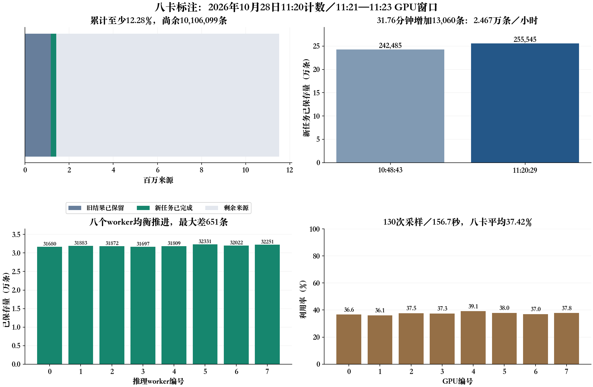

# 八卡开源标注进度：2026年10月28日11:20—11:25只读检查

八个推理进程都在运行、各卡都有计算进程，输出持续增加；没有发现单卡掉队或近期日志中的致命异常。不过当前吞吐约2.47万来源／小时，GPU平均利用率仅约37.4%，仍处于原FP32/eager、单窗batch1的执行方式，尚未切换提速候选。按本次半小时速度，剩余工作约17.07天；不是几小时内就能完成。

## 完成量和分母

任务ID为`t-20261028005420-h6675`，名称为`zhounan_redimnet2-ultra-remaining-resume-8a800-p6-20261028-v1`。平台11:22读取为运行中，实例00:54:56启动，1台8×A800 80GB、优先级6、720小时上限、自动重试关闭；本次没有改变这些配置。处理范围为VoxCeleb2、VoxBlink2、CN-Celeb2三训练域；正式生产推理使用开源模型，API调用为0。

11:20:29取得一个固定broker快照，核1022个已完成、非活动租约槽，8个活动租约未计入。只读计数槽，不扫全库侧车或原音，不建数据库。

| 项目 | 实际数量 |
|---|---:|
| 全部来源总数 | 11,521,178 |
| 已保留旧标注 | 1,159,534 |
| 当前新任务的输入分母 | 10,361,644 |
| 新任务已完成 | 255,545，完成其输入的2.47% |
| 新旧累计完成下界 | 1,415,079，完成全集的12.28% |
| 全集尚余 | 10,106,099 |
| 当前完成片 | 1,022 / 41,351 |
| 活动片 | 8，不加入完成量 |

恢复时旧结果已经从新任务输入中排除；没有把旧结果重新计为本次新增。来源数按每片真实数量相加，未用固定256乘片数。

新任务255545条中，candidate76830（30.07%）、unknown178715（69.93%）、failed0。这个比例是机器状态，不是文字或完整字界准确率；unknown仍保存原始结果和原因，candidate也不自动取得训练／正式评测资格。此前1736条只是01:11的历史小批次，不是当前总待审量。本次只更新进度，没有重新审查这17.87万侧车，也不声称它们的原因分布已经逐条重算。

## 实际吞吐和剩余时间

| 计数时刻（北京时间） | 新任务已保存来源 |
|---|---:|
| 10:48:43.869 | 242,485 |
| 11:20:29.765 | 255,545 |

31.7649分钟增加13060来源，约24668.7来源／小时，即6.85来源／秒、59.20万来源／日。该速度是八卡合计，包含转写、定位、读写和保存；不是单卡速度，也不是音频秒／秒。

剩余10106099来源除以这一速度，约409.67小时，即17.07天，条件完成时间约11月14日13:00（北京时间）。这只是按最近半小时负载不变的外推：后续音频长度／语言／多窗比例变化、失败、维护或资源回收会改变结果；人工质量核验、修正和训练阶段不包含在这17天内。不能把它当承诺的完工时间。

## 八个worker与八卡

11:25:04通过真实云容器WebShell核对8个已登记worker的PID、启动tick、PGID和SID，进程读取前后身份均一致、状态均R；UUID独立。容器PID2330—2337对应八worker，没有把NVML宿主PID1719491—1719498直接当作容器PID。每卡有一个compute记录，UUID与此前该任务一致。本次观察只用标准库和NVML，没有创建CUDA上下文。

下表来源数来自约11:21的各worker最近一次chunk_committed累计记录，合计恰为255545；GPU瞬时数值来自11:25:04，两者不是同一毫秒的状态。近期平均是已有父监控11:21:07—11:23:44的130次采样，覆盖156.7秒，不冒充整天平均。

| worker／GPU | 已完成来源 | candidate | unknown | 当前利用率 | 近期平均利用率 | 当前显存GiB |
|---|---:|---:|---:|---:|---:|---:|
| 0 | 31,680 | 9,453 | 22,227 | 34% | 36.63% | 13.65 / 80 |
| 1 | 31,883 | 9,491 | 22,392 | 33% | 36.09% | 13.23 / 80 |
| 2 | 31,872 | 9,681 | 22,191 | 35% | 37.55% | 13.35 / 80 |
| 3 | 31,697 | 9,608 | 22,089 | 34% | 37.33% | 13.36 / 80 |
| 4 | 31,809 | 9,594 | 22,215 | 51% | 39.14% | 13.48 / 80 |
| 5 | 32,331 | 9,589 | 22,742 | 39% | 37.95% | 13.32 / 80 |
| 6 | 32,022 | 9,763 | 22,259 | 38% | 36.95% | 13.66 / 80 |
| 7 | 32,251 | 9,651 | 22,600 | 38% | 37.75% | 13.25 / 80 |

最多与最少完成量相差651条，约为每worker均量的2.04%，没有明显单worker停滞。八卡近期平均利用率37.425%；显存约13.2—13.7GiB，不表示可直接加入其它进程或额外CUDA上下文，现有任务仍有独占监控。

## 异常与速度限制

八份worker.log分别只读尾64KiB，合计最多512KiB；读取时均在更新，最近完成片为05638—05645。该有限尾部未见Traceback、CUDA OOM、OutOfMemoryError、RuntimeError、Killed、No space left、Input/output error、ChildFailedError。反复出现的pad_token_id设为eos_token_id是生成器提示，不单独表示任务失败；也不能凭failed0声称全部运行和标注质量无问题。运行中尚无worker_summary是正常现象，旧worker仅在终态发布该文件。

当前低于满负荷是真实观测，不能只因显存空余就推断多进程数量或加速倍数。历史3000例中转写曾占累计进程时间87.81%，说明提速应优先验证转写；这不是本次八卡运行的阶段时间测量。旧生产worker没有运行中细分阶段汇总，本次不能虚构当前ASR占比、实际音频小时数或多窗吞吐。

目前没有切换vLLM／批量／精度，也没有热修此前发现的旧源钟、FIX和VAD规则；它们的诊断见同目录《2026-10-28-待审原因有限抽样与PTN实测》。任务仍持续保存原结果和异常，不通过放宽规则提高candidate比例。PTN没有被停止、改动或占用资源。

## 证据

本机原始快照位于仓库忽略目录`.audit-local/annotation-progress-20261028-1120/`：progress.json为固定队列计数，worker-logs.json与workers-summary.json为八worker尾部观察，gpu-parent-tail.json为已有监控尾部，cloud-live.json为真实云进程／NVML双读；calculated-summary.json保留原始时间差、吞吐与条件ETA。完整路径、PID和原日志没有加入本次公开图。

本次只读状态检查，没有修改推理代码，因此没有重跑GPU或无关测试；数量、百分比、8worker累计和、图表、时间换算已本机交叉核对。没有扫描全部侧车、构造数据库或重发已有音频标注。
