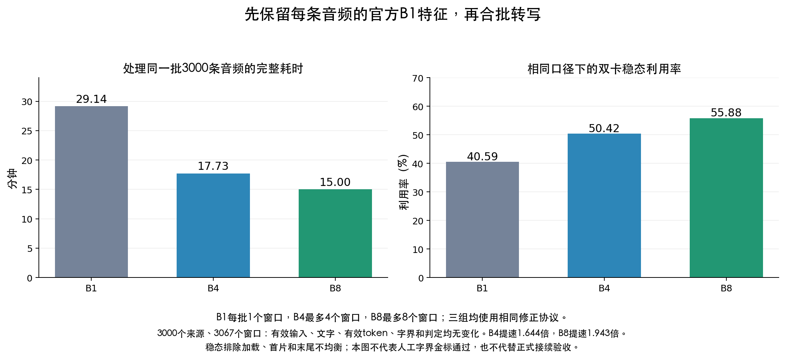

# 原生合批正式准入的独立审阅

这份记录审查`native_batch_admission.py`、`native_batch_readback.py`、`native_batch_queue_handoff.py`和新运行schema／GPU入口保护。实际两卡pilot和它的冻结源码保持不变，审阅没有运行GPU、读取真实媒体、停止任务或操作PTN。

这里区分两种结论：源码格式与CPU反例通过，表示维护程序在这些测试条件下满足约束；真实3000条、512条恢复、速度和完整字质量仍必须来自对应GPU任务原件。旧单窗结果不能自动授予原生batch4／8正式资格。

## 已核的主要边界

- 新正式协议使用独立native v2 schema，普通v1输入与旧单窗runtime不能启动native silver；父入口、bootstrap和worker都检查真实继承的运行许可。
- 正式合同只能相对选定pilot改变purpose／version和默认关闭声明；15个数学源必须保持原字节。正式包如需修控制程序，只允许四个明确CPU helper，逐文件保存新旧SHA、精确差异和独立审阅原件。GPU资源、挑战及清理代码不能靠CPU测试更换。
- 固定512恢复允许引用main原完整cohort中的额外成员，不能删原批成员来伪造一个独立512批次。
- 新waiting仍是新实例先发布真实请求、再核旧任务／worker终态、现有锁和最多8个在途片、最后发布独立新运行材料；不执行平台停止操作，不凭开发机进程号冒充云端PID。
- 完整原生文字包绑定已经包括模型、合同、来源记录、实际PCM、batch顺序、真实token矩形、有效EOS序列及padding；它不能替代定位和源时间映射的证据。

## 修前实际复现的问题

以下反例均只使用合成CPU文件和四条来源，原生包与已固定readback未被修改。它们证明准入条件存在不足，不表示当前真实GPU数据已发生伪造。

### 定位和来源观察尚未绑定

修前代码虽重新计算comparison两边的alignment相等标志，但这些alignment观察没有绑定真实sidecar／readback。原收据只保存每窗request和原生ASR引用，没有实际定位几何与源时间映射的摘要；全records摘要也无法由comparison的局部字段复算。

实际反例将comparison两边同时换成相同的17—19秒虚构定位，并将两边units、decision、quality_axes、VAD同时换成相同虚构值。相等标志仍自洽，质量文件没有任何差异处置，`check_native_selected_pilot`仍接受。修前admission源码SHA为`a96942890cb44bb1f7b574ed54fe8d2b4d9b0f0ab50f9876706364e1865c8edb`。

这不能通过继续增加“质量通过”布尔解决。修复应在四个允许CPU helper内生成新的有限封存收据，将实际SOURCE_INPUTS、完整source观察、窗口输入geometry和实际alignment view与源文件摘要绑定，并根据这些已绑定原件重算完整比较行。删除必需字段、同时改两边观察或把真实文字／边界变化归为padding元数据都应拒绝。

### 加速比没有和真实父耗时复算

修前代码只要求加速比大于1，以及收据与comparison的performance相同。另一实际反例只把加速比从2改为1,000,000，再更新质量文件指向的新comparison摘要；真实父结果、readback和native包不变，准入仍接受。

修复应按已固定真实父结果的`parent_elapsed_seconds`重新计算比值，核性能计数与父进程保存的worker summary／ready／ACK，并重新检查真实计算dtype、SDPA前向及行／批分母。不能由comparison与收据互相重复一个数字来代替实际运行证据。

两份原始反例均保存在本仓库忽略的`.audit-local/asr-speed-20261028/perf-evidence/`下，文件名分别为`native-v2-unbound-geometry-private-receipt.json`和`native-v2-unbound-ratio-private-receipt.json`。这些历史失败证据不覆盖为通过结果。

## 第一轮修正后的真实适配与字节认证检查

第一轮修正加入有限record view，并从实际父结果和worker摘要重新计算性能。独立执行53项CPU测试通过；最初的两份私有反例也分别因“观察不来自封存原件”和“加速比不等于真实父耗时”准确拒绝。对应admission SHA为`7aad87a7e932239bbc96d8ed984589cbd9796eacdd8519c7cf17d6c4adef22be`，readback SHA为`1d93f281554735de009749b167000259774d7535cb28baad9e304d9cc74aad84`。

继续检查真实接口后，发现两个仍需修正的问题：

1. **冻结auditor的真实返回值没有`receipts`。** 用完整真实文件CPU轨道执行冻结版本`load_track → seal_admission_readback`，实际出现`KeyError('receipts')`。第一轮fixture自行提供了这个字段，因而53项测试没有发现适配失败。解决时只能在允许的CPU helper内收集实际parent／worker绑定的小chunk引用，并增加真实auditor与命令行适配测试；不能改已冻结auditor冒充原版本。
2. **自述view摘要还没有接到实际sidecar字节。** 只改sealed record view的定位为17—19秒并重新计算view摘要，真实sidecar、commit、native包、parent、chunk和原`records_sha256`都不变，第一轮reader仍接受。只比较view内部摘要不够；应保存完整record，包括schema等顶层字段，回填真实ASR包后重算每源标准JSON的sidecar SHA及完整records SHA。原生框架本来按同一标准JSON格式写文件，所以可在内存完成，不需每个正式worker重新打开3000侧车。

这两份新失败证据是`native-v2-seal-actual-auditor-adapter-failure.json`和`native-v2-sealed-view-not-bytebound-private-receipt.json`。第一轮修正的两源码原字节另存于`native-v2-first-fix-sources/`并核SHA，避免后续修正抹掉出错实现。原始更早四helper还封存在SHA为`81edeb895eb9a8db6d32ea79d96daf04f0d528a3e4be797893fbac7c8cc66802`的100文件archive中。

## 修正方式与复验条件

不热改已冻结pilot，也不改15个数学源或GPU资源／清理代码。由允许修改的CPU helper对固定有限试验离线封存增强收据：可以利用冻结auditor实际完成有限读回后的内存records，固定真实来源、文字、几何、源时钟和资源链；新正式实例只核该增强收据、原生包和小控制文件，避免每个GPU子进程重新打开3000侧车。

最终应再次运行原失败反例并确认准确拒绝，同时通过完整有效输入、512原cohort子集、四个CPU helper精确替换以及waiting互斥测试。

## 最终CPU控制复验

第二轮修正完成后，56项普通测试用时11.680秒、相同56项`python -O`测试用时9.461秒，均独立通过。原两边同改假几何／源观察、加速比改为1,000,000、自洽重签sealed view三个私有反例，现在都因对应原件不符准确拒绝。

实际未修改的auditor SHA仍为`916231d8e7558bf59417d63328f6ea0d5ee8f30e59e1533818f94184cbe5132a`，其`load_track`仍没有`receipts`。独立使用完整真实文件CPU轨道执行`load_track → seal → verify`成功：只增加读取一个已固定父控制JSON，以获得原worker绑定的chunk引用，不重新打开媒体或侧车。正式reader回填原生包后重新认证完整record的标准JSON SHA、标准commit SHA和整体records SHA，原几何由真正父／chunk引用的原侧车字节认证，不再只是收据内部自述摘要。

本轮独立接受的admission源码SHA是`7aad87a7e932239bbc96d8ed984589cbd9796eacdd8519c7cf17d6c4adef22be`，readback源码SHA是`3412f7484488927c52a180e062cbb1e9f25a450c217c9508121f42911b4857d3`。四个CPU helper的完整SHA和测试收据另存`native-v2-independent-final-review-receipt.json`，原拒绝证据分别存`native-v2-final-private-counterexamples.json`、`native-v2-final-bytebinding-and-real-adapter.json`，修前证据及源码快照均保留。

这个结论只表示本轮控制修复和独立CPU反例通过。实际3000／512、真实中途恢复、文字及完整字质量仍须由对应GPU任务原件完成，才能填写正式选型材料；没有因这份报告修改已运行pilot、旧冻结、15个数学源或GPU资源／清理代码。

## 独立中途恢复探针复审

对新`run_native_partial_recovery_probe.py`另外进行静态检查及16项普通／16项`python -O`测试，分别用时0.546和0.569秒，均通过。此次没有运行GPU或读取真实音频。探针先在全新树冷跑固定30来源，再在另一新树观察首个完整ASR包，只通知本次精确子父进程TERM并等原清理；随后在同UUID锁内重新做5秒双空闲核验，同一队列／合同／结果树恢复。原包、计划、已发布侧车及commit必须保持SHA、inode和mtime；不能把全部已完成的缓存命中称为中途恢复。

独立审阅提出并复核两处控制修正：原`atomic_new`先link目标再清理临时名，目标可见时尚有两个硬链接，不能立即主动TERM制造孤立tmp。修后观察器在`st_nlink==2`时等待、不把包读成已发布；实际CPU硬链接反例确认临时名仍在时不会取消，原写入者正常unlink后才触发。已有孤立临时文件仍保留并拒绝恢复。另把精确PID、严格JSON和资源拓扑等实际间接依赖加入冻结来源核验，从五项扩为九项；没有修改冻结计算或GPU清理源码。

固定30重新安排为单分片、首组8来源含双窗原件，因此形成的新cohort与原screen不同，独立冷跑是为了取得同分组的比较基线。单分片只有一个worker领取实际工作，不能将其作为两卡吞吐证明。CPU通过只说明控制和文件事务反例通过；真实CUDA中途恢复仍需对应独立两卡任务原件，不能据此批准正式八卡接续。最终控制器SHA与测试收据保存在`independent-mid-cohort-probe-final-receipt.json`。

## 旧原生candidate的实测拒绝结论

固定3000来源B4／B8和512全命中恢复已经真实完成，B4约1.726倍、B8约1.987倍端到端加速可作为诊断性能结果保留；**这两个旧candidate均未通过文字和完整字边界质量准入**。这个结论不是把运行失败当成速度失败，而是区分实际完成的工程验证与尚未成立的数据质量证明。

已有比较确实保存了B4的110窗、B8的122窗标准化正文变化，以及82／90窗定位items变化；candidate净增3实际由4个来源升级、1个降级组成。变化包含删结尾词、改尾字以消除零时长和增加新词后形成零时长字界，不能当成padding元数据。新正式CPU准入器已经要求每个真实文字／字界变化有对应审阅证据，禁止把这些行标为`metadata_only_verified`绕过。缺少逐差异文字与削首／削尾／邻字验收材料时，应保留拒绝，不能用`review_complete`或candidate总数代替。

此外，实际保存的原生输入已有非padding prompt数量随批宽变化的直接例子。源PCM／窗口相同不等于声学模型实际收到的mel特征、有效帧和prompt相同；尚未封存每窗完整feature摘要，不能仅凭原`input_identity_equal`宣称严格同输入。官方批次特征提取可能受最长音频补零及STFT尾帧影响，ASR代理正用独立CPU反例确认原因。

因此选择应先修正特征协议，再在独立新schema／root进行真实GPU重测。新增逐条B1特征适配必须有自己明确的第16计算源和合同身份，由真正generate入口核实际tensor的dtype／shape、有效值、mask及非padding prompt；不能让另一个控制器自签摘要冒充真实模型输入。旧15源bundle、报告、cohort包及所有异常按原字节保留；新协议不能复用旧包授新结果资格，也不能热改已运行源码。新的B1／B4／B8应在相同修正协议下重新受控比较，先用固定小样本验证输入等价和文字行为，再决定后续3000条及正式接续。

## 新16源独立GPU的screen阶段实测

新唯一任务`t-20261028152505-xw6bs`使用独立根`native-feature-asr-20261028-v1`，不覆盖旧native v1材料。15:31固定screen现成报告显示，B1／B4／B8全部完成30来源、34个ASR窗口，32个定位窗口；B4／B8的文字、语言、有效EOS token、定位items、native／FIX时间数组和decision都没有变化，32个同目标可比窗口端点最大0ms。B4／B8只在21／28窗存在EOS后矩形padding变化。

这次还独立用已保存报告内136侧原生proof逐项复算：实际float32有效mel SHA及形状、原int32有效mask、实际generate非padding prompt及占位数量、SDK PCM和七类来源摘要，与各自官方独立B1参考一致；跨批宽对应窗口的实际有效输入也完全一致。此复核只读本机已有报告，没有再次执行auditor、读取侧车／原音或调用模型。原报告SHA分别为`de4b5949ca47bb9e4eb9d84eb3fc1c7ba3cc207781114ac0743af1aa008fdb37`和`5dc37a45b4f485576e9f4e59dbfaedce89ce6c6df7273fd524242acc4ef96e4a`；独立摘要保存在`new16-screen-independent-effective-input-check-v1.json`。

三轨父墙时97.672／63.353／63.338秒，ASR累计28.367／17.869／15.307秒。B1模型加载累计28.695秒，而后两轨约11.5／11.8秒，因此不能把screen约1.54倍父墙时直接投射为完整库速度；候选机器状态三轨均candidate11、unknown19、failed0，同样不能当人工金标。main3000、512恢复及完整字质量仍待新实际结果。

15:38另对新main B1的既有监控／worker日志做一次有界取证。统一steady定义为两个worker都完成首个ASR片且first attention trace成功之后，到较早的最新chunk提交；当时窗口15:32:33—15:37:01，共267.6秒、240个NVML样本，双卡均值42.27%／42.31%，峰值71%／67%。该结果已经剔除加载与首片，但只是运行中前缀，不是完整main平均；每worker当时提交384来源。B4／B8应在完成后用同一定义对照，不能拿不同窗口美化利用率。该读取没有直接查询或操作GPU，只保存已有监控样本和前缀SHA，文件为`new16-main-B1-steady-provisional-v1.json`。

## 新16源main3000完整独立复核

新任务同一修正协议下B1／B4／B8已经完成固定3000来源、3067窗口。ASR代理作为唯一大报告提取方，只从既有报告各读取一次并核完整SHA；本审阅仅解析已保存的本机原报告，没有再次执行auditor或读取PFS侧车／原音。B4完整报告SHA为`d6658bbe7a49e6b463cbcf67d7cace880687788f749d88cc3d5849530ff2f2e1`，B8为`00e88b310efd47be6b90713de9ce4b900d4bbd79136ec901f3dd9ee29228008a`。

逐窗复核两份报告共12,268侧实际输入proof：有效float32 mel SHA／形状、int32 feature mask、SDK PCM、真实generate去left-padding prompt及音频占位数量、来源库绑定均符合官方独立B1参考；跨批宽实际有效输入、raw／标准化文字、语言、有效EOS序列、alignment items、native／FIX字界和decision state变化均为0。B4／B8只有2230／2623窗口EOS后矩形padding改变。这证明本次加速没有引入已比较字段的额外漂移，不能证明原基线所有文字和完整字边界本身都正确。

| 固定3000来源 | B1 | B4 | B8 |
| --- | ---: | ---: | ---: |
| 冷运行父墙时（秒） | 1748.644 | 1063.611 | 900.046 |
| 对同协议B1加速 | 1.000倍 | 1.644倍 | 1.943倍 |
| 相同稳态定义双卡平均利用率 | 40.59% | 50.42% | 55.88% |
| 标准化文字／有效token／字界／decision state变化 | 基准 | 0 | 0 |

稳态定义是两个worker首个真实ASR提交chunk的较晚时刻，到两个worker最终提交的较早时刻，排除加载、首chunk和末尾工作不均；B1／B4／B8分别1467.5／842.5／697.4秒、1317／757／626个已保存NVML样本。两卡分别均值B1 40.49%／40.69%，B4 51.40%／49.45%，B8 55.89%／55.87%；峰值B1 72%／75%，B4与B8均100%。这是相同口径的实际两卡观测，不是全程平均，也不直接承诺八卡线性外推。读取只涉及三个固定资源目录现成监控和worker日志，没有执行新的NVML查询。

两份main比较各有119来源的`errors`／`vad`字段差异。独立逐叶比对全部原始源观察后，这119处均只在`errors[0].traceback`与`vad.errors[0].traceback`的冻结源码根`b1/code`对`b4/code`／`b8/code`不同；只替换这个明确字面目录后，整份源观察完全相同。原`invalid old VAD interval`错误、unknown决策和全部原生几何异常均未抹去。此处只解释跨轨差异，不把旧错误变成可发布标注；不修改原报告或生产sidecar。

完整独立摘要为`new16-main-independent-full-review-v1.json`，119条原观察与逐叶说明为`new16-main119-exact-metadata-difference-review-v1.json`，原监控SHA／边界及样本为`new16-main-three-steady-util-existing-v1.json`，图为`new16-main-speed-util-and-quality-v1.png`。真实中途恢复、512既有结果原字节不变、正式质量处置及完整启动成本仍需各自对应的真实材料，不能由该速度和零漂移结论代替。

## 正式启动候选的加密修正与独立复验

默认关闭的Linux memfd／同CLI scope候选最初存在metadata同tick碰撞，原型不具备内容不变证明。独立Linux64自有文件反例中24个内容实际改变而全部metadata相同，原失败保存不覆盖。修后每次复用全部输入仍实际核SHA，唯一祖先目录身份与stat只作快速拒绝；缓存只减少大JSON解析／原生映射重构，不减少内容读取。真实Linux61项普通及61项优化模式均无跳过通过，原64反例全部拒绝；完整启动成本未实测通过前保持default off。设计、版本SHA与失败证据详见[启动成本预算](../plans/2026-10-28-原生正式准入有限证明的启动成本预算.md)。

另独立审阅B8中途恢复控制准备器`cba9f61abf4de1a16645eab339fa03e72e6636b01fbdd5dfd6e7f731650fefcb`，9项普通／9项优化模式均通过。默认B4保持，B8必须显式选择，stage／finish重新绑定实际prepared profile、bundle、九依赖、解释器和approved控制器231649原字节；默认检查不传`--execute`且结果根不存在。这只说明独立GPU故障恢复验证可以准备，尚不是实际恢复结论。

## 新16源512完整命中恢复的现成终态补充

本次只分析已经保存的小终态摘要`new-feature-final-512-small-status-v1.json`（SHA `ca0fabff8d13effe9fcc6b9db8741ec84e1cc38315582c0e83dea8db69623034`），没有重新读取PFS比较、512侧车或音频。新16源驱动最终SHA为`46eba82f9af3eb3ed6d387ac71c685d8cbb5e0963db47d76b0fd8ce8feba5baf`，九阶段有限审计完成且均资源归还，failure缺失。三个512父终态均是8片／512来源，worker各256侧车命中，新侧车／ASR／FA均0，完整读回通过且错误0，candidate209／unknown303／failed0。最终驱动完成原严格恢复比较断言后写出终态；本审阅不声称再次独立复算18—22MB恢复比较的全部原数组。

因此新16源已发布结果全命中恢复已有真实工程证明；中途未完成cohort恢复仍由独立B8任务`t-20261028170325-4hjb6`验证。该任务已唯一提交部署中，正式新八卡尚未提交，不能拿512全命中代替真实中途故障结果。新的图与主报告完整表格见[交接报告第12节](2026-10-28-转写提速真实两卡与八卡交接.md#12-新16源完整3000与512结果稳态利用率)。

随后独立B8中途恢复任务`4hjb6`实际完成。新result SHA为`c32c5dcaab2c0339b3510e4c244ebf37fdf69a5a96eb9509baaaa2dd3bbb5e74`，`partial_recovery_verified=true`，原文件SHA／inode／mtime不变；attempt2父SHA为`d1c5cc3caacd1421a055e1bbe44de4366a55569b5ed5e5e5a493ce0d2435cc1`，30来源完整侧车读回、错误0、资源归还。独立审阅另外只读取该试验唯一30来源比较原件1,624,758字节，SHA为`8b094a29804c354c31e5b22382c4f7ecedf0e6928d5b9da5c4dcde5a509f2163`，不重跑auditor或读3000侧车／原音。逐行复算30来源、34窗口，完整源观察、完整ASR原生字段、定位数组和durable包引用均相同，唯一叶变化是恰8窗cache_hit由false变为true。恢复实际新ASR26行、复用8行、FA32行、新侧车30、完整侧车命中0，candidate11／unknown19；有效EOS、原始token、prompt和实际mel proof也独立核对。这补上了真实未完成整批接续的工程证据；人工完整字真值及正式启动成本仍独立验收，正式八卡未因本段自动提交。

## 119条冻结traceback差异分类的最终独审

新增分类`frozen_traceback_root_only_verified`保持旧`metadata_only_verified`不变，只处理已固定result→plan→main矩阵内B1及所选候选的真实冻结目录。两根bundle和每个成员实际核SHA，新增依赖pin进入后续scope／runtime；质量表不能手写路径授资格。仅改写规范Traceback中属于真实bundle Python成员的File帧目录，函数、行号、代码正文、异常类型和消息均不可变化。完整源观察仍经sealed原侧车字节认证，不能自签比较或两边同时伪造正文。

独审初版发现并保留了candidate窗口数True／1.0、普通文字冒充traceback、两边同时改成无关异常仍被接受的反例；也发现实际119中61条含额外几何错误、69条含额外原因，单error／单reason夹具不能代表真实输入。修后只规范化source.errors[0]唯一reuse_vad与对应vad.errors[0]，原其他全部异常和原因逐字段完整保留、精确深比；unknown、不可训练／评测、无人审和原失败状态均保持。实际B4／B8的119份完整源观察共238对独立纯CPU适配全部通过，原输入未修改；该纯适配测试本身不代替真实root／窗口／正式准入。

另对新分类收紧有效EOS位置、max_new_tokens及所有非矩形ASR语义flag，只有generated_token_ids、post_eos_token_ids和raw_returned_token_count三个矩形补齐flag可差；输入身份和窗口存在必须为实际True，数字不能冒充。最终源码SHA为`feea0018a20c66939cbdbc741eb2b524dd826704a555b3a9c5f4034ab5363644`，独立114项普通／114项优化模式分别15.983／15.952秒通过，另外14类私有对抗正负例符合预期。原误接受、旧源码、最终拒绝及238对适配证据保存在本机perf-evidence，不覆盖旧异常或标注。它允许解释并逐条处置这119个跨轨路径差异，不能删除它们原错误，也不能把unknown释放为正式训练金标。
