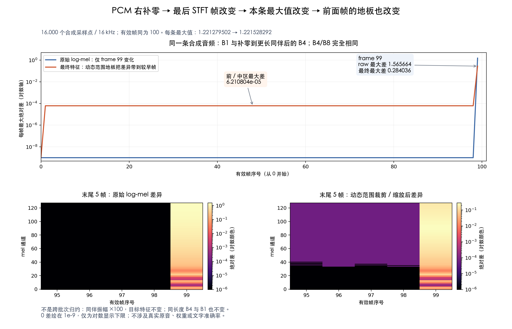

# 原生合批补零为什么改变声学输入（2026-10-28）

本轮已经用实际安装的官方Whisper特征器和纯合成PCM复现了两类输入变化：部分长度会增加有效mel帧和音频占位数量；即使有效帧数量完全相同，先补PCM再提特征也可能改变有效特征值。因此，不能仅把批次mask裁成B1长度，就宣称已经与原单条输入相同。应先让每条输入按官方B1方式完成特征提取，再在特征层补齐并保留逐条证明；新协议仍须独立真实模型和质量验收。

本报告不使用业务音频、用户原音或模型权重。下图是纯合成数值证据，可以公开；原9.28MB中间数组留在私有证据目录，不加入Git。

图中上行比较每帧的最大绝对差，下行放大最后五帧。原始log-mel只在frame99变化，最终特征在99个有效帧中出现差异。差异首先来自本条音频的边界条件，再经本条音频内部的动态范围裁剪传播；不是另一个人的音频幅值直接混入本条。

## 1. 固定了什么，实际运行了什么

使用实际冻结B4合同所指ASR目录中的`preprocessor_config.json`，只读配置，不构造ASR模型、tokenizer或权重。实际配置是128个mel通道、16kHz、hop160、FFT400、右侧补零、dither0；配置没有写`sampling_rate`时使用已核官方构造器默认16000，并再次检查实际特征器属性。调用明确为`padding=True`、`truncation=False`、`return_attention_mask=True`、`device='cpu'`、`do_normalize=False`。

四个合成长度为16000、16128、49408、401408个采样点，较长同伴固定416000点。每个目标分别放入B1、B4、B8；目标自身PCM字节相同。第二次已授权的诊断还保留原始log-mel，按已固定官方torch公式复算中间量，并确认重构的完整输出与官方特征器逐bit相同。没有进行第三次特征诊断；图只读取已保存数组。

| 固定材料 | SHA256 |
|---|---|
| 官方`feature_extraction_whisper.py` | `c209e669fae0ea5de92e1846d8790e3d6d66ce28f4cd4071789c2eec88c84a66` |
| 官方`processing_qwen3_asr.py` | `a61f1fbfc06e3dfc63a2b8d15e3b29e98b032792c3fb7d0e01c04ca9c2181ffb` |
| 实际特征配置JSON | `45e120a4eda2c20c5d7f2ea9354e63536bf35e27aa573fb7cdf78017b378770d` |
| 第二次诊断控制源 | `c096830ddeb3f5a534e9f30b5046fe618203dcfd6b3a0b14ea35aea0a0dd3251` |
| 保存的纯合成有效mel及raw-log数组 | `d5daa63ae80e9838c54fa9ce7f78ab41096f5a9b186a2ca6e0f0d7777e0228bb` |

环境为NumPy2.2.6、PyTorch2.10.0+cu128，但实际device始终为CPU，`CUDA_VISIBLE_DEVICES`为空、CUDA未初始化。审计钩子禁止打开真实音频和模型权重，实际尝试次数为0。B1/B4/B8所有有效特征、mask、PCM和官方输出长度函数均保存SHA。长度函数只从已固定官方源码提取纯算术AST，不导入Qwen模型类。

## 2. 第一类变化：有效帧数依赖同伴长度

官方Whisper先把原始PCM补到本批最大长度，再做短时傅里叶变换（STFT）。采样mask按`[:, ::hop_length]`降采样；如果**整批补齐后的长度**不是hop的整数倍，再统一删掉最后一列。于是短目标单独运行时可得到floor帧数，与更长整hop同伴合批时却保留ceil帧数。

| 同一目标的采样点数 | B1有效mel帧 | B4/B8有效mel帧 | B1音频占位数 | B4/B8音频占位数 |
|---:|---:|---:|---:|---:|
| 16000 | 100 | 100 | 13 | 13 |
| 16128 | 100 | 101 | 13 | 14 |
| 49408 | 308 | 309 | 40 | 41 |
| 401408 | 2508 | 2509 | 326 | 327 |

音频占位数由实际官方`_get_feat_extract_output_lengths`计算，未调用tokenizer，因此不能把这些数字冒充整段prompt的token数。本次后三个非整hop目标的共同floor前缀逐bit相同；它们出现的是多保留一帧及多一个音频占位。不能把“所有长度都会改变共同前缀”写成普遍结论。

## 3. 第二类变化：帧数相同也会改变特征值

16000点正好是100个hop，B1和B4/B8都保留100帧、13个音频占位，但有效mel并不相同。

先看未经动态范围裁剪的原始log-mel。共同100帧中，只有最后frame99有差；前区、中区原始差都为0。STFT中心帧会在音频末尾使用窗外样本：B1在真实末尾采用反射边界，先补零后的PCM在该位置已经是有效数组内部的零，因此末帧内容不同。实际raw最大差为1.565664291，位于mel127、frame99。

末帧变化又改变了**本条音频自己的**全时频最大值。官方torch代码在每个row内先沿时间、再沿mel取max，不沿batch维归约：

| 16000点目标 | B1 | 与长同伴合批B4/B8 |
|---|---:|---:|
| 本条raw log-mel最大值 | 1.221279502 | 1.221528292 |
| 最大值所在mel/frame | 6 / 9 | 6 / 99 |
| 实际float32动态范围下限（max−8） | −6.778720379 | −6.778471947 |

官方随后把低于`本条max−8`的值抬到下限，再执行`(log_spec+4)/4`。地板的小幅改变会影响较早时间上的低能量mel通道，即便那些位置的原始STFT和raw log-mel并没有改变。本次前区、中区归一化后最大差均为`6.2108039856×10⁻⁵`；尾区最大差为`0.2840361595`，位于mel91、frame99。最终99个有效帧的差超过10⁻⁶，不能全部解释为“最后一个时间点不同”。

这也说明，仅从合批特征中截取前100帧，仍会留下已经传播到前面帧的地板差异。必须先逐条完成原B1特征提取，包括该条原有边界和动态范围，再考虑特征层补齐。

## 4. 已排除哪些替代解释，边界是什么

- **不是跨batch取最大值。** 官方torch方法对每条row归约，NumPy方法逐条循环后对该条取max。把其他长同伴振幅乘100，目标有效特征仍逐bit不变。
- **不是本次CPU批FFT实现本身造成的。** 四条完全相同长度的目标合批、不发生PCM补零时，B4目标与B1逐bit相同。此结论限定为本次数值环境和合成输入，不能代替未来GPU内核的独立数值检查。
- **不是本次零均值方差归一化。** `do_normalize=False`。官方该可选函数启用时也按每个vector及其有效长度分别计算，而不是把全批拼成一个统计总体。
- **没有证明文字或字界质量已恢复。** 本轮只核了特征、mask和占位长度。原decision变化、零时长项、削首、削尾和邻字污染仍保留，必须用新协议实际模型结果再次验收，不能据本报告放宽质量规则。

## 5. 对维护实现和正式接续的要求

新处理方式必须显式声明用途、计算模块及官方预处理源码身份，旧冻结合同不会被原位修正。基线、候选及正式合同应精确绑定七类官方预处理源和实际配置，保存逐行有效mel、mask、去padding prompt和SDK PCM证明。只要`preprocessing_*_equal`出现非True，就不能把该差异归为padding元数据。

真实B1/B4/B8、恢复和质量仍要按新合同独立验证，保留原批次及旧结果。此处不停止PTN或旧标注，不重新标注已有全库，不建立数据库。此前固定五条新音频传回本机的动作被自动审批拒绝，未换通道或运行API；本报告全部来自另外独立授权的纯合成CPU数值，不借它冒充那五例人工听审。

维护入口为`tools/open_annotation/diagnose_native_feature_padding.py`，默认只检查固定操作计划，`--execute`才进行合成特征诊断。绘图入口为`tools/open_annotation/plot_synthetic_feature_padding.py`，只读已保存的数组和报告及其SHA，不重新生成或计算特征。私有完整输出在`.audit-local/asr-speed-20261028/native-feature-padding/`。

诊断中的`elapsed_seconds`只计库导入后的特征矩阵及raw-log探针，未包含SSH、Python或torch导入，不是模型或端到端吞吐；峰值RSS来自实际直接进程。两次原输出及最早SSH引用错误均保留，不改写历史。
