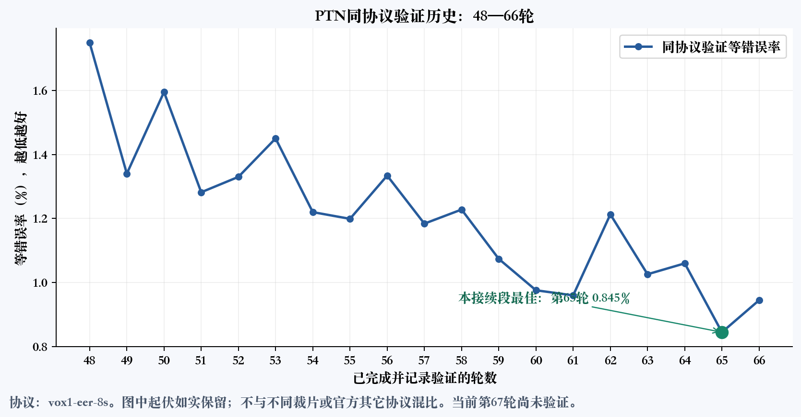
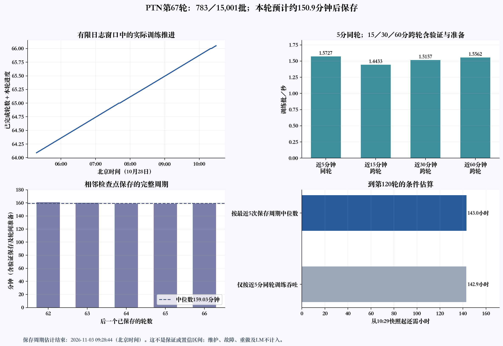

# 1736条待审的实际原因、24原音复核与PTN进度

本次检查证明：`unknown`比例高同时涉及模型覆盖、字词定位质量、作者修复算法和旧流程的具体缺陷。不能把1736条全部解释成转写错误，也不能把无机器告警的`candidate`当作文字和完整字界正确。现有标注正在继续保存，PTN也正常推进。本次没有修改它们的源码、环境、冻结清单、标签或质量条件，没有重启、停止或迁移任务，没有另建CUDA上下文。

## 本次只检查什么

用户明确要求停止额外全库审计。本次没有重新运行被停止的联合库审查，没有建设数据库。先复核用户问到的历史13片、2452条结果；再从后续2片固定抽56条作对照，并限定查看64条体积较大的已完成侧车以追踪多窗问题。远端JSON读取实际2656次，包括重复读取、分片收据及commit，未超过预先限定的2700次。采集过程中曾因完整片不是恰好250条而保守退出，缺失的历史逐源stage交叉统计未通过重扫补齐；实际数量与偏差保留在私有报告。

按原因分层选定的最终诊断音频集合为24个原件、18条unknown与6条candidate，覆盖VoxCeleb2、VoxBlink2和CN-Celeb2。四份多窗或截断样本替换了原选24例中的四份，原始选样没有覆盖；发送内部API的独立原件仍然只有24份。总原音305.3011875秒、编码文件8016705字节；24份编码SHA与原采样率、多声道float32 PCM SHA均与侧车完全一致。长源按原标注context窗形成32个视图，保留窗口重叠；没有把32段相加当作32个独立原件或无重覆盖文本。

用户明确允许这些原件及必要裁片发送内部Qwen辅助复核。本次按内部音频复核技能执行：先不提供旧转写的盲审，再只对具体冲突提供参考；API请求只用于本机诊断，不写回标注。模型输出不是人工听审或精确字界真值，图像审阅也不能替代人工听音。

## 1736不是“这批全都待审”

历史快照为北京时间2026年10月28日01:11:23.592853：2452条中，candidate716条（29.20%）、unknown1736条（70.80%）、failed0条。前八片是恢复时优先补完的部分片，不能用这一前缀比例估计整个数据集的质量。

`unknown`的实际语义是：这个来源至少一个窗口、一个字词或保存的处理错误没有通过全部机器检查。文字、语言、原生时间、作者FIX后的时间和可提取词项仍保存着；不是全部丢弃，也不是人工审阅队列已逐条判错。任一窗口失败会使整条来源成为unknown，不能据整源状态断言其它窗口都错。

下表按unknown来源去重，去掉窗口编号；各行有交集，不能相加。

| 机器原因 | 来源数 | 正确解释 |
|---|---:|---|
| `processing_errors_preserved` | 886 | 包括字界几何检查和旧VAD问题，不等于886次模型崩溃 |
| `native_zero_or_negative_duration` | 835 | 实际检查作者最终items，包含FIX后才产生的零长，不能全称原始预测零长 |
| FIX变化或修复状态未明 | 809 | 修复过不证明边界正确；保留待核 |
| 文字口语形式需复核 | 712 | 包括词内撇号拆分、数字、混合脚本等，不能据此直接判原文错 |
| 对齐未成功、没有原生字界条目、没有可用词项 | 各506 | 多数涉及定位语言覆盖，三行高度重合 |
| 源词项重叠或次序异常 | 63 | 混有旧时钟换算的假重叠，需看原生/FIX/源采样点 |
| 原生边界超context范围 | 35 | 不能裁边后冒充合法 |
| 空转写未证实为噪声 | 17 | 不等于17例漏语音 |
| ASR未完整结束、未观察到EOS | 各2 | 需核token上限与实际EOS，不能统一归咎于捕获错误 |
| 定位文字覆盖不一致 | 2 | 需保留逐词覆盖证据 |

501个**窗口**明确记录定位语言不支持；不能写成501个文件。历史仅受“对齐未成功／无原生字界条目／无可用词项”这一组合影响的来源有461条。本轮未保存501窗口的精确语言交叉表，不能拿全部ASR语言的边际计数替代。

后续固定56条中candidate16、unknown40；22条有处理问题，21条涉及`invalid_native_geometry`，2条涉及旧VAD无效区间，交集1条。未见解码、转写或定位模型抛出异常。这个定向小对照不是随机准确率测量；历史886条的stage分布仍未完整取得。

## 已查实的具体原因

### 转写和定位的语言覆盖不同

实际下载模型配置与固定源码表明：Qwen3-ASR 1.7B声明30种转写语言，Ultra定位模型声明11种：中文、粤语、英语、德语、西语、法语、意语、葡语、俄语、韩语、日语。两处支持集不是同一件事，源码也已经把语言名转成小写比较，不是所有拒绝都来自大小写错误。

例如一个49.544秒来源的首尾窗有完整Hindi转写，但定位器明确不支持；另一窗口又同时触及生成上限。这些情况应保存文字与“不支持定位”的原因，不能把虚构字界写进去。`Brazilian_portuguese`可能有单独的别名兼容问题，不能据此解释全部501窗。ASR语言预测本身仍可能错误；已授权的盲审是独立核实，而不是拿模型配置替代听音。

### 作者FIX可以新造零长，普通短词也受影响

已用保存的真实完整时间向量，单独提取并重放作者的纯`fix_timestamp`函数；不导入模型、不用GPU。四个窗口的重放结果与侧车FIX逐点一致。

| 诊断编号 | 词／字 | 原生毫秒 | FIX毫秒 |
|---|---|---|---|
| q02 | a | 480—560 | 560—560 |
| q04 | s | 1520—1600 | 1600—1600 |
| q06 | 第二个“也” | 6560—6800 | 6800—6800 |
| q09 | to | 400—480 | 480—480 |
| q09 | it | 3200—3280 | 3280—3280 |

该算法修扁平时间序列的倒退，采用最长非递减子序列，短异常段会复制邻近端点。允许相等并不保证每个词的起点严格小于终点。因此前词结束晚于本词开始时，修复可能把本词起点推到自身终点。这是可重放的算法行为，不能称修复之后天然更准。

另有样本原生就是零长，FIX也未修好。无效词项未进入最终units；因此按剩余两个units取片，可能仍包含中间被排除的零长词声音。这正是需要检查邻字污染的原因，不能通过删掉文字项伪装为完整两字。

### 旧源时钟会造1采样点假重叠

三份真实多窗原件共六对相接字界，原生与FIX都恰好相接，旧浮点floor/ceil换算却映成重叠1采样点。例如16.08秒乘16000，二进制浮点得到257279.99999999997；起点floor成为257279，前词终点ceil成为257280。16kHz的1采样点是0.0625毫秒，不能把它说成实际音素重叠。

维护源码已有十进制v2映射，本次运行的旧23文件生产包仍按其原v1声明执行。没有热改旧包或改冻结清单。即使独立影子换算消除了这六对假重叠，其它FIX、文字或真实几何问题仍保留，不能自动把整源升为candidate。

### 两份旧VAD尾端是格式精度问题，身份并没有错

两个原音分别21177和200249采样点、16kHz，即1.3235625和12.5155625秒；旧RTTM尾端为1.324和12.516秒，均多7采样点（0.4375毫秒）。原路径、大小、mtime、采样率、声道、帧数、模型SHA与推理签名全部吻合。当前复用校验不比较历史device，不能归因于跨节点device变化。

其中一例只有这项错误，其native/FIX/units轨一致；另一例同时还有FIX及零长。没有裁剪旧RTTM或放宽所有越界的规则。若以后实现兼容，应显式根据旧格式量化精度和物理帧数建立新版本转换，保留原RTTM、转换前后值及原因；超过可证明量化范围的越界仍拒绝。它不能改善模型本身80毫秒时间栅格的精度。

### 有真实512-token截断，不是全部EOS捕获错误

49.544秒来源的三窗新增token数为478、512、83；中窗恰到512上限、EOS未出现、状态truncated，按既有规则不做定位。其它两窗EOS出现，但因Hindi不在定位支持集仍不对齐。EOS配置两处只改变ID顺序，集合一致；不能据少量未结束样本就宣布全局EOS捕获坏了，也不能统一加token上限后声称语言问题消失。

## 音频和图的实际检查

已生成24源、140张波形／频谱／字界图，原生、FIX、源采样点词项、旧VAD分别画轨，附每项原文与毫秒／采样点表。189份输出的SHA再次核对一致。定量判定1采样点误差使用数值表，不能凭25毫秒频谱窗上的视觉判断。

真实音频、完整文本、样本ID和原始侧车只保留本机`.audit-local/unknown-audit-20261028/`，不进公开Git。可读入口为该目录的`boundary-figures-v2/index.html`；详细取证为`rules-review/24原音与字界图审记录.md`。API原始流、提示词、输入WAV/PCM SHA、请求参数及真实返回模型也独立保存。逐源盲审和必要裁片结论见本机同目录的诊断报告；不以模型听辨替代人工完整字边界真值。

## 32视图盲审、3参考复核与6裁片的实际结果

共41次内部API请求：32个原context盲审视图、3个具体冲突参考复核、同5个来源的6个必要连续裁片。独立原件总数仍24，没有新增来源。全部传输、协议、结构正常结束，实际返回模型为`qwen3.8-omni-flash`；六裁片中一份0.32秒片有内容标记，不能因结构合格就称音频结论可靠。提示词、WAV／PCM、清单和原始SSE摘要逐条核对一致，原件没有写回或用于正式训练。

| 例子 | 原结果与独立听辨 | 可下的结论 |
|---|---|---|
| q07空ASR | API盲审为无人声电子音乐，heard_text空 | 空转写可能合理；仍未获得人工噪声金标 |
| q01/q12/q24 | API所辨Hindi／Arabic与原语言一致 | 支持真实定位语言覆盖不足，而非单纯字符串误判 |
| q16，candidate | 原文“新的微笑”；盲审和参考审阅均听“会心的微笑” | 已放行候选也有实质文字分歧，须听核，不能用candidate当正确率 |
| q02短英语 | 原ASR“How'd a partner”；盲审“how to partner”；参考“Howdy, partner” | 原转写、撇号拆分与听辨都未解决；API也不稳定，不能择一覆盖 |
| q10首2保留units | units为Like、Kill，中间零长a被排除；连续裁片被API听“like a kill” | 去掉零长文字项不会去掉声音，不能称纯两词裁片 |
| q11首2保留units | 目标I、have；裁片API听Um、I have a l-，且猜little，整源原文为lot | 起音／邻词及短上下文均有风险，不把API猜词当纠正真值 |
| q15首2保留units，candidate | 目标新、出；整源盲审和裁片听“最新出”，参考改为开头[听不清]新出 | 可能有前字残留或原转写漏首字；三种观察冲突保留，未人工验收 |
| q05首0.32秒 | 全源模型可辨“非常非常的荣幸”，短裁片却说“嗯＋蜂鸣”并有内容标记 | API对极短片不可靠，不能据此断言原音真有蜂鸣或自动淘汰 |
| q20首2词 | API一面说that的/t/已经发出，一面标记end_cut | 字段语义不一致，不能自动计为语音削尾 |

长源中专名、日语重叠上下文及可能插话也有分歧，逐源24节原答与分析保存在本机`rules-review/API盲审对照.md`。API对32视图的28个尾端报cut，其中7个本来就是人工context右切口；另有音乐、句意未完及“没有淡出”等依据，不能汇总成音素削尾率。真实源端点与必要裁片端点也不同，例如q05末裁片到1.28秒、原件到1.3235625秒，不投票伪造共同端点结论。

这些实测证明目前不能承诺完整字精确无误。已证实的数字换算缺陷、作者FIX行为、实际语言覆盖与生成截断可以分别处理；文字和细边界问题还要人工听审或独立可靠的声学证据。内部API仅作辅助，正式全量标注仍使用开源模型，不转为逐条API打标。

## PTN当前证据与预计剩余时间

任务为`zhounan_redimnet2-b6-ptn-r47-capture-8a800-p6-20261026-v2`，ID `t-20261026074833-ctjsk`。平台只读页面显示运行中，1实例、8张A800 80GB、优先级6，原始挂载及入口未改。

| 检查 | 实测 |
|---|---|
| 10月28日11:05:45最终短时回读 | 第67轮4259/15001批，轮内28.39%，最新检查点仍model_66 |
| 10:29:18详细曲线快照 | 第67轮783/15001批，轮内5.22% |
| 最新保存与验证 | model_66.pt，650777251字节；第66轮EER0.945% |
| 本次接续48—66轮最好 | 第65轮EER0.845%；66轮比它回升0.100个百分点 |
| 10:41:31真实云容器进程 | 8训练rank、每rank24数据worker，共192worker；200唯一PID两次读身份一致 |
| 八卡瞬时利用率 | 88、97、98、89、98、88、98、98%，均值94.25% |
| 八卡显存 | 55260—55356MiB／81920MiB，约53.96—54.06GiB／卡 |
| 观察工具 | 标准库与NVML，只读已登记PID，无torch/CUDA、无信号与锁 |

NVML宿主compute PID与容器训练PID属于不同命名空间，未硬作一一数值对应；每卡有compute记录不单独证明rank正常，另用容器内rank及worker登记身份核实。GPU利用率是一瞬间，不是整天平均值。

10:29详细快照内的八rank同一775批日志loss4.1784—4.3390、accuracy40.191—42.448%，均为有限值。loss记录是当前轮的分类训练统计，不能与说话人验证EER直接比较。WARNING前缀用于该项目训练表格，不应把所有WARNING都当训练异常。

两图保留10:29详细快照，不把11:05短时日志回读冒充重新计算了全部曲线。11:05已推进到4259批，与之前条件预计约13:00保存一致。

近5分钟同轮有效速度1.5727批／秒；15／30／60分钟窗口跨第66轮验证和第67轮准备，分别1.4433／1.5157／1.5562批／秒。不能把含验证开销的速度和纯训练速度混用。

按10:29观测，当前轮预计约13:00保存；最近五次检查点保存周期中位159.03分钟，目标120轮约余143小时，条件结束时刻约11月3日09:28。最近周期情景范围约142.8—144.8小时，不是置信区间；未计未来故障、维护、资源回收、验证波动或之后LM阶段。11:05的PTN名义训练进度约55.24%，不代表整个研究任务完成55%。

本次没有大文件全哈希或`torch.load`检查点；大小、保存时间、验证表和后续轮正常训练证明其已产生，不能替代以后真正的断点恢复验收。日志异常检查限定尾部2MiB启动日志及128KiB训练日志，未见Traceback、NaN/Inf、OOM、RuntimeError、NCCL或FLAC解码错误；不是声称历史全部日志零异常。

## 标注仍在推进

10月28日10:48:43仅读取当前队列的一个broker快照、身份与970个已封账槽（993280字节），没有再打开侧车或音频。新任务已封账242485条：candidate72811、unknown169674、failed0，排除8个活动租约。加上旧任务已保存1159534条，累计至少1402019条，占11521178总来源约12.17%。这是发布完成下界，不是文字或字界正确率，也不是人工可训练标签数量。

后续当前unknown约69.97%，与历史前缀70.80%接近；不能据计数一致说每类原因比例也相同。failed0只表示该发布决定计数为0，不能表示全部运行、质量或方法没有问题。本次没有为提高candidate比例改变任何条件。

## 修正与后续顺序

1. 本次新增的是有限取样原音收集、已保存字界绘图和内部API诊断工具；修正它们审阅发现的范围约束、身份绑定、超时与凭据脱敏问题，CPU再验。正在运行的生产23文件不变。
2. 先保留本次固定24源全部原声、raw/FIX和API冲突，按具体词项核验削首、削尾、邻字；模型时间不当精确真值。缺人工听审的项目明确未验收。
3. 以后独立新版本对比十进制源钟、旧VAD量化转换、词内撇号处理和FIX行为；逐项比较，不同时改多个因素后只看unknown比例。
4. 不支持定位的真实语言按语言路由到经过验证的开源定位方案，或保留可用转写、定位待核状态；不输出假时间。具体替代模型仍需同批真实音频验证，不能用配置语言表宣布效果。
5. 对真实截断单独设计有界续写／细分转写对照，保留语音连续性与窗口上下文，检查漏词、重复、EOS和边界；不把所有样本简单升token预算作为已验证方案。
6. 任何生产切换仍要独立版本、保存已有结果、不重复全量转写、不改PTN；当前诊断完成不自动授权重启或热切换正在运行的任务。

## 本次代码与审阅验收

新增维护工具均在仓库：`collect_sample_audio.py`、`prepare_sample_audio_review.py`、`sample_audio_review.py`、`plot_saved_boundary_review.py`，配中文说明和测试。API工具19项、准备／裁片17项、绘图6项，共42项不同CPU测试最终在19.812秒内通过且无跳过（开启ResourceWarning后0资源警告）；准备／裁片另外在`-O`模式17项通过，独立审阅亦复验。新增范围守卫、侧车单次字节解析、来源绑定、连续裁片证据、解析表摘要绑定、SSE／错误体期限和凭据回显脱敏的反例曾先失败，修正后再通过；失败日志保留本机，不删除失败历史。

最终准备器本机重验32视图，PCM和原源／窗口绑定全部一致；重新写WAV的编码字节因libsndfile PEAK时间戳不同而不同，逐chunk已核仅该时间戳变化，不假称文件逐字节一致。真正发送API的原WAV／PCM摘要与原件始终保留，没有重复API请求补造证据。CPU检查、API辅助、图像查看与人工字界真值、生产GPU切换分别记录。

首次41项全套通过时有两条HTTP连接资源警告，原日志保留。随后用错误体滴流超时和超过64KiB两种真实localhost响应复现HTTPError未显式关闭，新增一项双场景回归，并用finally关闭响应。最终42项全套通过且无资源警告。41次真实API采用旧f04f源码，已按原字节封存；HTTPError关闭修正后的83bd源码只做CPU复验，不把旧API执行冒充新源码实测，也没有重复发送真实请求。
