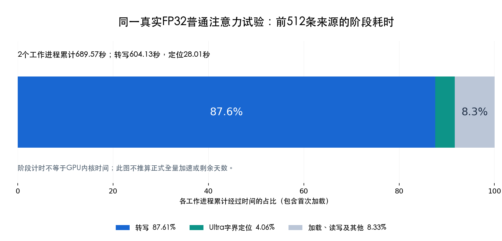
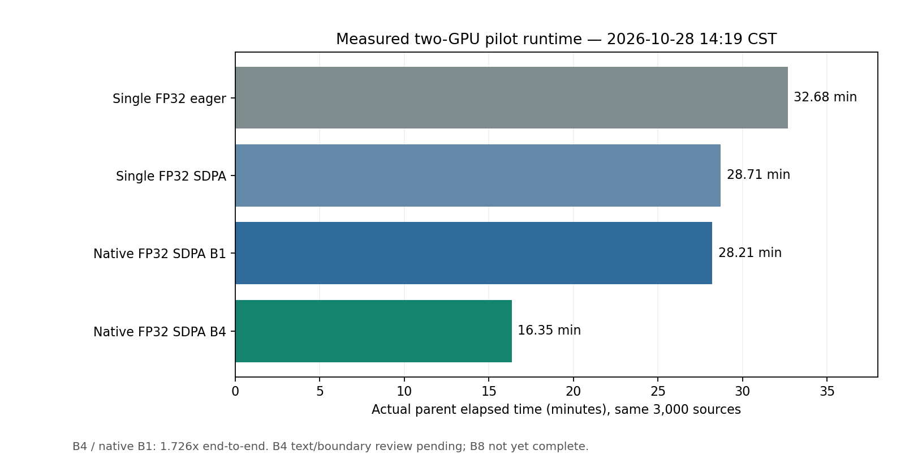

# 2026年10月28日：转写提速真实两卡试验与八卡交接

截至北京时间12:39，独立两卡试验已经实际运行，30条筛选已完成，3000条主对照正在运行。新八卡生产尚未切换，现有标注和主训练保持运行。以下结果是分阶段记录，不能把尚缺的3000条、512条恢复及正式八卡验收写成完成。

## 1. 为什么需要提速，以及已经查到什么

11:20的八卡标注剩余约1011万条。按此前31.76分钟实际增加13,060条估计，速度约24,669条/小时，条件性剩余时间约17.07天。这个估计依赖后续数据分布、任务持续运行和吞吐不变，不是平台承诺的完成时间。此前157秒、130次采样的平均GPU利用率为37.425%；GPU利用率表示采样窗口内GPU忙碌时间，不能直接用100/37推导可实现加速倍数。

旧八卡程序使用FP32、普通注意力和每次一条音频生成，随后串行做字界定位、保存中间结果和完整侧车。每条音频存在源身份核验和窗口读取；不能因为代码有两次读取，就断定磁盘是主瓶颈。

12:12在真实旧标注容器只观察已知八个worker的10秒CPU与I/O增量：每个进程约占一个CPU核的97.78%—99.68%，合计约7.915个核，新增CPU时钟的99.785%在用户态；读取字符约55.19MB。该窗口说明进程持续执行主机代码，不能解释成全部睡眠等磁盘。vePFS下块级读取为0不证明没有文件I/O，也不能单靠这个窗口把耗时归因于某个转写函数。完整阶段比例由新试验实测。

12:45，新两卡基线已完成前512条。两个工作进程累计689.57秒中，转写604.13秒（87.61%）、定位28.01秒（4.06%）、加载与读写等57.43秒（8.33%）。同期355份既有监控样本的两卡平均利用率分别35.33%和34.69%。这段证据把主要优化目标指向转写；不能仅凭它断言具体哪个CPU算子或CUDA调度行为造成低利用率，合批差分仍要真实测量。

## 2. 独立资源与真实提交

独立试验任务为`zhounan_redimnet2_asr_speed_pilot_2a800_p6_20261028_v1`，ID为`t-20261028123255-dmsw5`。平台回读为优先级6、单实例两张A800 80GB、28个vCPU、490GiB内存，12:34:06开始运行，最长6小时，自动重试关闭。时限是保护上限，完成即退出，不要求跑满6小时。

镜像沿用`prod-cn-beijing.cr.volces.com/aiplatform/dev_zhounan:4.0`；共享组目录挂到`/shared/group-shared`且只读，用户目录挂到`/root`且读写。任务入口读回与预期1275字符完全相等，并在执行前固定部署收据和每个源码文件摘要。

部署目录为`/root/experiments/redimnet2/asr-speed-20261028-v1/build-code-v2`，来自Git `447c4ae`；计划SHA256为`a3bab8f400aa7eabf0d077c27452bac889e067d49069d36aa7bbd904618e4df0`。最初v1准备曾因部署目录布局识别错误被路径保护拒绝，尚未进入GPU；原异常保留，修复后另建v2，没有修改冻结v1。

原八卡标注任务`t-20261028005420-h6675`和主训练任务`t-20261026074833-ctjsk`不参与这次资源分配。两卡开发机仍有既有和未知进程，因此没有使用空余显存或结束进程。本次在独立云任务验证，不在旧八卡旁另建CUDA上下文。

## 3. 同批30条的实际结果

三种转写方式使用同一Qwen模型、同一维护源码、同一十进制源时钟和同一Ultra定位方式；仅改变转写精度和注意力实现。它们不是旧23文件生产引擎的逐字节同软件比较。

| 观察项 | FP32普通注意力 | FP32/SDPA | BF16/SDPA |
| --- | ---: | ---: | ---: |
| 来源数 | 30 | 30 | 30 |
| 转写窗口数 | 34 | 34 | 34 |
| 生成token数 | 930 | 930 | 930 |
| 有完整定位结果的可比较窗口 | 32 | 32 | 32 |
| 候选 / 待审 / 失败 | 11 / 19 / 0 | 11 / 19 / 0 | 11 / 19 / 0 |
| 两个worker累计转写秒数 | 31.888 | 26.378 | 26.885 |
| 父进程总墙钟秒数 | 100.19 | 68.15 | 69.84 |
| 完整侧车读回 | 30 | 30 | 30 |

两种SDPA方式相对基线的原始文字、规范化文字、语言、token序列、结束标记和决策均未发生变化。32个可比较窗口的原生及修正后字界差异均为0毫秒。另有两条来源的`errors`、`vad`元数据字段差异已逐项核实：三轨保存同一旧FireRed RTTM摘要和同样的`invalid_old_VAD_interval`异常，traceback写入了不同冻结路径。旧RTTM保留三位小数，两个端点分别比真实音频长0.4375和0.3125毫秒；现有严格源时钟拒绝，三轨均待审，其中一条另有同样的原生定位几何异常。这些原件完整保留，不算SDPA新增退化，也没有简单放宽容差或改冻结结果。

实际forward观察表明，SDPA两轨的52个注意力模块均调用PyTorch SDPA；FP32轨实际Q/K/V为FP32，BF16轨为BF16，普通注意力轨没有SDPA调用。这证明请求的计算方式真实执行，尚不证明人工完整字准确率。

从累计纯转写时间看，FP32/SDPA约为1.21倍，BF16/SDPA约为1.19倍。不能把父墙钟的1.47倍、1.43倍直接投射到17天：基线首次模型加载总计约31.78秒，后两轨约11.14秒和12.00秒，包含首次访问和页缓存差异。BF16暂未比FP32/SDPA快，不能预先指定BF16最优。

每轨均在退出后完成CUDA排空与两次资源空闲检查，再运行下一轨。12:38之后终端曾看到两卡均2MiB、0%利用率、没有compute PID，这是轨间归还状态；随后3000条FP32普通注意力主对照已启动。

## 4. 后续验收与正式切换条件

主对照固定3000条，三个训练域各1000条；30条筛选和512条恢复均是这3000条的完整源记录子集。三种方式分别新推理，再对同合同512条完整已发布结果验证恢复：零新转写、零新定位，旧结果字节、时间和身份均不变。这个恢复测试不冒充未发布半批或进程中途故障的全部恢复证明。

三域均衡样本不是全量生产的自然比例。选型要看相同来源的转写和完整处理速度比、耗时分解、失败及逐差异文字字界质量；八卡上线后用实际新增量重新估剩余时间，不能直接把两卡均衡样本绝对速度乘四当正式吞吐。

已有结果接续采用显式新薄索引和独立生产者，已封账片只核固定槽，最多八个未封账片逐源检查；未领取片仅保留父索引描述，真正领取才读取。不会重开百万旧侧车，不复制千万行清单，不建数据库，不删除旧异常，不修改旧合同或冻结清单。

正式候选通过后，先提交并核实唯一`zhounan_`新八卡任务等待，旧标注此时继续运行；新任务的真实请求可读后，再受控结束精确旧标注任务并保留终态，准备最后至多八片与新鲜平台材料。新八卡取得原始语义锁、祖先队列锁和最近旧writer锁后才进GPU。主训练从始至终不操作。

维护代码的有界正式入口已独立审阅，根侧另实际运行20项定向测试全部通过，并提交`cf7e859`。这些CPU结果不授真实速度、字界质量或八卡资格。后续真实结果应追加本文件，保留早期观察和失败记录。

12:43再次只读完成槽：旧八卡本轮已完成290,840条，其中候选87,293、待审203,547、失败0，完成1,163片。与11:20的255,545相比继续增加35,295条；没有为提速验证暂停旧标注。同次主训练日志为第67轮13,514/15,001步，八个rank在13,500步均有记录；本次仅观察日志，不把它写成重新执行进程或GPU验收。

现场原件位于本仓库`.audit-local/asr-speed-20261028/`、`.audit-local/asr-acceleration-20261028/`和`.audit-local/bounded-handoff-20261028/`。音频、完整文字、名单、日志及部署输入不进入公开Git。

## 5. 13:18追加：完整基线与原生合批新任务

单窗试验的3000条FP32普通注意力基线已实际全部完成，24片封账、活动租约0，完整读回及CUDA归还通过；候选875、待审2125、失败0。父总墙钟1960.77秒（32.68分钟），两个进程累计转写3369.70秒、生成106,997个token。13:18时FP32/SDPA已封账512条，BF16主对照尚未开始；这仍不是三轨完整最终比较。

单条转写的收益有限，因此另实现同一原生Transformers引擎的批宽1/4/8。没有在旧任务旁再开共享进程，也没有启用尚未完成清理验收的vLLM真实构造。新协议固定完整来源组、实际PCM、成员顺序、mask、EOS与原始矩形token，整批原生JSON原子保存后才逐源定位；Ultra继续单窗。源码、缓存文件、异常捕获、有限完整比较及调度共60项CPU检查在普通和`-O`模式均实际通过，独立复审通过。后续新增的正式准入模块另行测试，不借这60项声明全部正式入口完成。

新任务为`zhounan_redimnet2_native_asr_batch_pilot_2a800_p6_20261028_v1`，ID`t-20261028131845-5qt4r`，13:18创建。平台回读为P6、单实例2张A800、28个vCPU、490GiB、3小时保护上限、自动重试关闭及相同两个挂载；1307字符入口完整回读一致。提交前精确名称搜索返回零结果，只提交一次。首次回读是排队、worker部署中，平台提示可能存在配额碎片；不能写成模型已开始执行。

新试验目录为`/root/experiments/redimnet2/native-asr-batch-20261028-v1`。冻结源码是Git基线`3f9f0e6`加本次工作区增量，**不是声称全部源码已经属于该Git提交**；100文件前后SHA一致，源码归档SHA为`81edeb895eb9a8db6d32ea79d96daf04f0d528a3e4be797893fbac7c8cc66802`。部署收据、每个文件及计划均在入口核SHA，部署副本不热改。最终维护实现仍须在review和测试完成后commit/push；真实试验保存的是实际冻结字节身份。

30/3000/512全部复用前述固定有限来源，批宽三轨独立新队列和结果。对照重推理仅发生在这份明确有限试验中，不能将它混称为重新标注已有生产结果。新任务与旧两卡计算对照、旧八卡标注和PTN均独立，未为了排队停止或迁移任何既有任务。

正式合批准入的独立复审还发现一个需修的证据绑定问题：原始ASR已绑定整批原件，但比较中的字界和部分源观察尚未全部绑定固定侧车，可构造自洽的虚假相同观察。两份CPU反例已分别保存，正在允许的纯CPU准入helper中增强固定有限读回；不会修改已冻数学或GPU守卫，也不会以几个布尔值掩盖问题。此项不妨碍有限GPU对照，但修复和复验完成前不得正式切八卡。

## 6. 13:26追加：原生合批已真实运行与首批差异

新原生任务13:19:23开始运行。13:25的实际原件表明，三种批宽均完成30条、完整读回和CUDA归还，没有失败文件，并已自动进入3000条基线。它已超出“提交／排队”状态，但完整3000与恢复仍未结束。

| 首批观察 | 批宽1 | 批宽4 | 批宽8 |
| --- | ---: | ---: | ---: |
| 两工作进程累计ASR秒 | 27.885 | 17.466 | 14.199 |
| 相对批宽1的纯ASR倍数 | 1.00 | 1.60 | 1.96 |
| 父总墙钟秒 | 91.76 | 61.21 | 60.14 |
| 峰值allocated显存约GiB | 11.34 | 12.15 | 13.25 |
| 相对批宽1文字变化窗口 | 0 | 1 | 2 |
| 候选／待审／失败 | 11／19／0 | 11／19／0 | 11／19／0 |

批宽4实际执行过四行生成，批宽8实际执行过八行生成，尾批不足时照实记录；Ultra全部为单窗。纯ASR倍数尚不等于正式全流程吞吐倍数，小批加载仍有影响。

两个实际变化来源均为VoxCeleb2。一条为专名／缩写的书写变化，批宽4和8均出现；另一条只在批宽8把三个法语数字词写成一个数字串，定位目标及词数也改变。对应31／30个同目标可比较窗口的端点差为0毫秒，但不能把目标发生变化的窗口也记成零差异，或把合并词数称为定位更精细。原音、三种文字、全部原生和FIX时间均保留，正在做独立内部模型复核；API观察也不是人工字界真值。

13:26:51真实新容器只读NVML查询确认两张独立UUID，各仅一个compute记录，当时显存13,682／13,458MiB、瞬时利用率41%／46%。这是3000条批宽1阶段的瞬时观察，不能当成批宽8稳态利用率。没有新增CUDA上下文；旧八卡和PTN未操作。

正式门的独立复审同时要求把速度分子、分母和计算观察绑定实际parent／worker终态，不能只相信报告中的`ratio>1`。修前反例、修后新helper和复验分别记录；既有实测数学源码不因此改写。

## 7. 14:19追加：三千条实际速度，不以微小样本外推

单窗三轨的3000条及各自512条已发布结果恢复均完成。FP32/SDPA相对普通注意力的完整父墙钟为1.1383倍，3067窗文字、语言、token和2702个同目标定位窗口端点均无差异。另有119来源的errors/VAD观察字段变化，这个总数尚不能全部认定为路径差异。BF16比FP32/SDPA仅再快约2.23%，却相对普通注意力有297窗规范化文字、7窗语言和365窗token变化，因此本轮继续优先FP32。三轨512恢复均为512条侧车命中、新写入0、实际转写和定位调用0；它们不替代中途未完成整批的真实故障恢复。

原生合批同一冻结代码和同一3000条输入，B1完整墙钟1692.6613秒，B4为980.8406秒，即28.21分钟降到16.35分钟，实际完整处理1.7257倍。两worker累计转写2857.3839降至1506.0530秒，约1.8973倍；实际转写3067行由3067次调用降为808次，其中751次四行、6次两行、51次单行。两轨侧车及阶段缓存命中均为0。Ultra仍单窗，累计定位149.8149与150.0315秒基本相同。

B4两卡实测allocated峰值约12.12/12.26GiB，reserved峰值14.06/15.62GiB。这只证明每卡当前一个工作进程的峰值，不能据空闲显存直接承诺多进程倍速。B4机器候选878而B1为875，生成有效token多13个，文字/字界逐窗比较尚未生成，不能宣布人工质量通过。B8此时18/24片，未完成的速度不列入选型结论。

两个30条变化原件及必要连续上下文已按既有明确授权由内部Qwen辅助复核，共10次观察、2个来源；所有原始请求、回答和音频摘要保存在私有证据目录，没有写回侧车。德语人名、简称存在基线和合批都可能写错的情况；法语数字出现文字和数字表示变化。辅助模型的削首削尾判断多次混淆语句不完整与声学字被切断，因此不当成人工完整字真值，也不据此放行训练。

## 8. 真实有限结果封存的异常与定位

正式接续使用新的有限结果读回，必须将实际侧车和整批原件、行映射、父子终态与比较观察绑定。审阅中发现过字界视图可被自签伪造、速度可仅信摘要、真实冻结auditor返回接口不一致等问题，均已保留原反例、修正并独立复验。四个CPU控制文件与实际GPU计算包分开，15个计算源和原GPU资源守卫没有热改。

首次在开发机封存真实3000条时300秒超时，原异常保留。新增单CPU诊断入口在实际独立云节点执行，CUDA不可见、仅CPU0、每60秒保存调用栈。实际62.077秒成功，峰值约1.284GiB，封存124,996,371字节（约119.206MiB），摘要2b67a413f9aa72fb6e69bb0563c6e8b87910ef24ed4abc339220c70e27537d34。60秒时栈在JSON序列化写出，不能继续把它归咎为读侧车卡死；不同节点耗时差异仍保留，不作无证据解释。

这次成功是实际3000条CPU读回封存，不是GPU加速质量通过。接下来仍须完成原件绑定复验、候选3000条逐差异比较、512恢复和真实整批中断恢复，再考虑唯一新八卡交接。每个八卡子入口会各自解析有限证明，需将这119MiB和约1.3GiB单进程峰值纳入内存/启动成本估计，不能宣传为零开销。

## 9. 15时追加：旧候选拒绝，修复后重新验证

旧native任务在14:28:51正常结束，三轨30/3000/512工程审计均完成，但这不代表质量通过。完整3000条B8墙钟852.0216秒，B1对B8为1.986641倍；B4为1.725725倍。B4有130窗原始文字、110窗规范化文字、82窗定位items变化；B8为143/122/90窗，另有1窗语言变化。B4的110窗正文变化全部也发生在B8，且两种批宽这些窗正文相同。机器candidate净增3实际是4条unknown升candidate、1条candidate降unknown，包含删尾词和新零时长字界，不能称质量改善。

合成CPU与真实已核原件共同定位出模型输入问题：官方batch前补PCM会改变有效mel帧、mask及音频占位，尾帧反射变化又可改变本条动态范围地板。即使PCM及prompt长度相同，实际mel仍可能不同。详见[完整根因报告与合成图](2026-10-28-原生合批补零与声学特征差异根因.md)及[修复再验证方案](../plans/2026-10-28-逐条声学特征后合批修复与再验证.md)。旧约2倍只保留为工程速度观察，正式质量门不放宽，旧生产输出没有覆盖。

新增显式逐条官方B1特征协议和第16个计算源。服务器隔离CPU组普通及-O各11项、零跳过通过，其中6项使用真实Tensor，其余为合同/准备反例；另实际官方AutoProcessor、SDK归一化、七类依赖来源守卫连续两组验证成功，没有读权重/真实音频，没有初始化CUDA。新审计器32项、准备器9项、正式控制36项均经普通/-O独立复审。新整套本机回归954项，成功并明确有1项隔离Tensor入口跳过；该类的6项实际Tensor内容已在服务器同一受审计算源码用上述11项CPU组零跳过执行，不能把本机跳过隐去。

新独立GPU试验仍待实际提交和运行。它会沿同批三域30/3000/512重新验证有效mel、mask、SDK PCM及去左padding提示词，并重新测文字、字界、速度和恢复；旧15源报告不能代替新16源结果。14:56平台列表只读显示原八卡标注h6675与PTN ctjsk均仍运行中；这一观察不代替它们最新完整训练或标注终验。

最后一处准入布尔类型反例修复后再次完整回归：955项、65.501秒，成功且仍明确跳过1个需隔离解释器的Tensor类。它包含的6项真实Tensor已由服务器CPU组实际执行。新测试阻止数字0借Python的0==False伪装成布尔观察；没有删除原失败或放宽质量门。
